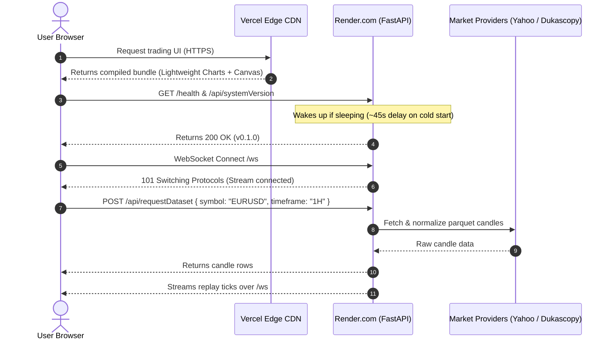

# Cloud Deployment Plan & Requirements: Vercel & Render.com

This document is the official deployment specification and step-by-step operational plan for hosting the **Trading Chart Replayer**:
- **Frontend:** [Vercel](https://vercel.com) (Static Single-Page Application on Free Hobby Tier)
- **Backend:** [Render.com](https://render.com) (FastAPI + WebSockets on Free Web Service Tier)
- **Cost:** **$0 / month** (No credit card required on either platform)

---

## 1. System Requirements & Free Tier Constraints

### 1.1. Accounts & Access
* **GitHub Account:** To host the repository for continuous Git-driven deployment.
* **Vercel Account:** Free Hobby Tier (Sign up via GitHub).
* **Render.com Account:** Free Tier (Sign up via GitHub — **no credit card required**).

### 1.2. Cloud Resource Specifications & Budgets

| Resource | Vercel (Frontend) | Render.com (Backend) |
| :--- | :--- | :--- |
| **Service Type** | Global Edge CDN (Static SPA) | Containerized Web Service (Uvicorn) |
| **Memory (RAM)** | N/A (Client-rendered in browser) | **512 MB** |
| **CPU** | N/A | **0.1 vCPU** (Shared) |
| **WebSockets** | N/A | **Fully Supported** (`/ws`) |
| **Storage** | 100 MB bundle size limit | **Ephemeral** (Wiped on redeploy/spin-down) |
| **Sleep Policy** | Never sleeps (Always instant) | **Spins down after 15m of inactivity** |
| **Cold Start Delay** | 0 ms | **~40–50 seconds** on first request |
| **Monthly Cost** | **$0** | **$0** |

---

## 2. Architecture & Data Flow



---

## 3. Pre-Flight Requirements Checklist

Before deploying, ensure the workspace passes all local verification gates:

```powershell
# 1. Verify TypeScript types and frontend build
npm run typecheck
npm run build

# 2. Verify all frontend tests pass (265 unit tests)
npm test

# 3. Verify Python test suite passes (133 tests)
pytest -q
```

---

## 4. Phase 1: Deploy Backend to Render.com

### 4.1. Configuration Settings
* **Repository:** `tv_chart_replay` (your GitHub repo)
* **Runtime:** `Python 3`
* **Region:** Choose the region closest to you (e.g. Frankfurt, Oregon, Ohio, Singapore)
* **Branch:** `main` (or your active branch)
* **Build Command:**
  ```bash
  pip install -r requirements-cloud.txt
  ```
* **Start Command:**
  ```bash
  uvicorn app.api.server:app --host 0.0.0.0 --port $PORT
  ```
* **Plan Type:** `Free (512 MB)`

### 4.2. Environment Variables on Render
Under **Environment Variables** in Render's dashboard, add:

| Key | Value | Description |
| :--- | :--- | :--- |
| `PYTHON_VERSION` | `3.12.0` | Ensures Python 3.12 is used by the buildpack |
| `CORS_ORIGINS` | `*` | Or specify your Vercel URL once known (e.g. `https://your-app.vercel.app`) |

### 4.3. Step-by-Step Instructions
1. Log in to [dashboard.render.com](https://dashboard.render.com).
2. Click **New +** $\rightarrow$ **Web Service**.
3. Choose **Build and deploy from a Git repository** $\rightarrow$ click **Next**.
4. Select your `tv_chart_replay` repository.
5. Enter the settings from Section 4.1.
6. Click **Create Web Service**.
7. Wait 2–3 minutes for the build to complete.
8. Copy your live backend URL (e.g., `https://trading-replayer-backend.onrender.com`).

### 4.4. Backend Verification
Open in browser or terminal:
```bash
curl https://<YOUR-RENDER-APP>.onrender.com/health
# Expected output: {"status":"ok"}

curl https://<YOUR-RENDER-APP>.onrender.com/api/systemVersion
# Expected output: 0.1.0
```

---

## 5. Phase 2: Deploy Frontend to Vercel

### 5.1. Configuration File (`vercel.json`)
The project includes [`vercel.json`](file:///d:/code/tv_chart_replay/vercel.json) at root:

```json
{
  "framework": "vite",
  "buildCommand": "npm run build",
  "outputDirectory": "frontend/dist",
  "rewrites": [
    { "source": "/(.*)", "destination": "/index.html" }
  ]
}
```

### 5.2. Environment Variables on Vercel
Under **Project Settings** $\rightarrow$ **Environment Variables**, add:

| Key | Value | Description |
| :--- | :--- | :--- |
| `VITE_BACKEND_URL` | `https://<YOUR-RENDER-APP>.onrender.com` | Base URL of your live Render backend |

### 5.3. Step-by-Step Instructions
1. Log in to [vercel.com](https://vercel.com) $\rightarrow$ click **Add New...** $\rightarrow$ **Project**.
2. Select your `tv_chart_replay` repository and click **Import**.
3. Verify Build Settings:
   - **Framework Preset:** `Vite`
   - **Build Command:** `npm run build`
   - **Output Directory:** `frontend/dist`
4. Expand **Environment Variables** $\rightarrow$ Add `VITE_BACKEND_URL`.
5. Click **Deploy**.
6. Vercel will build the frontend in ~30 seconds and provide an HTTPS production URL (e.g., `https://tv-chart-replay.vercel.app`).

---

## 6. Phase 3: Post-Deployment Integration Verification

Once both services are deployed, execute this 5-point verification plan:

| Test Case | Procedure | Expected Pass Criteria |
| :--- | :--- | :--- |
| **1. Bridge Status** | Open the Vercel URL in a browser. | Top header badge turns green: `bridge v0.1.0` (indicates successful handshake with Render backend). |
| **2. Symbol Search** | Click the symbol search button and type `BTC` or `EUR`. | Real-time search suggestions dropdown populated via Render's `/api/searchSymbols`. |
| **3. Historical Load** | Select `EURUSD` and click **Fetch Data**. | Historical candlestick series renders on Lightweight Charts canvas. |
| **4. WebSocket Ticks** | Open the Replay Bar and click **Play**. | Ticks stream in real-time over `wss://.../ws`, advancing the playhead smoothly. |
| **5. Drawing Persistence**| Draw a Trendline and Fibonacci retracement, then refresh the page. | Drawings persist across browser reloads via Render's session database. |

---

## 7. Operational Runbook & Edge-Case Management

### 7.1. Built-in Smart Keep-Alive System (14-Minute Pings · Max 4 Hours)
To eliminate Render's ~45s cold start delay during trading sessions while protecting your free 750 monthly hours quota, the frontend includes an **automated client-side keep-alive system** in [`frontend/src/bridge/python-bridge.ts`](file:///d:/code/tv_chart_replay/frontend/src/bridge/python-bridge.ts):

* **14-Minute Wake-up Pings:** The browser automatically sends a lightweight `GET /health` ping every 14 minutes (just before Render's 15-minute idle spin-down threshold).
* **4-Hour Maximum Inactivity Window:** If no user interaction (mouse movement, clicks, key presses, scrolling, or tab focus) occurs for **4 consecutive hours**, the pings stop automatically, allowing Render to sleep and conserve free monthly instance hours.
* **Auto-Wake on Return:** As soon as the user returns and touches the mouse, keyboard, or tab, the frontend detects activity, immediately fires an asynchronous wake-up ping, and resets the 14-minute interval loop.
* **Zero Third-Party Dependencies:** No external cron services (like UptimeRobot) are required. Keeping a tab open keeps the backend warm during your entire trading session.

### 7.2. Managing Render's 512 MB RAM Limit
* **Constraint:** Loading 5+ years of raw uncompressed tick data simultaneously can spike memory past 512 MB and trigger an OOM termination.
* **Safe Practice:** Request data in bounded windows (e.g., 30–90 days for 1m/5m data, or 1–2 years for 1H/4H/Daily data). This keeps Polars memory consumption well below 150 MB.

### 7.3. Ephemeral Disk Reset
* **Constraint:** When Render restarts, the local SQLite database and Parquet cache reset.
* **Behavior:** The application gracefully re-downloads candle data on-demand from Yahoo Finance / Dukascopy when a symbol is requested.
