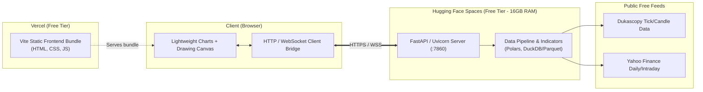

# Cloud Deployment Guide: Vercel (Frontend) & Hugging Face Spaces (Backend)

This guide details the complete requirements, architecture, and step-by-step instructions to deploy the **Trading Chart Replayer** completely for free using:
- **Vercel** for the TypeScript/Vite frontend (Free Hobby Tier).
- **Hugging Face Spaces** for the Python data & replay backend (Free Tier with **16 GB RAM** and **2 vCPUs**).

---

## 1. High-Level Architecture



---

## 2. Prerequisites & Accounts

All platforms used in this setup offer permanent free tiers without requiring paid subscriptions:

1. **GitHub Account**: To host the repository.
2. **Vercel Account**: [vercel.com](https://vercel.com) (Log in with GitHub — Free Hobby Tier).
3. **Hugging Face Account**: [huggingface.co](https://huggingface.co) (Free Tier includes Docker Spaces with 16 GB RAM).

---

## 3. Backend Deployment: Hugging Face Spaces

### Why Hugging Face Spaces?
Processing multi-year tick datasets and calculating rolling indicators using **Polars** and **Pandas** requires significant memory. Standard free tiers (e.g., Render or Koyeb) cap RAM at 512 MB, which risks Out-Of-Memory (OOM) termination. Hugging Face Spaces provides **16 GB RAM** on its free Docker runtime.

### 3.1. Headless Requirements (`requirements-cloud.txt`)
Unlike the local desktop app, the cloud backend does not require desktop GUI libraries (`PySide6`). Create `requirements-cloud.txt`:

```text
fastapi>=0.115.0
uvicorn[standard]>=0.30.0
pydantic>=2.7
pydantic-settings>=2.3
polars>=1.0
numpy>=2.0
pandas>=2.2
pyarrow>=16.0
yfinance>=0.2.40
dukascopy-python>=4.0.1
requests>=2.31
```

### 3.2. Cloud API Server (`server.py`)
Create a lightweight FastAPI wrapper that replaces the Qt `QWebChannel` IPC with HTTP/WebSocket endpoints:

```python
"""Cloud API Server for Trading Chart Replayer backend."""

import os
from fastapi import FastAPI, HTTPException
from fastapi.middleware.cors import CORSMiddleware
from pydantic import BaseModel

app = FastAPI(title="Trading Chart Replayer API")

# Enable CORS for Vercel deployment
app.add_middleware(
    CORSMiddleware,
    allow_origins=["*"],  # Restrict to your Vercel domain in production
    allow_credentials=True,
    allow_methods=["*"],
    allow_headers=["*"],
)

class DatasetRequest(BaseModel):
    symbol: str
    timeframe: str
    start_s: int | None = None
    end_s: int | None = None

@app.get("/")
def health_check():
    return {"status": "ok", "service": "trading-chart-replayer-backend"}

@app.post("/api/requestDataset")
async def request_dataset(req: DatasetRequest):
    # Delegate to app.bridge.commands.BridgeCommandHandler
    try:
        # Pipeline execution logic here
        return {"ok": True, "data": {"status": "ready"}}
    except Exception as exc:
        return {"ok": False, "error": str(exc)}

@app.post("/api/loadHistory")
async def load_history(req: DatasetRequest):
    try:
        # Load parquet rows and return to client
        return {"ok": True, "data": {"columns": ["time", "open", "high", "low", "close", "volume"], "rows": []}}
    except Exception as exc:
        return {"ok": False, "error": str(exc)}
```

### 3.3. Hugging Face `Dockerfile`
Hugging Face Spaces enforces non-root execution (UID `1000`) and serves on port `7860`.

```dockerfile
FROM python:3.12-slim

# Prevent Python from writing .pyc files and buffer stdout/stderr
ENV PYTHONDONTWRITEBYTECODE=1 \
    PYTHONUNBUFFERED=1 \
    PORT=7860

# Install system dependencies
RUN apt-get update && apt-get install -y --no-install-recommends \
    build-essential \
    curl \
    && rm -rf /var/lib/apt/lists/*

# Create user with UID 1000 per Hugging Face Spaces requirements
RUN useradd -m -u 1000 user
USER user
ENV HOME=/home/user \
    PATH=/home/user/.local/bin:$PATH

WORKDIR $HOME/app

# Install Python requirements
COPY --chown=user:user requirements-cloud.txt .
RUN pip install --no-cache-dir --user -r requirements-cloud.txt

# Copy application source code
COPY --chown=user:user . .

# Ensure storage directories exist
RUN mkdir -p data/raw data/normalized data/cache sessions drawings logs

EXPOSE 7860

CMD ["uvicorn", "server:app", "--host", "0.0.0.0", "--port", "7860"]
```

### 3.4. Hugging Face Space Metadata (`README.md`)
At the root of the Hugging Face Space repository, include this YAML header in `README.md`:

```yaml
---
title: Trading Replayer Backend
emoji: 📈
colorFrom: blue
colorTo: indigo
sdk: docker
app_port: 7860
pinned: false
---
```

### 3.5. Hugging Face Deployment Steps
1. Navigate to [Hugging Face Spaces](https://huggingface.co/spaces) and click **Create new Space**.
2. Space Name: `trading-replayer-backend`.
3. License: `MIT` (or your preferred license).
4. Select SDK: **Docker** -> **Blank**.
5. Space Hardware: **Free (CPU basic · 2 vCPU · 16 GB RAM)**.
6. Push your backend code using Git or upload the files directly via the Web UI:
   ```bash
   git remote add space https://huggingface.co/spaces/<YOUR-USERNAME>/trading-replayer-backend
   git push space main
   ```
7. Once built, your backend URL will be:
   `https://<YOUR-USERNAME>-trading-replayer-backend.hf.space`

---

## 4. Frontend Deployment: Vercel

### 4.1. Vercel Configuration (`vercel.json`)
Place `vercel.json` in the root of the project to map Vite’s output directory (`frontend/dist`) and enable Single-Page Application (SPA) routing:

```json
{
  "framework": "vite",
  "buildCommand": "npm run build",
  "outputDirectory": "frontend/dist",
  "rewrites": [
    { "source": "/(.*)", "destination": "/index.html" }
  ]
}
```

### 4.2. Environment Variable Configuration
Add an environment variable in the frontend to point to your Hugging Face Space:

1. Create a `.env.example` in `frontend/`:
   ```env
   VITE_BACKEND_URL=https://<YOUR-USERNAME>-trading-replayer-backend.hf.space
   ```
2. In TypeScript, access it via `import.meta.env.VITE_BACKEND_URL`.

### 4.3. Vercel Deployment Steps
1. Push your repository to GitHub.
2. Go to [Vercel Dashboard](https://vercel.com/dashboard) and click **Add New...** > **Project**.
3. Import your repository.
4. Configure Build Settings:
   - **Framework Preset**: `Vite`
   - **Build Command**: `npm run build`
   - **Output Directory**: `frontend/dist`
5. Expand **Environment Variables**:
   - Key: `VITE_BACKEND_URL`
   - Value: `https://<YOUR-USERNAME>-trading-replayer-backend.hf.space`
6. Click **Deploy**.

---

## 5. Connecting Frontend & Backend

In `frontend/src/bridge/python-bridge.ts`, ensure requests fall back to HTTP when `window.qt` is undefined:

```typescript
export class PythonBridge {
  private backendUrl = import.meta.env.VITE_BACKEND_URL || '';

  async callJson<T>(method: string, payload: unknown): Promise<T> {
    if (this.connected && this.objects.bridge) {
      // Desktop Qt WebChannel mode
      return (this.objects.bridge as any)[method](JSON.stringify(payload));
    }

    if (this.backendUrl) {
      // Web / Cloud mode via Hugging Face Space
      const res = await fetch(`${this.backendUrl}/api/${method}`, {
        method: 'POST',
        headers: { 'Content-Type': 'application/json' },
        body: JSON.stringify(payload),
      });
      return res.json() as Promise<T>;
    }

    throw new Error('No backend connection available (browser offline mode)');
  }
}
```

---

## 6. Verification Checklist

| Step | Test | Expected Result |
| :--- | :--- | :--- |
| **Backend Health** | Open `https://<YOUR-SPACE>.hf.space/` in browser | Returns `{"status":"ok", ...}` |
| **CORS Check** | Make fetch request from Vercel domain | Response includes `access-control-allow-origin` |
| **Frontend Static** | Load Vercel URL directly | Lightweight Chart renders EURUSD |
| **Data Fetching** | Click "Fetch Data" on Vercel app | Backend downloads and returns candle rows |
| **Drawings & State** | Draw lines and refresh page | State loads correctly via cloud bridge |

