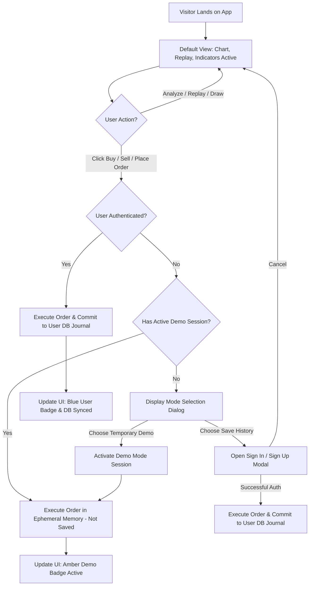

# User Authentication & Paper Trade History System Specification

**Target Version:** `0.2.0`  
**Related ADR:** [ADR 0008: User Authentication and Paper Trade History System with Instant Demo Mode](file:///d:/code/tv_chart_replay/docs/adr/0008-user-authentication-and-paper-trade-history-system.md)  
**Status:** Architecture Specification & Implementation Blueprint (Pre-Code)

---

## 1. Executive Summary

The **Trading Chart Replayer** is evolving into a full-featured simulation and paper trading platform usable both as a native desktop application and as a cloud-deployed web app (hosted across Vercel and Render.com).

This specification details the architecture, UX flows, database schema, and API contracts for introducing:
1. **User Accounts & Authentication:** Secure signup, login, session management, and profile controls.
2. **Persistent Multi-Tenant Paper Trade History:** Saving every trade, fill, stop-loss, take-profit, and equity change to a user's persistent journal.
3. **Frictionless Default Experience:** Visitors landing on the application experience zero disruption: the chart, indicators, drawing tools, and historical bar replay work immediately without forcing registration.
4. **Order Placement Decision Gateway:**
   - **Save History (Account Required):** Traders sign in/register to permanently track trade performance, journal analytics, and equity metrics across devices.
   - **Temporary Demo Preview (No Account Required):** Anyone can instantly preview and test paper trading in an ephemeral sandbox where **no trade history is written to persistent storage**.

---

## 2. Core Architectural Requirements

| Requirement | Description |
| :--- | :--- |
| **Default Appearance** | Must look and behave exactly as it does now upon initial visit. No splash screens, no forced login popups, no blocking gates. |
| **Order Interception** | Triggered only when an unauthenticated guest attempts to execute a trade (via Quick Trade bar, Order Panel, or Hotkey). |
| **Instant Demo Mode** | Allows immediate execution of paper orders. Calculations (PnL, margin, SL/TP triggers) run entirely in-memory. Zero rows written to SQLite. |
| **Persistent User Mode** | Authenticated users have all closed trades, open positions, and account balances saved to the SQLite database tied to their unique `user_id`. |
| **Dual Transport Support** | Seamless compatibility with both the cloud web backend (FastAPI HTTP + WebSocket) and the native desktop shell (PySide6 `QWebChannel`). |
| **Zero Bloat Security** | Native Python cryptographic hashing (`hashlib.pbkdf2_hmac` with SHA256) and cryptographically secure tokens (`secrets.token_urlsafe`), requiring no paid third-party auth services or external servers. |

---

## 3. User Journey & Wireframe Flows

### 3.1 Flow Diagram: Order Placement & Auth Routing



---

### 3.2 UI Component Wireframes

#### 3.2.1 Header Navigation Integration (`frontend/index.html` & `app.ts`)

In the top header (`header.tv-header`), on the far right alongside the existing `Watchlist`, `Trade Panel`, `Logs`, and `Bridge Status`:

##### State A: Unauthenticated Guest (Default)
```
[ Watchlist ]  [ Trade Panel ]  [ Logs ]  [ 🟢 Connected ]  [ 👤 Sign In ]
```
*Clicking `Sign In` opens the unified Auth Modal directly.*

##### State B: Active Temporary Demo Mode
```
[ Watchlist ]  [ Trade Panel ]  [ Logs ]  [ 🧪 Demo Mode (Unsaved) ⚡ ]  [ 👤 Sign In ]
```
*Clicking the amber Demo pill opens a tooltip explaining: "You are currently trading in temporary preview mode. No trades are saved. Click Sign In to save history."*

##### State C: Authenticated User
```
[ Watchlist ]  [ Trade Panel ]  [ Logs ]  [ 👤 Alex_Trader ▾ | $10,450.00 ]
```
*Clicking the user pill opens a dropdown menu:*
- **Account Summary:** Balance, Equity, Total PnL, Win Rate
- **Export Journal:** Download CSV of trading history
- **Switch to Demo Sandbox:** Test new strategies without affecting live journal
- **Reset Account Balance:** Reset starting capital to $10,000 (with confirmation)
- **Sign Out**

---

#### 3.2.2 Mode Selection Modal: "Choose Paper Trading Mode"

Triggered when an unauthenticated guest clicks **Buy**, **Sell**, or **Place Order**:

```
+-------------------------------------------------------------------------+
|                       CHOOSE PAPER TRADING MODE                         |
|   Select how you would like to execute your paper trading session       |
+-------------------------------------------------------------------------+
|                                    |                                    |
|   ⭐ OPTION 1: TRACK & SAVE        |   🧪 OPTION 2: TEMPORARY DEMO      |
|   (Requires Free Account)          |   (Instant Preview - No Sign Up)   |
|                                    |                                    |
|   • All trades & closed positions  |   • Instant order execution        |
|     permanently saved in database  |   • Test market, limit, stop orders|
|   • Win rate, profit factor &      |   • Test SL/TP & risk calculations |
|     drawdown analytics             |   • ⚠️ NO trade history is saved   |
|   • Multi-device & multi-session   |   • Discarded when browser tab is  |
|     portfolio synchronization      |     closed or refreshed            |
|   • Export trade history to CSV    |   • Perfect for quick testing      |
|                                    |                                    |
|   [ Create Free Account / Sign In ]|   [ Continue in Temporary Demo ]   |
|   (Recommended)                    |                                    |
+-------------------------------------------------------------------------+
|           [x] Remember my choice for this browser session               |
+-------------------------------------------------------------------------+
```

---

#### 3.2.3 Unified Authentication Modal (`Sign In` / `Sign Up`)

TradingView Dark Theme styling (`#1e222d` background, `#2a2e39` inputs, `#2962ff` brand buttons):

```
+-------------------------------------------------------+
|  [ Sign In ]  |  [ Create Account ]               [X] |
+-------------------------------------------------------+
|                                                       |
|  Email or Username:                                   |
|  [ trader@example.com                               ] |
|                                                       |
|  Password:                                            |
|  [ ••••••••••••••••••                             👁 ] |
|                                                       |
|  [ ] Remember me on this device                       |
|                                                       |
|  [               Sign In & Continue                 ] |
|                                                       |
|  --------------------- OR --------------------------- |
|                                                       |
|  Want to test first without an account?               |
|  [ Switch to Temporary Demo Mode (No History Saved) ] |
+-------------------------------------------------------+
```

---

#### 3.2.4 Trading Drawer & Journal Indicators

In the bottom `Trading Drawer` (`trading-drawer.ts`):
- **Authenticated Mode:**
  - Header displays: `Account: Real Paper | Balance: $10,450.00 | Equity: $10,520.00 | Sync: 🟢 Saved`
  - "Trade Journal" tab displays all historical closed trades loaded from SQLite.
- **Demo Mode:**
  - Header displays: `Account: Temporary Demo | Balance: $10,000.00 | Equity: $10,000.00 | Sync: ⚠️ Unsaved`
  - "Trade Journal" tab displays session-only trades with a persistent warning banner:
    *"Temporary Demo Session: These records will be erased when the session ends. [Save My Trades -> Sign In]"*

---

## 4. Technical Architecture & Data Model

### 4.1 SQLite Database Schema

Migrations added to `app/database/migrations.py`:

```sql
-- 1. Users Table
CREATE TABLE IF NOT EXISTS users (
    id              TEXT PRIMARY KEY,          -- Format: usr_uuid4_hex
    username        TEXT NOT NULL UNIQUE COLLATE NOCASE,
    email           TEXT NOT NULL UNIQUE COLLATE NOCASE,
    password_hash   TEXT NOT NULL,             -- PBKDF2-HMAC-SHA256
    salt            TEXT NOT NULL,             -- 32-byte hex salt
    initial_balance REAL NOT NULL DEFAULT 10000.0,
    balance         REAL NOT NULL DEFAULT 10000.0,
    created_at      TEXT NOT NULL,             -- ISO-8601 UTC
    last_login_at   TEXT
);
CREATE INDEX IF NOT EXISTS idx_users_username ON users(username);
CREATE INDEX IF NOT EXISTS idx_users_email ON users(email);

-- 2. User Sessions Table (Bearer Token Authentication)
CREATE TABLE IF NOT EXISTS user_sessions (
    token           TEXT PRIMARY KEY,          -- 64-character URL-safe token
    user_id         TEXT NOT NULL,
    created_at      TEXT NOT NULL,
    expires_at      INTEGER NOT NULL,          -- Unix epoch seconds
    FOREIGN KEY(user_id) REFERENCES users(id) ON DELETE CASCADE
);
CREATE INDEX IF NOT EXISTS idx_user_sessions_user ON user_sessions(user_id);
CREATE INDEX IF NOT EXISTS idx_user_sessions_expiry ON user_sessions(expires_at);

-- 3. Trade Journal Table (Updated with User Isolation)
CREATE TABLE IF NOT EXISTS trade_journal (
    id              TEXT PRIMARY KEY,          -- Format: trd_uuid4_hex
    user_id         TEXT NOT NULL,             -- Foreign key to users(id)
    session_id      TEXT,                      -- Optional replay session association
    symbol          TEXT NOT NULL,
    side            TEXT NOT NULL,             -- BUY, SELL, LONG, SHORT
    quantity        REAL NOT NULL,
    entry_price     REAL NOT NULL,
    exit_price      REAL NOT NULL,
    pnl             REAL NOT NULL,
    pnl_percent     REAL NOT NULL,
    commission      REAL NOT NULL DEFAULT 0.0,
    opened_at       REAL NOT NULL,             -- Timestamp
    closed_at       REAL NOT NULL,             -- Timestamp
    exit_reason     TEXT NOT NULL,             -- SL, TP, MANUAL, REPLAY_RESET
    FOREIGN KEY(user_id) REFERENCES users(id) ON DELETE CASCADE
);
CREATE INDEX IF NOT EXISTS idx_trade_journal_user_closed 
ON trade_journal(user_id, closed_at DESC);
CREATE INDEX IF NOT EXISTS idx_trade_journal_user_symbol 
ON trade_journal(user_id, symbol);
```

---

### 4.2 Security Architecture

- **Password Hashing:**
  ```python
  import hashlib
  import secrets

  def hash_password(password: str) -> tuple[str, str]:
      salt = secrets.token_hex(16)
      dk = hashlib.pbkdf2_hmac(
          'sha256', 
          password.encode('utf-8'), 
          salt.encode('utf-8'), 
          100_000
      )
      return dk.hex(), salt

  def verify_password(password: str, password_hash: str, salt: str) -> bool:
      dk = hashlib.pbkdf2_hmac(
          'sha256', 
          password.encode('utf-8'), 
          salt.encode('utf-8'), 
          100_000
      )
      return secrets.compare_digest(dk.hex(), password_hash)
  ```
- **Session Tokens:**
  - Generated using `secrets.token_urlsafe(32)` providing 256 bits of cryptographic entropy.
  - Default expiration: 30 days (for "Remember me") or 24 hours standard.
  - Invalidate automatically on explicit logout or account password change.

---

### 4.3 Order Execution Engine: Ephemeral vs. Persistent

To strictly honor the guarantee that **no demo trades are saved in the database**:

```
                       +-------------------------------+
                       |      Order Placement Call     |
                       | (Symbol, Side, Qty, SL, TP)   |
                       +-------------------------------+
                                       |
                                       v
                       +-------------------------------+
                       | Authenticated User Context?   |
                       +-------------------------------+
                                /             \
                      [Yes]    /               \    [No / Demo Flag]
                              v                 v
          +-----------------------+     +-------------------------------+
          |  Persistent Engine    |     |  Ephemeral Demo Engine        |
          |  (OrderEngine)        |     |  (DemoOrderEngine)            |
          +-----------------------+     +-------------------------------+
                      |                                 |
                      | 1. Execute order                | 1. Execute order
                      | 2. Emit WebSocket tick fills    | 2. Emit WebSocket tick fills
                      | 3. Commit to SQLite Journal     | 3. Buffer in volatile RAM
                      v                                 v
          +-----------------------+     +-------------------------------+
          | SQLite `trade_journal`|     | Discard on close/reload       |
          |  (user_id = usr_...)  |     | (0 Database writes)           |
          +-----------------------+     +-------------------------------+
```

1. **`OrderEngine` (Persistent):**
   - Receives authenticated `user_id`.
   - On position close, executes `self.journal.record_trade(...)`, inserting the record into the SQLite database.
   - Updates `users.balance` in the database.

2. **`DemoOrderEngine` (Ephemeral):**
   - Does not touch the database connection.
   - Maintains an in-memory dictionary of positions and a local list of closed trades.
   - Emits normal WebSocket events (`trading.account`, `trading.positions`, `trading.tradeClosed`) so the frontend chart overlays, position badges, and drawer tables update in real time identically to a real account.
   - When the session is restarted or page is refreshed, memory resets cleanly to $10,000.00.

---

## 5. API & Bridge Interface Contracts

### 5.1 Authentication Endpoints (FastAPI Cloud Transport)

#### `POST /api/auth/register`
**Request Body:**
```json
{
  "username": "alex_trader",
  "email": "alex@example.com",
  "password": "SecurePassword123!"
}
```
**Response (200 OK):**
```json
{
  "ok": true,
  "data": {
    "user": {
      "id": "usr_9f8b2c4e",
      "username": "alex_trader",
      "email": "alex@example.com",
      "balance": 10000.0,
      "created_at": "2026-11-03T10:00:00Z"
    },
    "token": "tok_e4b2d187cf9a0e6b8c..."
  }
}
```

#### `POST /api/auth/login`
**Request Body:**
```json
{
  "login": "alex_trader",
  "password": "SecurePassword123!"
}
```
**Response (200 OK):** Same envelope with user object and active session token.

#### `POST /api/auth/logout`
**Headers:** `Authorization: Bearer <token>`  
**Response (200 OK):** `{"ok": true}`

#### `GET /api/auth/me`
**Headers:** `Authorization: Bearer <token>`  
**Response (200 OK):** Returns current user profile, balance, and account summary stats.

---

### 5.2 Trading Endpoints with Auth & Demo Routing

#### `POST /api/trading/order`
**Headers:** `Authorization: Bearer <token>` *(Optional if demo flag is true)*  
**Request Body:**
```json
{
  "symbol": "EURUSD",
  "side": "BUY",
  "order_type": "MARKET",
  "quantity": 1.0,
  "stop_loss": 1.0850,
  "take_profit": 1.0950,
  "current_market_price": 1.0900,
  "is_demo": false
}
```
- If `is_demo == true`: Executed on `DemoOrderEngine`. Returns filled order. Does **not** require bearer token.
- If `is_demo == false` and token is missing or invalid: Returns HTTP 401:
  ```json
  {
    "ok": false,
    "error": "AUTHENTICATION_REQUIRED",
    "message": "An account is required to save trade history. Choose demo mode or sign in."
  }
  ```
- If `is_demo == false` and token is valid: Executed on `OrderEngine` scoped to user.

#### `GET /api/trading/journal`
**Query Parameters:** `?limit=100&is_demo=false`
- If authenticated: Returns user's persistent trade history from SQLite.
- If demo: Returns ephemeral session trade records from memory.

#### `POST /api/trading/reset-account`
**Request Body:** `{"initial_balance": 10000.0, "is_demo": false}`
- Resets user balance in database or resets demo memory state.

---

### 5.3 Desktop Bridge Command Equivalence (`QWebChannel`)

The identical functionality is mirrored in `app/bridge/commands.py` for native desktop operation:
- `authRegister(payload_json: str) -> str`
- `authLogin(payload_json: str) -> str`
- `authLogout(payload_json: str) -> str`
- `authGetMe(payload_json: str) -> str`
- `placeOrder(payload_json: str) -> str` *(inspects `is_demo` and authenticated session)*

*Desktop Auto-Login Behavior:* On native desktop PySide6 shell, if the user does not want an account, the app can automatically authenticate a local offline profile (`local_trader`), allowing offline persistence with zero required typing, while still providing the Demo mode toggle.

---

## 6. Frontend State Management (`frontend/src/`)

### 6.1 Auth State Model (`frontend/src/auth/auth-state.ts`)

```typescript
export interface UserProfile {
  id: string;
  username: string;
  email: string;
  balance: number;
  initialBalance: number;
}

export type TradingMode = 'guest' | 'demo' | 'authenticated';

export class AuthStateManager {
  private currentMode: TradingMode = 'guest';
  private currentUser: UserProfile | null = null;
  private token: string | null = null;

  constructor() {
    this.restoreSession();
  }

  isDemo(): boolean {
    return this.currentMode === 'demo';
  }

  isAuthenticated(): boolean {
    return this.currentMode === 'authenticated' && this.currentUser !== null;
  }

  setDemoMode(): void {
    this.currentMode = 'demo';
    sessionStorage.setItem('trading_mode', 'demo');
    this.notifySubscribers();
  }

  setAuthenticated(user: UserProfile, token: string): void {
    this.currentUser = user;
    this.token = token;
    this.currentMode = 'authenticated';
    localStorage.setItem('auth_token', token);
    this.notifySubscribers();
  }

  signOut(): void {
    this.currentUser = null;
    this.token = null;
    this.currentMode = 'guest';
    localStorage.removeItem('auth_token');
    sessionStorage.removeItem('trading_mode');
    this.notifySubscribers();
  }
}
```

---

## 7. Edge Cases & Resilience

1. **Mid-Session Conversion (Demo to Registered):**
   - If a user starts in Demo Mode, executes 3 trades, and then decides to create an account:
   - When registering, the app prompts: *"Would you like to import your 3 demo trades into your permanent account journal or start fresh?"*
   - If imported: The frontend passes the in-memory trade records to the backend to be committed with their new `user_id`.
   - If fresh: The demo trades are wiped, and their account starts with a fresh $10,000 balance.

2. **Network Disconnection / Backend Wakeup:**
   - In cloud mode (Render.com free tier spins down on idle), auth tokens are stored in `localStorage`.
   - When the user returns, the bridge wakes the backend (via existing ping mechanism) and automatically validates the token with `GET /api/auth/me`. If valid, session restores silently with zero UI flickering.

3. **Database Concurrency & Locking:**
   - SQLite is configured with `PRAGMA journal_mode = WAL; PRAGMA busy_timeout = 5000;`.
   - Thread-safe repository wrappers ensure that multiple users placing orders or querying journals concurrently never trigger `database is locked` errors.

---

## 8. Implementation Roadmap (Phases)

| Phase | Description | Deliverables |
| :---: | :--- | :--- |
| **Phase 1** | **Database & Cryptography Core** | Add `users` and `user_sessions` migrations in `app/database/migrations.py`. Implement `UserRepository` and PBKDF2 hashing in `app/database/`. Update `TradeJournal` to be user-aware. |
| **Phase 2** | **Backend Services & API Server** | Implement `AuthService` in `app/auth/`. Add FastAPI auth routes (`/api/auth/*`) in `app/api/server.py`. Update `order_engine.py` to support `persist=False` ephemeral execution. |
| **Phase 3** | **Desktop Bridge Adapter** | Mirror auth commands in `app/bridge/commands.py` (`authRegister`, `authLogin`, `authGetMe`) for PySide6 desktop target. |
| **Phase 4** | **Frontend Auth & Mode Gateways** | Build `AuthModal`, `PaperTradingModeDialog`, and `UserNavWidget` in `frontend/src/ui/`. Wire into `order-panel.ts` and `quick-trade-overlay.ts` to intercept unauthenticated orders. |
| **Phase 5** | **Testing & Verification** | Add end-to-end tests: default guest view verification, demo mode zero-write verification, user login and persistent journal verification, and session restore tests. |

---

## 9. Conclusion

This architecture delivers the exact requirements requested:
- The terminal **looks and functions completely normal by default** without imposing any registration barriers on visitors.
- When placing orders, users are given a crystal clear choice: **store history** (requiring account) or **instant demo preview** (no history saved, zero database footprint).
- Fully compatible with the dual-transport vision of native desktop speed and zero-cost cloud hosting.

