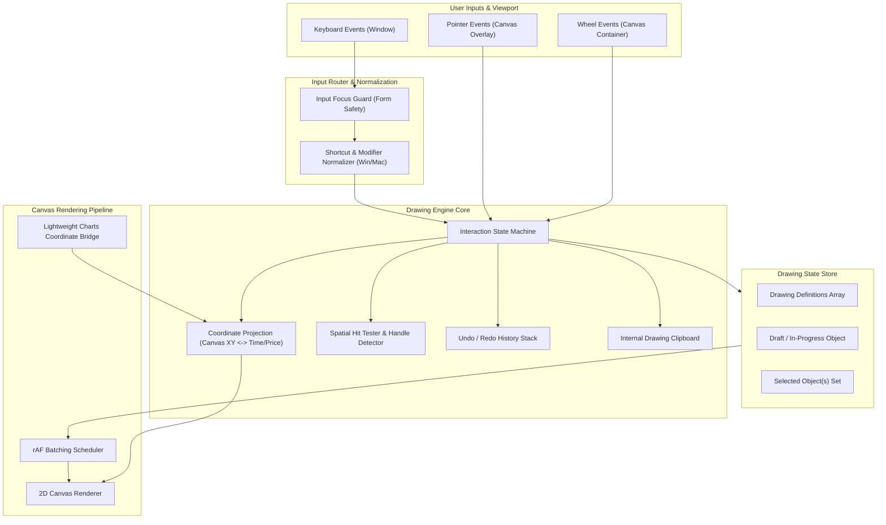
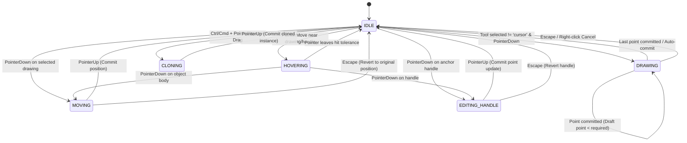

# ADR 0003: Drawing Tools Engine Architecture, Interaction Model, and Shortcut Mapping

- **Status**: Accepted
- **Date**: 2026-11-01
- **Branch**: `drawing-tools`
- **Context**: Trading Chart Replay Terminal (`tv_chart_replay`)
- **Related Documents**: 
  - [ADR 0001: Smooth Animations, Options, and Tradeoffs](file:///d:/code/tv_chart_replay/docs/adr/0001-smooth-animations-options-and-tradeoffs.md)
  - [ADR 0002: Replay Candle Formation Strategy](file:///d:/code/tv_chart_replay/docs/adr/0002-candle-formation-simulation-modes.md)
  - [ADR 0004: Drawing Tool Interaction Lifecycle, Handle Topology, and Snapping Engine Specification](file:///d:/code/tv_chart_replay/docs/adr/0004-drawing-tool-interaction-lifecycle-and-behavior-specification.md)
  - [TradingView Drawing Tool Behaviors Reference](file:///d:/code/tv_chart_replay/docs/tradingview-drawing-tool-behaviors.md)
  - [TradingView Drawing Shortcuts Reference](file:///d:/code/tv_chart_replay/docs/tradingview-drawing-shortcuts.md)

---

## 1. Context and Problem Statement

Discretionary traders, technical analysts, and algorithmic backtesters heavily rely on chart annotations—trendlines, horizontal levels, Fibonacci retracements, channels, shapes, and measurement tools. A professional trading terminal must feel instantaneous, precise, and identical in ergonomics to industry standards (specifically TradingView).

In `tv_chart_replay`, chart rendering is powered by TradingView's [Lightweight Charts](https://tradingview.github.io/lightweight-charts/), which provides high-performance candlestick and time-scale rendering. However, Lightweight Charts does not provide a built-in interactive vector drawing studio.

### Current Deficiencies in the Initial Prototype
1. **Limited Hotkey Coverage**: Only `Delete`, `Backspace`, and `Escape` were handled in [`drawing-engine.ts`](file:///d:/code/tv_chart_replay/frontend/src/drawings/drawing-engine.ts#L457-L485). Standard TradingView shortcuts (`Alt + T`, `Alt + H`, `Alt + F`, `Shift + Alt + R`, etc.) were missing.
2. **Missing Advanced Modifiers**: TradingView relies heavily on contextual modifier keys:
   - `Ctrl + Drag` for instant object cloning.
   - `Ctrl + Move point` for inverting Magnet snap to candle OHLC.
   - `Shift + Drag` for strictly horizontal or vertical translation.
   - `Rectangle + Shift` for square locking; `Ellipse + Shift` for circle locking.
   - `Arrow Keys` for pixel/tick nudging.
3. **Event Interception Conflicts**: An overlay canvas can accidentally swallow mouse wheel and pan events, breaking Lightweight Charts viewport navigation, or steal keystrokes when the user is typing in order entry forms.
4. **State Machine Fragility**: Managing multi-point draft states (e.g., 2-point trendlines vs. 3-point channels and pitchforks) while handling cancellations, selections, handle drags, and hover states requires a formalized finite state machine (FSM).

We need an Architectural Decision Record (ADR) establishing the unified drawing engine architecture, interaction state machine, coordinate projection system, and keyboard shortcut mapping.

---

## 2. Decision Drivers

- **TradingView Ergonomic Parity**: Zero learning curve for traders accustomed to TradingView hotkeys, modifier combos, and gesture behaviors.
- **Coordinate System Invariance**: Drawings must anchor to logical coordinates—timestamp ($t \in \mathbb{R}$) and price ($p \in \mathbb{R}$)—so zooming, panning, layout transitions, and timeframe switching preserve exact chart geometry.
- **Sub-16ms (60fps/120fps) Rendering**: Vector redraws must occur in synchronization with chart animation frames (`requestAnimationFrame`) without causing garbage collection pauses or layout thrashing.
- **Cross-Platform Parity**: Full support for Windows/Linux (`Ctrl`, `Alt`) and macOS (`⌘ Cmd`, `⌥ Option`).
- **Non-Destructive Event Pipeline**: Drawing canvas must transparently pass pointer and wheel events to Lightweight Charts unless an active drawing or modification gesture is underway.

---

## 3. Evaluated Architectural Alternatives

| Architecture Alternative | Implementation Strategy | Pros | Cons | Verdict |
|:---|:---|:---|:---|:---|
| **A. SVG Vector DOM Overlay** | Render drawing elements as SVG paths inside an absolute overlay SVG container. | Native DOM events per element, crisp vector scaling, CSS styling support. | High DOM overhead with 50+ drawings; poor synchronization during fast panning/zooming; difficult to clip to chart panes. | **Rejected** |
| **B. Lightweight Charts Custom Series Primitives** | Implement drawings as custom plugin primitives using Lightweight Charts v4 plugin API. | Deep integration with chart render loop and time-scale. | Constrained API; difficult to build rich handle interactions, multi-step drafts, position risk-reward calculators, and floating context bars. | **Rejected** |
| **C. Layered HTML5 Canvas with World-Space Projection** *(Adopted)* | Standalone transparent `<canvas>` layer positioned directly over chart view, synchronized via RAF, storing data in $(t, p)$ coordinates and projecting to $(x, y)$ on render. | Highest performance; complete control over hit-testing, antialiased rendering, handles, and custom tools; zero DOM bloat. | Requires custom hit-testing math and coordinate conversion math. | **Accepted** |

---

## 4. Architectural Design & Specifications

### 4.1 System Component Architecture



---

### 4.2 Interaction State Machine (FSM)

The drawing engine operates as a deterministic Finite State Machine:



#### State Definitions
1. **`IDLE`**: Cursor is neutral; wheel and drag events pass through to Lightweight Charts for chart panning/zooming.
2. **`HOVERING`**: Pointer is within hit tolerance threshold ($\epsilon \le 6\text{px}$) of an anchor handle or edge. Visual highlight cursor (`move` or `pointer`) is shown.
3. **`DRAWING`**: Active tool is placing points. Preview coordinates update dynamically on `pointermove`.
4. **`MOVING`**: Selected drawing is translated across time and price. If `Shift` is held, translation is locked to the primary axis.
5. **`EDITING_HANDLE`**: Specific vertex/control handle is being dragged. If `Shift` is held on lines, angle snaps to $45^\circ$ increments.
6. **`CLONING`**: Triggered when `Ctrl` (`⌘`) is held while dragging an existing drawing. The original remains unchanged while a duplicate follows the pointer.

---

### 4.3 Coordinate Systems & Mathematical Projection

Every drawing is stored in **Logical World Coordinates**:
$$\mathbf{P}_{\text{world}} = (t, p) \quad \text{where } t \in \text{timestamp (seconds)}, \; p \in \text{price (number)}$$

On every animation frame, points are transformed into **Screen Coordinates**:
$$\mathbf{P}_{\text{screen}} = (x, y) \quad \text{where } x, y \in [0, W] \times [0, H]$$

Using the Lightweight Charts time scale and series API:
$$x = \text{timeScale.timeToCoordinate}(t)$$
$$y = \text{series.priceToCoordinate}(p)$$

#### Inverse Projection (Screen to World on Pointer Input)
$$t = \text{timeScale.coordinateToTime}(x)$$
$$p = \text{series.coordinateToPrice}(y)$$

#### Orthogonal & $45^\circ$ Constrained Snapping Math
When `Shift` is pressed during point placement or handle adjustment, the endpoint $(x_1, y_1)$ relative to origin $(x_0, y_0)$ is constrained:
$$\Delta x = x_1 - x_0, \quad \Delta y = y_1 - y_0$$
$$\theta = \operatorname{atan2}(\Delta y, \Delta x)$$
$$\theta_{\text{snapped}} = \operatorname{round}\left(\frac{\theta}{\pi / 4}\right) \times \frac{\pi}{4}$$
$$R = \sqrt{\Delta x^2 + \Delta y^2}$$
$$x_{\text{constrained}} = x_0 + R \cos(\theta_{\text{snapped}}), \quad y_{\text{constrained}} = y_0 + R \sin(\theta_{\text{snapped}})$$

---

## 5. Official Shortcut & Interaction Mapping

As specified in [TradingView Drawing Shortcuts](file:///d:/code/tv_chart_replay/docs/tradingview-drawing-shortcuts.md), the system strictly implements official TradingView hotkeys:

### 5.1 Tool Activation Mappings
```typescript
export const DRAWING_TOOL_SHORTCUTS: Record<string, DrawingType> = {
  'Alt+KeyT': 'trend_line',
  'Alt+KeyH': 'horizontal_line',
  'Alt+KeyJ': 'ray',
  'Alt+KeyV': 'vertical_line',
  'Alt+KeyC': 'cursor', // Crossline / cursor toggle
  'Alt+KeyF': 'fib_retracement',
  'Alt+Shift+KeyR': 'rectangle',
};
```

### 5.2 Contextual Modifiers Matrix
| Interaction | Trigger Modality | Windows / Linux | macOS | Mathematical / Engine Action |
|:---|:---|:---|:---|:---|
| **Square Lock** | `Rectangle` + Modifier | Hold `Shift` | Hold `⇧ Shift` | Force bounding box $\Delta X = \Delta Y$ in screen pixels. |
| **Circle Lock** | `Ellipse` + Modifier | Hold `Shift` | Hold `⇧ Shift` | Force radius $R_X = R_Y$ in screen pixels. |
| **Angle Snap** | `Trendline` + Modifier | Hold `Shift` | Hold `⇧ Shift` | Snap angle to $\{0^\circ, \pm 45^\circ, \pm 90^\circ, \pm 135^\circ, 180^\circ\}$. |
| **Fixed Gann Grid** | `Gann Box` + Modifier | Hold `Shift` | Hold `⇧ Shift` | Enforce harmonic square unit ratios. |
| **Axial Move** | Translation + Modifier | Drag + `Shift` | Drag + `⇧ Shift` | Clamp $\min(\|\Delta x\|, \|\Delta y\|) = 0$. |
| **Instant Clone** | Drag + Modifier | `Ctrl` + Drag | `⌘ Cmd` + Drag | Fork object into new ID and drag duplicate. |
| **Magnet Inversion**| Point Drag + Modifier | `Ctrl` + Move point | `⌘ Cmd` + Move point | Invert global magnet mode: snap to bar $\{O, H, L, C\}$. |
| **Multi-Selection**| Canvas Click + Modifier | `Ctrl` + Click | `⌘ Cmd` + Click | Toggle object membership in `selectedDrawingIds` set. |
| **Partial Erase** | Eraser + Modifier | `Ctrl` + Eraser | `⌘ Cmd` + Eraser | Segment intersection clipping. |
| **Fine Nudge** | Keypress | `Arrow Left/Right/Up/Down` | `Arrow Left/Right/Up/Down` | Shift coordinates by $\pm 1\text{ bar}$ or $\pm 1\text{ tick}$. |
| **Visibility** | Key Combination | `Ctrl + Alt + H` | `⌘ Cmd + ⌥ Option + H` | Toggle global layer visibility flag `isHidden`. |
| **Clipboard** | Key Combination | `Ctrl + C` / `Ctrl + V` | `⌘ Cmd + C` / `⌘ Cmd + V` | Deep copy drawing JSON to clipboard / paste at viewport center. |
| **Delete** | Keypress | `Delete` / `Backspace` / `Mid-Click` | `Delete` / `Backspace` / `Mid-Click` | Remove selected drawing ID and push to Undo stack. |

---

## 6. Implementation Architecture

### 6.1 Input Focus Guard
To prevent accidental hotkey activations when the user types in order tickets, search inputs, or settings dialogs, all keyboard handlers are routed through an active element guard:

```typescript
function isFormInputActive(): boolean {
  const el = document.activeElement;
  if (!el) return false;
  const tag = el.tagName;
  return (
    tag === 'INPUT' ||
    tag === 'TEXTAREA' ||
    tag === 'SELECT' ||
    (el as HTMLElement).isContentEditable
  );
}
```

### 6.2 Event Lifecycle & Memory Teardown
To ensure zero memory leaks during timeframe changes or chart destroys:
- All listeners attached to `window` or `document` (`keydown`, `keyup`, `pointermove`, `pointerup`) are registered with bound instance methods and retained in an `unsubscribeFns` array.
- On `destroy()`, all bound handlers are detached and canvas rendering contexts are released.

---

## 7. Consequences & Trade-offs

### Positive
- **Instant Familiarity**: Traders experience exact TradingView muscle memory.
- **Robust Coordinate Integrity**: Storing world-space $(t, p)$ guarantees annotations do not drift or warp during chart resizing, panning, or replay step updates.
- **High Frame Rates**: Drawing calculations are batched in `requestAnimationFrame` with dirty-flag checking (`isDirty`), preventing CPU thrashing during idle chart states.
- **Maintainability**: Separating math (`drawing-math.ts`), renderers (`drawing-renderers.ts`), and interaction dispatch (`drawing-engine.ts`) ensures clean extensibility for new tools.

### Negative & Mitigations
- **Non-Linear Time Scales**: Market gaps (weekends, holidays) create discontinuities in timestamp-to-coordinate mapping.
  - *Mitigation*: Leverage Lightweight Charts' `logicalToCoordinate` index-based projection for continuous geometric alignment.
- **Platform Key Discrepancies**: Mac uses `Cmd` (MetaKey) whereas Windows/Linux use `Ctrl`.
  - *Mitigation*: Implement standard platform normalization: `const modKey = isMac ? e.metaKey : e.ctrlKey;`.

---

## 8. Rollout Plan & Milestones

1. **Phase 1: Shortcut Router & Focus Guard (Immediate)**:
   Integrate `handleDrawingKeyboardShortcut` into `drawing-engine.ts` with input focus safety and platform detection.
2. **Phase 2: Modifier Integration (Immediate)**:
   Add `Ctrl + Drag` clone mode and `Shift + Drag` axial constraint to `handleContainerPointerMove`.
3. **Phase 3: Multi-Select & Nudging**:
   Expand `selectedDrawingId` from single string to `Set<string>` to support multi-object selection and arrow-key nudging.
4. **Phase 4: Undo / Redo Command Stack**:
   Implement `HistoryManager` with bounded command stack for drawing mutations.

