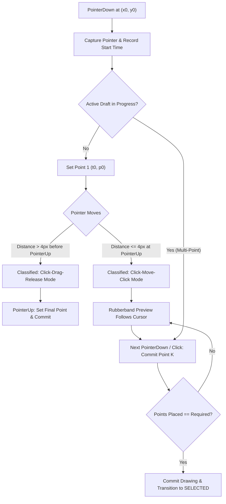
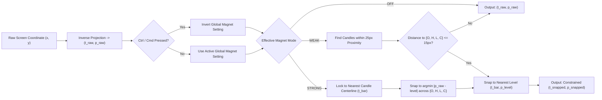

# ADR 0004: Drawing Tool Interaction Lifecycle, Handle Topology, and Snapping Engine Specification

- **Status**: Accepted
- **Date**: 2026-11-02
- **Branch**: `drawing-tools`
- **Context**: Trading Chart Replay Terminal (`tv_chart_replay`)
- **Related Documents**:
  - [ADR 0001: Smooth Animations, Options, and Tradeoffs](file:///d:/code/tv_chart_replay/docs/adr/0001-smooth-animations-options-and-tradeoffs.md)
  - [ADR 0002: Replay Candle Formation Strategy](file:///d:/code/tv_chart_replay/docs/adr/0002-candle-formation-simulation-modes.md)
  - [ADR 0003: Drawing Tools Engine Architecture, Interaction Model, and Shortcut Mapping](file:///d:/code/tv_chart_replay/docs/adr/0003-drawing-tools-architecture-and-interaction-model.md)
  - [TradingView Drawing Tool Behaviors Reference](file:///d:/code/tv_chart_replay/docs/tradingview-drawing-tool-behaviors.md)
  - [TradingView Drawing Tool Icons Visual Catalog](file:///d:/code/tv_chart_replay/docs/tradingview-drawing-tool-icons.md)
  - [TradingView Drawing Shortcuts Reference](file:///d:/code/tv_chart_replay/docs/tradingview-drawing-shortcuts.md)

---

## 1. Context and Problem Statement

In [ADR 0003](file:///d:/code/tv_chart_replay/docs/adr/0003-drawing-tools-architecture-and-interaction-model.md), we established the high-level drawing canvas architecture (Layered HTML5 Canvas over Lightweight Charts) and formalized the core Finite State Machine (FSM) states along with master keyboard shortcut mappings.

However, real-world charting interaction requires precise, tool-specific behavioral mechanics that go beyond generic $(x, y)$ coordinate capture:

1. **Diverse Point Requirements & Termination Semantics**:
   - 1-point instant placement (e.g., `horizontal_line`, `cross_line`, `price_label`).
   - 2-point vector endpoints (e.g., `trend_line`, `fib_retracement`, `rectangle`).
   - 3-point constrained planar topologies (e.g., `parallel_channel`, `pitchfork`, `fib_extension`, `triangle`).
   - $N$-point open/closed polylines (e.g., `polyline`, `path`, harmonic patterns).
   - Continuous sample streams (e.g., `brush`, `highlighter`, `pencil`).
2. **Gesture Ambiguity (Click-Move-Click vs. Click-Drag-Release)**:
   Traders employ both interaction styles interchangeably. Without a unified gesture discriminator, premature mouse-up events can drop incomplete drawings or fail to register drag-release placements.
3. **Complex Handle Topologies & Spatial Constraints**:
   Not all control handles represent independent Cartesian vertices. For example:
   - In a **Parallel Channel**, moving Handle 3 must adjust perpendicular channel width while strictly maintaining parallelism with the baseline defined by Handles 1 and 2.
   - In an **Andrews' Pitchfork**, the median line origin passes through the dynamic midpoint of Handles 2 and 3; in **Schiff Pitchfork**, the origin is vertically offset by $50\%$ of the price distance between Handles 1 and 2.
   - In **Long/Short Positions**, dragging the entry line must translate the entire position, whereas dragging the target or stop handle modifies risk-to-reward ratios and recomputes position sizes in real time.
4. **Magnet Snapping & Temporal OHLC Alignment**:
   Snapping must distinguish between **Weak Magnet** (proximity thresholding) and **Strong Magnet** (unconditional candle-column locking), with support for dynamic inversion via `Ctrl`/`Cmd`.

We require a formal Architectural Decision Record defining the complete behavioral contracts, handle topologies, snapping pipelines, and real-time calculation engines across the entire drawing suite.

---

## 2. Decision Drivers

- **Uncompromising TradingView Behavioral Parity**: 1:1 muscle memory fidelity for discretionary traders and analysts.
- **Parametric Geometric Integrity**: Storing drawings as logical parameters $(t, p)$ while resolving secondary handles through deterministic geometric constraints.
- **Zero Input Latency (Sub-16ms)**: Handle dragging, OLS linear regression calculations, and position sizing updates must compute within a single requestAnimationFrame tick without heap allocation spikes.
- **Robust Cancellation & Reversion**: Seamless draft abortion (`Escape`, right-click) and non-destructive handle cancellation without leaving orphaned canvas artifacts.

---

## 3. Evaluated Architectural Alternatives

| Architecture Alternative                                                      | Implementation Strategy                                                                                                                                                                                                   | Pros                                                                                                                                      | Cons                                                                                                                                                           | Verdict      |
| :---------------------------------------------------------------------------- | :------------------------------------------------------------------------------------------------------------------------------------------------------------------------------------------------------------------------ | :---------------------------------------------------------------------------------------------------------------------------------------- | :------------------------------------------------------------------------------------------------------------------------------------------------------------- | :----------- |
| **A. Generic Homogeneous Point Array Model**                                  | Treat all drawings as flat arrays of `DrawingPoint[]` with identical handle behavior.                                                                                                                                     | Minimal code complexity; uniform serialization.                                                                                           | Cannot enforce geometric constraints (e.g. parallel lines break during individual handle drags); fails on complex compound tools (Position tools, Pitchforks). | **Rejected** |
| **B. Object-Oriented Polymorphic Tool Classes**                               | Create individual TypeScript class instances (`TrendLineTool`, `PitchforkTool`) that manage their own events and handle logic.                                                                                            | Encapsulates logic per tool.                                                                                                              | High memory overhead; fragmented state management; difficult to maintain global undo/redo, serialization, and clipboard operations centrally.                  | **Rejected** |
| **C. Parametric Topology Engine with Declarative Tool Contracts** _(Adopted)_ | Retain normalized JSON schema (`DrawingDefinition`), pairing each `DrawingType` with a declarative **Tool Behavior Descriptor** defining point requirements, handle roles, constraint solvers, and live preview builders. | Clean separation of concerns; centralized FSM and undo/redo; mathematically exact handle constraints; zero object instantiation overhead. | Requires explicit constraint solver functions in `drawing-math.ts`.                                                                                            | **Accepted** |

---

## 4. Architectural Design & Specifications

### 4.1 Unified Pointer Gesture Pipeline

The interaction engine normalizes pointer events into two seamless execution paths:



1. **Threshold Discrimination**:
   - If mouse displacement exceeds $4\text{px}$ between `PointerDown` and `PointerUp`, the engine executes **Drag-and-Release** completion for 2-point tools.
   - If mouse displacement is $\le 4\text{px}$ upon `PointerUp`, the engine remains in `DRAFT_ACTIVE` state for **Click-Move-Click** interaction.
2. **Draft Cancellation Contract**:
   - `Escape` keypress or `PointerDown` with `button === 2` (Right-Click) instantly clears `draftDrawing` and restores engine state to `IDLE` (or re-arms active tool).

---

### 4.2 Declarative Tool Topology & Handle Constraint Model

Every `DrawingType` registers a **`ToolBehaviorDescriptor`** specifying its semantic anatomy:

```typescript
export interface HandleDescriptor {
  index: number;
  role: "vertex" | "secondary" | "midpoint" | "dimension" | "target" | "stop";
  cursor:
    | "crosshair"
    | "move"
    | "nwse-resize"
    | "nesw-resize"
    | "ew-resize"
    | "ns-resize";
  resolvePosition: (
    points: DrawingPoint[],
    style: DrawingStyle,
  ) => DrawingPoint;
  applyConstraint: (
    draggedPoint: DrawingPoint,
    allPoints: DrawingPoint[],
    style: DrawingStyle,
  ) => { updatedPoints: DrawingPoint[]; updatedStyle?: Partial<DrawingStyle> };
}

export interface ToolBehaviorDescriptor {
  type: DrawingType;
  pointCount: number; // Exact count or -1 for dynamic N-points
  inputMode: "fixed" | "multi_point" | "continuous_drag" | "instant";
  handles: HandleDescriptor[];
  calculatePreview: (
    draftPoints: DrawingPoint[],
    currentCursor: DrawingPoint,
  ) => DrawingPoint[];
}
```

#### Topological Constraint Solvers

1. **Parallel Channel**:
   - Handle 1 ($P_1$) and Handle 2 ($P_2$) form baseline $\vec{B} = P_2 - P_1$.
   - Handle 3 ($P_3$) defines the parallel offset.
   - When dragging $P_1$ or $P_2$, $P_3$ is automatically updated such that the perpendicular distance $d_{\perp}(P_3, \vec{B})$ is preserved:
     $$P_3' = P_3 + (\Delta P_{\text{baseline}})$$
2. **Andrews' & Schiff Pitchfork**:
   - Midpoint $M = (P_2 + P_3) / 2$.
   - Median vector $\vec{v} = M - P_1$ (Andrews) or $M - P_1'$ (Schiff, where $p_1' = p_1 + (p_2 - p_1)/2$).
   - Prongs are rendered strictly parallel to $\vec{v}$ through $P_2$ and $P_3$.
3. **Axis-Aligned Rectangle**:
   - 4 Corner Handles: Dragging $(t_k, p_k)$ modifies both adjacent corners.
   - 4 Edge Midpoint Handles: Dragging horizontal edges alters only price ($p$); dragging vertical edges alters only timestamp ($t$).

---

### 4.3 Spatial Snapping & Magnet Architecture



#### Performance-Optimized Candle Indexing

To avoid scanning thousands of candles per mousemove:

- The engine maintains a binary-search lookup over the active dataset sorted by timestamp $t$.
- Proximity candidates are sliced within index bounds $[\text{idx}_{\text{center}} - 2, \; \text{idx}_{\text{center}} + 2]$.

---

### 4.4 Risk/Reward Position Sizing Engine

For `long_position` and `short_position`, the tool functions as an active financial calculator:

```
                      Position Sizing & Analytics Model

  p_target [Handle 1] --------------------------------------------- +$1,250 (+2.50%)
                      |                                           |
                      |          PROFIT ZONE (Target)             | Take Profit
                      |                                           |
  p_entry  [Handle 3] ============================================= Entry Level
                      |                                           |
                      |           RISK ZONE (Stop Loss)           | Stop Loss
                      |                                           |
  p_stop   [Handle 2] --------------------------------------------- -$500   (-1.00%)
                      [<----------------- dt -------------------->][Handle 4: Width]
```

#### Mathematical Formulas

1. **Risk Capital ($R_{\$}$)**:
   $$R_{\$} = \begin{cases} 
   \text{Account Size} \times \left(\frac{\text{Risk } \%}{100}\right) & \text{if Risk Mode} = \text{PERCENT} \\ 
   \text{Risk Cash Amount} & \text{if Risk Mode} = \text{CASH} 
   \end{cases}$$
2. **Unit / Lot Position Size ($Q$)**:
   $$Q = \frac{R_{\$}}{|p_{\text{entry}} - p_{\text{stop}}| \times \text{Contract Size}}$$
3. **Risk-to-Reward Ratio ($R:R$)**:
   $$R:R = \frac{|p_{\text{target}} - p_{\text{entry}}|}{|p_{\text{entry}} - p_{\text{stop}}|}$$
4. **Projected Monetary Profit / Loss**:
   $$\text{Profit}_{\$} = Q \times |p_{\text{target}} - p_{\text{entry}}| \times \text{Contract Size}$$
   $$\text{Loss}_{\$} = Q \times |p_{\text{entry}} - p_{\text{stop}}| \times \text{Contract Size} = R_{\$}$$

---

## 5. Tool Category Behavioral Matrix

| Category          | Primary Tools                                      |       Point Count       | Placement Gesture                           | Handle Topology                                             | Modifier Constraints                                       |
| :---------------- | :------------------------------------------------- | :---------------------: | :------------------------------------------ | :---------------------------------------------------------- | :--------------------------------------------------------- |
| **Trend Lines**   | `trend_line`, `ray`, `extended_line`, `arrow`      |            2            | Click-Click or Drag-Release                 | 2 terminal vertices + 1 center translation midpoint handle. | `Shift`: $45^\circ$ angle snapping; `Ctrl`: Magnet toggle. |
| **Levels & Rays** | `horizontal_line`, `vertical_line`, `cross_line`   |            1            | Single click commit                         | 1 central anchor handle on price/time axis.                 | Axis-constrained by definition.                            |
| **Fibonacci**     | `fib_retracement`, `fib_channel`, `fib_extension`  |         2 or 3          | Multi-click sequential                      | Primary base vertices + expansion anchor handle.            | `Shift`: Horizontal ratio level alignment.                 |
| **Pitchforks**    | `pitchfork`, `schiff_pitchfork`, `modified_schiff` |            3            | 3 sequential clicks ($P_1 \to P_2 \to P_3$) | 3 handles ($P_1$ origin, $P_2/P_3$ swing channel).          | Median ray passes through $(P_2+P_3)/2$.                   |
| **Channels**      | `parallel_channel`, `regression_channel`           | 3 (or 2 for Regression) | Clicks 1 & 2 = baseline; Click 3 = width    | Handles 1 & 2 set slope; Handle 3 controls offset.          | Baseline parallelism strictly preserved.                   |
| **Shapes**        | `rectangle`, `circle`, `ellipse`, `triangle`       |         2 or 3          | Diagonal corners / perimeter / vertices     | 4 corner handles + 4 side midpoints.                        | `Shift`: 1:1 aspect ratio square / circle lock.            |
| **Polylines**     | `polyline`, `path`                                 |        $N \ge 2$        | Sequential clicks; double-click finish      | Individual vertex handle per point.                         | `Enter` / double-click commits; `P_1` click closes.        |
| **Freehand**      | `brush`, `highlighter`, `pencil`                   |         Stream          | Continuous pointer drag                     | Bounding box handles on selection.                          | Distance decimation + Catmull-Rom smoothing.               |
| **Positions**     | `long_position`, `short_position`                  |        1 (or 2)         | Click entry candle                          | 4 handles: Entry, Target, Stop, Width.                      | Real-time R:R and position sizing solver.                  |
| **Annotations**   | `text`, `callout`, `price_label`, `date_label`     |         1 or 2          | Click / Drag anchor                         | 1 text anchor + 1 leader arrow tip handle.                  | Floating inline textarea editor.                           |

---

## 6. Consequences & Trade-offs

### Positive

- **Deterministic Parity**: Drawing tools behave identically to TradingView Supercharts across all tools.
- **Parametric Robustness**: Topological constraints ensure geometric figures never warp or lose parallelism during individual handle adjustments.
- **Accurate Risk Analytics**: Position tools calculate exact contract lot sizes based on live symbol specifications and account equity.
- **Unified Event Pipeline**: Zero friction between click-move-click and click-drag-release input modalities.

### Negative & Mitigations

- **Computational Overhead on Dense Channels**: Real-time linear regression across 10,000+ bars could induce frame drops.
  - _Mitigation_: Cache OLS sums $(\sum x, \sum y, \sum x^2, \sum xy)$ in prefix sum arrays to guarantee $O(1)$ channel recalculations.
- **Coordinate Boundary Edge Cases**: Panning past current chart time limits ($t > \text{latest}$).
  - _Mitigation_: Extrapolate time scale using fixed bar interval spacing ($\Delta t_{\text{bar}}$) for future date projections.

---

## 7. Implementation & Integration Roadmap

1. **Phase 1: Declarative Behavior Registry (`drawing-types.ts`)**:
   Implement `ToolBehaviorDescriptor` map for all 45+ tools with explicit point counts and handle definitions.
2. **Phase 2: Topological Constraint Engine (`drawing-math.ts`)**:
   Implement constraint solvers for parallel channels, pitchfork variants, and rectangle midpoint handles.
3. **Phase 3: Snapping & Magnet Architecture (`drawing-engine.ts`)**:
   Integrate binary-search candle lookup and weak/strong magnet snapping routines.
4. **Phase 4: Financial Position Calculation Solver (`position-calculator.ts`)**:
   Implement dynamic risk/reward, account sizing, and lot quantity calculations for long and short position tools.
5. **Phase 5: Canvas Renderers & Stats Overlays (`drawing-renderers.ts`)**:
   Render rich HUD statistics cards for `info_line`, `date_and_price_range`, and position tools.
