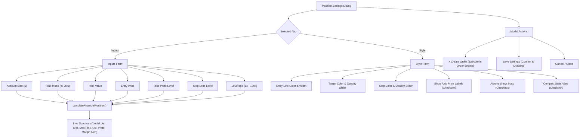

# ADR 0005: Position Drawing Tool Styling, Appearance, and Settings Model Architecture

- **Status**: Accepted
- **Date**: 2026-11-02
- **Branch**: `drawing-tools`
- **Context**: Trading Chart Replay Terminal (`tv_chart_replay`)
- **Related Documents**:
  - [ADR 0003: Drawing Tools Engine Architecture, Interaction Model, and Shortcut Mapping](file:///d:/code/tv_chart_replay/docs/adr/0003-drawing-tools-architecture-and-interaction-model.md)
  - [ADR 0004: Drawing Tool Interaction Lifecycle, Handle Topology, and Snapping Engine Specification](file:///d:/code/tv_chart_replay/docs/adr/0004-drawing-tool-interaction-lifecycle-and-behavior-specification.md)
  - [TradingView Drawing Tool Behaviors Reference](file:///d:/code/tv_chart_replay/docs/tradingview-drawing-tool-behaviors.md)

---

## 1. Context and Problem Statement

In [ADR 0004](file:///d:/code/tv_chart_replay/docs/adr/0004-drawing-tool-interaction-lifecycle-and-behavior-specification.md), we established the mathematical formulation for the Risk/Reward sizing engine (Phase 4) and baseline canvas overlays (Phase 5). 

However, professional discretionary traders on TradingView rely heavily on the exact visual anatomy, layout hierarchy, and settings customizability of the **Long Position** and **Short Position** tools:

1. **Exact Visual Anatomy & Color Token Fidelity**:
   - TradingView renders a green Profit Zone and red Risk Zone with independently adjustable fill opacities ($0\%\text{--}100\%$, defaulting to $20\%$).
   - Distinct, non-clipping **Target Tag** and **Stop Tag** headers attached to boundary edges showing price levels, pips/ticks, percentage change, and monetary amounts.
   - A central **Risk/Reward Summary Card** displaying open price, lot quantity ($Q$), risk capital, time horizon (bars & duration), and leverage margin constraint warnings.
   - Dual layout modes: full 3-line card vs. condensed single-line **Compact Stats Mode** (`🟢 LONG R:R 2.00`).
   - Dedicated **Price Scale Axis Labels** on the chart's vertical price scale at target, entry, and stop levels.
2. **Interactive 6-Handle Topology**:
   - Independent adjustment of Take Profit, Stop Loss, Entry translation, Duration width, and dual-axis corner resizing with specialized cursors (`ns-resize`, `ew-resize`, `move`, `nesw-resize`, `nwse-resize`).
3. **TradingView-Standard Dual-Tab Format Settings Dialog**:
   - **Inputs Tab**: Account Size, Account Currency, Risk (% of equity vs. cash amount), Entry Price, Profit Level (ticks or price), Stop Level (ticks or price), Leverage multiplier, and Lot Sizing.
   - **Style Tab**: Line color & thickness, Target Color & Opacity slider, Stop Color & Opacity slider, Axis Price Labels toggle, Compact Stats toggle, and Always Show Stats toggle.
   - Real-time two-way calculation synchronization: editing any input field dynamically updates lot size, R:R ratio, dollar risk, and projected profit without requiring modal save/re-open.

This ADR formalizes the data models, canvas rendering pipelines, and UI modal architecture required to achieve 1:1 fidelity with TradingView's position tools.

---

## 2. Decision Drivers

- **1:1 Visual Parity with TradingView Supercharts**: Colors, typography, padding, rounded pills, and opacity blending must match industry muscle memory.
- **Parametric Transparency & Customization**: Fills must never obscure underlying candlesticks, volume bars, or technical indicators.
- **Reactive Financial Recalculation**: Sizing, margin requirements, and risk metrics must update reactively on every input keystroke and canvas handle drag.
- **Unified Order Bridge**: Seamless transition from chart visual setup into live order execution via a 1-click "Create Order" action.

---

## 3. Evaluated Architectural Alternatives

| Architecture Alternative | Implementation Strategy | Pros | Cons | Verdict |
| :--- | :--- | :--- | :--- | :--- |
| **A. Hardcoded Color & Static Layout Model** | Hardcode fixed 20% alpha fills and rigid tag positions directly in canvas render loops. | Simplest implementation. | Rigid; unable to support user styling, custom opacities, or axis price scale indicators. | **Rejected** |
| **B. DOM-Overlay Position Widget** | Render position boxes and tags as HTML/CSS elements floating on top of canvas. | Easy CSS styling, animations, and form inputs. | Suffers from coordinate desync during rapid chart panning/zooming; high DOM overhead with multiple positions. | **Rejected** |
| **C. Layered Canvas Rendering with Parametric Style Model & Interactive Reactive Modal** _(Adopted)_ | Extend `DrawingStyle` with opacity and display tokens; render all zones, badges, and axis markers directly to HTML5 Canvas; pair with a reactive HTML modal featuring live recalculation listeners. | Perfect coordinate synchronization at 60 FPS; customizable fills and opacities; zero DOM jitter; rich interactive modal with live calculations. | Requires custom canvas pill drawing and color conversion routines. | **Accepted** |

---

## 4. Technical Architecture & Specification

### 4.1 Data Model Extensions (`drawing-types.ts`)

We extend `DrawingStyle` with position-specific styling and layout tokens:

```typescript
export interface DrawingStyle {
  // Core styling
  color: string;                     // Entry line & border color
  width: number;                     // Line thickness (1-3px)
  
  // Position visual styling tokens
  targetColor?: string;              // Hex color for Profit Zone (default: #089981)
  stopColor?: string;                // Hex color for Risk Zone (default: #f23645)
  targetOpacity?: number;            // Opacity for Profit Zone [0.0 - 1.0] (default: 0.20)
  stopOpacity?: number;              // Opacity for Risk Zone [0.0 - 1.0] (default: 0.20)
  showPrices?: boolean;              // Toggle price scale axis badges (default: true)
  alwaysShowStats?: boolean;         // Persistent vs hover/selection stats (default: false)
  compactStats?: boolean;            // Compact single-line pill vs full card (default: false)

  // Financial inputs & risk parameters
  accountSize?: number;              // Total trading balance (default: 10,000)
  accountCurrency?: string;          // Currency code (e.g. 'USD', 'EUR')
  riskMode?: 'PERCENT' | 'CASH';     // Risk calculation basis
  riskPercent?: number;              // Risk percentage (e.g. 1.0 = 1%)
  riskAmount?: number;               // Cash dollar risk (e.g. $100)
  entryPrice?: number;               // Planned open price
  targetPrice?: number;              // Planned take profit price
  stopPrice?: number;                // Planned stop loss price
  lotSize?: number;                  // Explicit lot override if specified
  leverage?: number;                 // Applied account leverage (e.g. 50 = 50:1)
  lotPrecision?: number;             // Decimal rounding precision (default: 2)
}
```

---

### 4.2 Visual Anatomy & Layout Specifications

```
                       [Target Badge: Floating Centered Pill]
                 +--------------------------------------------------+
                 | Target: 10.10 (0.252%) 1010, Amount: 1508.05     |
                 +--------------------------------------------------+
   [O] (TL Handle)
    +---------------------------+-----------------------------------+
    |                           |                                   |
    |   ACTIVE EXECUTION ZONE   |          PROJECTION ZONE          |
    |   (Darker Fill: 32%)      |         (Lighter Fill: 16%)       |
    |            \              |                                   |
    |             \ - - - - > [Exit Candle]                         |
    |                           |                                   |
   [O] (Entry Handle)           |                                  [O] (Right Handle)
====+===========+---------------+----------------===================+==== Entry Line
    |           |   [Center Card: White Border, Reactive Fill]      |
    |           |   +-------------------------------------------+   |
    |           |   | Closed PnL: 10.10, Qty: 50                |   |
    |           |   | Risk/reward ratio: 2.03                   |   |
    |           |   +-------------------------------------------+   |
    |                           |                                   |
    |       STOP LOSS ZONE      |                                   |
    |                           |                                   |
    +---------------------------+-----------------------------------+
   [O] (BL Handle)
                 +--------------------------------------------------+
                 | Stop: 4.97 (0.124%) 497, Amount: 750             |
                 +--------------------------------------------------+
                        [Stop Badge: Floating Centered Pill]
```

#### Exact Component Visual Design Specifications

1. **Target Header Badge (Floating Centered Pill)**:
   - **Positioning**: Horizontally centered over position width at $X = \frac{x_{\text{left}} + x_{\text{right}}}{2}$; floating $6\text{px}$ outside top boundary (`topProfitY - badgeH - 6` for long).
   - **Corner Radius**: $6\text{px}$ rounded pill; height $24\text{px}$; horizontal padding $12\text{px}$.
   - **Fill**: Solid emerald teal `#089981` (opacity $\ge 0.95$); text pure white `#ffffff`, $10.5\text{px}$ semi-bold.
   - **Text Template**: `Target: <diff> (<pct>%) <ticks>, Amount: <profitAmount>` (e.g. `Target: 10.10 (0.252%) 1010, Amount: 1508.05`).

2. **Stop Footer Badge (Floating Centered Pill)**:
   - **Positioning**: Horizontally centered over position width at $X = \frac{x_{\text{left}} + x_{\text{right}}}{2}$; floating $6\text{px}$ outside bottom boundary (`bottomLossY + 6` for long).
   - **Corner Radius**: $6\text{px}$ rounded pill; height $24\text{px}$; horizontal padding $12\text{px}$.
   - **Fill**: Solid crimson red `#f23645` (opacity $\ge 0.95$); text pure white `#ffffff`, $10.5\text{px}$ semi-bold.
   - **Text Template**: `Stop: <diff> (<pct>%) <ticks>, Amount: <lossAmount>` (e.g. `Stop: 4.97 (0.124%) 497, Amount: 750`).

3. **Center Summary Card (Reactive Outcome State & Border)**:
   - **Positioning**: Horizontally centered at $X = \frac{x_{\text{left}} + x_{\text{right}}}{2}$; vertically centered on entry line (`entryY - cardH / 2`).
   - **Dimensions**: Width $190\text{px}\text{--}220\text{px}$, height $38\text{px}\text{--}42\text{px}$, corner radius $6\text{px}$.
   - **Border**: **$1.5\text{px}$ solid pure white stroke (`#ffffff`)**.
   - **Outcome Fill**:
     - **Teal/Green (`#089981`)** when $\text{Closed PnL} \ge 0$ (Target hit / profitable outcome).
     - **Crimson Red (`#f23645`)** when $\text{Closed PnL} < 0$ (Stop hit / losing outcome).
   - **Content (2 Centered Lines)**:
     - Line 1: `Closed PnL: <±pnl>, Qty: <qty>` (e.g. `Closed PnL: 10.10, Qty: 50` or `Closed PnL: -6.25, Qty: 40`).
     - Line 2: `Risk/reward ratio: <rr>` (e.g. `Risk/reward ratio: 2.03` or `Risk/reward ratio: 1.49`).

4. **Selection Handles (Squarcles Topology)**:
   - **Shape**: $8\times 8\text{px}$ rounded squares with $2\text{px}$ corner radius.
   - **Style**: $2\text{px}$ solid vibrant blue border (`#2962ff`), filled with dark background `#131722`.
   - **4 Visible Anchor Handles**:
     - Top-Left: `(leftX, tpY)` — Take Profit adjustment.
     - Mid-Left: `(leftX, entryY)` — Entry price anchor & vertical translation.
     - Bottom-Left: `(leftX, slY)` — Stop Loss adjustment.
     - Mid-Right: `(rightX, entryY)` — Time duration / box width adjustment.

5. **Trade Execution Trajectory & Dual-Zone Shading**:
   - **Trajectory Line**: Dashed gray line (`[4, 4]`, `#8c929e`, width $1.2\text{px}$) from entry point `(leftX, entryY)` to exit candle `(exitX, exitY)`.
   - **Dual-Zone Shading**:
     - Active execution zone ($x_{\text{left}} \to x_{\text{exit}}$): Rendered with deeper opacity ($\approx 32\%$).
     - Forward projection zone ($x_{\text{exit}} \to x_{\text{right}}$): Rendered with standard projection opacity ($\approx 16\%$).

#### Color Blending Utility
To support hex codes (`#089981`), 3-digit shorthand, and custom colors without canvas state corruption, a dedicated conversion utility resolves CSS RGBA strings:

$$\text{hexToRgba}(\text{hex}, \; \alpha) \to \text{"rgba}(r, g, b, \alpha)\text{"}$$

---

### 4.3 Axis Price Scale Badges

When `showPrices !== false`, the renderer projects high-contrast price tag badges onto the right-hand price axis at coordinate $X = w$:

1. **Target Axis Badge**: Filled with `targetColor` at $Y = y_{\text{tp}}$, displaying $p_{\text{target}}$.
2. **Entry Axis Badge**: Filled with `d.style.color` at $Y = y_{\text{entry}}$, displaying $p_{\text{entry}}$.
3. **Stop Axis Badge**: Filled with `stopColor` at $Y = y_{\text{sl}}$, displaying $p_{\text{stop}}$.

---

### 4.4 Settings Modal Architecture (`drawing-style-editor.ts`)

The position settings modal follows TradingView's two-tab layout with real-time recalculation:



---

### 4.5 Real-Time Price Action Evaluation & Dynamic Trajectory Engine

To transition the position tool from static mock fractions to live price-action functionality, the renderer couples with `evaluatePositionPriceAction(...)`.

#### Evaluation Algorithm
1. **Candle Stream Inspection**:
   Evaluates historical or replaying bars starting from $t_{\text{entry}}$ up to $\min(t_{\text{end}}, t_{\text{current}})$:
   - For **Long Positions**:
     - $\text{bar.high} \ge p_{\text{target}} \implies \text{WIN}$ (Exit at $p_{\text{target}}$ on that bar).
     - $\text{bar.low} \le p_{\text{stop}} \implies \text{LOSS}$ (Exit at $p_{\text{stop}}$ on that bar).
   - For **Short Positions**:
     - $\text{bar.low} \le p_{\text{target}} \implies \text{WIN}$ (Exit at $p_{\text{target}}$ on that bar).
     - $\text{bar.high} \ge p_{\text{stop}} \implies \text{LOSS}$ (Exit at $p_{\text{stop}}$ on that bar).

2. **Intrabar Ambiguity Resolution**:
   When both target and stop are breached within the same candle:
   - Bullish bar ($\text{close} \ge \text{open}$): open $\to$ low $\to$ high $\to$ close. The dip occurred before the rally (Stop checked before Target for Long).
   - Bearish bar ($\text{close} < \text{open}$): open $\to$ high $\to$ low $\to$ close. The rally occurred before the drop (Target checked before Stop for Long).

3. **Lifecycle State Machine**:
   - `WIN`: Trade reached TP. Trajectory dashed line connects $(x_{\text{entry}}, y_{\text{entry}})$ to $(x_{\text{exit}}, y_{\text{tp}})$. Center card turns solid green (`#089981`) with `Closed PnL: <+val>, Qty: <qty>`.
   - `LOSS`: Trade reached SL. Trajectory dashed line connects $(x_{\text{entry}}, y_{\text{entry}})$ to $(x_{\text{exit}}, y_{\text{sl}})$. Center card turns solid red (`#f23645`) with `Closed PnL: <-val>, Qty: <qty>`.
   - `OPEN`: Price is running within range. Trajectory dashed line connects to current bar $(x_{\text{current}}, y_{\text{close}})$. Center card reflects unrealized PnL: `Open PnL: <±val>, Qty: <qty>` (Green if in profit, Red if in loss).
   - `PLANNED`: Future setup where $t_{\text{entry}} > t_{\text{current}}$. Trajectory line hidden; center card displays planned `Risk/reward ratio: <rr>`.

4. **Dual-Zone Opacity Shading**:
   The canvas splits horizontally at $X_{\text{split}} = \text{chartToPixel}(t_{\text{exit}})$:
   - **Active Zone** ($x_{\text{left}} \to X_{\text{split}}$): Rendered with high opacity ($\approx 32\%$) representing the executed market exposure.
   - **Projection Zone** ($X_{\text{split}} \to x_{\text{right}}$): Rendered with base transparency ($\approx 16\% - 20\%$) representing the visual planning envelope.

---

## 5. Implementation Roadmap

1. **Phase 1: Type & Style Token Enhancements (`drawing-types.ts`)**:
   Add `targetOpacity`, `stopOpacity`, `leverage`, `accountCurrency`, and `lotPrecision` to `DrawingStyle`.
2. **Phase 2: Canvas Opacity Blending & Price Axis Labels (`drawing-renderers.ts`)**:
   Implement dynamic opacity blending (`colorWithOpacity`), price scale axis tags, and enhanced tag pill sizing.
3. **Phase 3: Settings Modal Dual-Tab Expansion (`drawing-style-editor.ts`)**:
   Implement opacity sliders, axis label toggles, leverage inputs, and real-time live preview event binding.
4. **Phase 4: Order Engine Bridge Integration**:
   Ensure "Create Order" accurately maps position sizing, side, SL, and TP into active order placement.
5. **Phase 5: Verification & Unit Testing (`phase5-canvas-renderers.test.ts`, `drawing-ui.test.ts`)**:
   Validate opacity rendering, axis price tags, live calculator updates, and compact mode toggles.

---

## 6. Consequences & Benefits

- **Authentic TradingView Parity**: Discretionary traders get 1:1 identical visual cues, R:R badges, and customization sliders.
- **Zero Chart Clutter**: Configurable opacities and compact stats mode keep charts readable during dense price action.
- **Instant Trade Execution**: 1-click bridge eliminates manual re-entry of lot sizes and stop/target prices into order forms.
- **High Performance**: Pure HTML5 canvas rendering ensures smooth 60 FPS scrolling and zooming without DOM node bloat.

