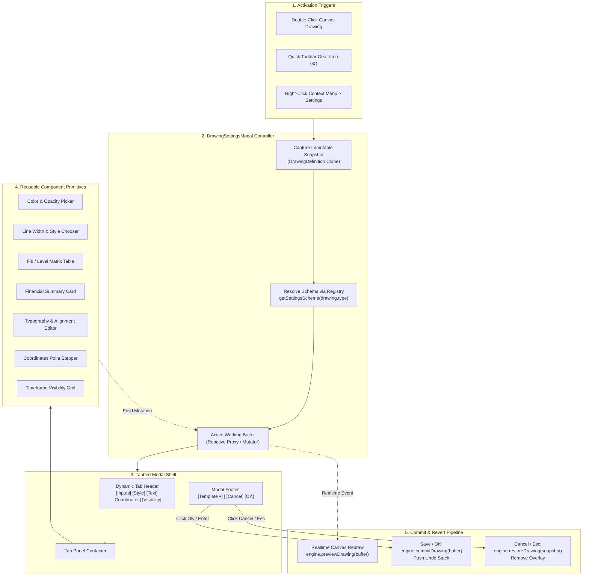

# ADR 0006: Unified Drawing Tool Settings Dialog Architecture and Declarative Schema Engine

- **Status**: Accepted
- **Date**: 2026-11-02
- **Branch**: `drawing-tools`
- **Context**: Trading Chart Replay Terminal (`tv_chart_replay`)
- **Related Documents**:
  - [ADR 0003: Drawing Tools Engine Architecture, Interaction Model, and Shortcut Mapping](file:///d:/code/tv_chart_replay/docs/adr/0003-drawing-tools-architecture-and-interaction-model.md)
  - [ADR 0004: Drawing Tool Interaction Lifecycle, Handle Topology, and Snapping Engine Specification](file:///d:/code/tv_chart_replay/docs/adr/0004-drawing-tool-interaction-lifecycle-and-behavior-specification.md)
  - [ADR 0005: Position Drawing Tool Styling, Appearance, and Settings Model Architecture](file:///d:/code/tv_chart_replay/docs/adr/0005-position-drawing-tool-styling-appearance-and-settings-architecture.md)
  - [TradingView Drawing Tool Settings Specification](file:///d:/code/tv_chart_replay/docs/drawing-tool-settings-popup-design.md)
  - [TradingView Drawing Tool Behaviors Reference](file:///d:/code/tv_chart_replay/docs/tradingview-drawing-tool-behaviors.md)

---

## 1. Context and Problem Statement

In [ADR 0003](file:///d:/code/tv_chart_replay/docs/adr/0003-drawing-tools-architecture-and-interaction-model.md) and [ADR 0004](file:///d:/code/tv_chart_replay/docs/adr/0004-drawing-tool-interaction-lifecycle-and-behavior-specification.md), we established the core vector drawing canvas, interaction lifecycle, handle topology, and hotkey systems across 92 drawing tools. In [ADR 0005](file:///d:/code/tv_chart_replay/docs/adr/0005-position-drawing-tool-styling-appearance-and-settings-architecture.md), we implemented a specialized dual-tab settings modal (`Inputs` and `Style`) tailored strictly to the Long and Short Position tools.

However, the current settings dialog implementation in [`drawing-style-editor.ts`](file:///d:/code/tv_chart_replay/frontend/src/ui/drawing-style-editor.ts#L283-L675) exhibits significant architectural limitations:

1. **Bifurcated & Asymmetrical Architecture**:
   - The Position tools (`long_position`, `short_position`) possess an interactive two-tab modal with financial metrics and color pickers.
   - All other 90 tools (Trend Lines, Fibonacci Retracements, Pitchforks, Channels, Rectangles, Text, Harmonic Patterns, Volume Profiles) fall back to a minimal, hardcoded 2-field modal (Line Color and Line Width only).
2. **Missing Universal TradingView Settings Tabs**:
   - **`Coordinates` Tab**: Traders cannot view or precisely adjust numerical price values or bar timestamps for anchor vertices.
   - **`Visibility` Tab**: Multi-timeframe visibility filtering is absent. Lower timeframe drawings clutter higher timeframes without granularity controls.
   - **`Text` Tab**: Annotation tools, notes, callouts, and geometric shapes with embedded text lack typography, font sizing, alignment, or text wrap controls.
   - **`Inputs` Tab (Non-Position Tools)**: Advanced analytical tools like Fibonacci Retracements (24 configurable ratio levels), Anchored VWAP, and Regression Channels have no ratio matrices or parameter customization.
3. **Absence of Template & Default Presets Engine**:
   - TradingView traders rely heavily on the bottom-left **Template** dropdown menu (`Save As...`, `Apply Default`, `Save as Default`) to store recurring technical templates (e.g. "Golden Pocket Fib", "Order Block Rectangle", "Key Daily S/R").
4. **Lack of Transactional Safety & Live Preview Buffer**:
   - Modifying settings must immediately reflect on the canvas in real-time for visual feedback, but hitting `Cancel` or `Escape` must cleanly roll back to an immutable snapshot of the pre-dialog state without polluting the Undo/Redo stack.

We require a unified, declarative, polymorphic settings dialog architecture capable of rendering the exact TradingView configuration interface for any of the 92 drawing tools while maintaining modularity, type safety, and 60 FPS live reactivity.

---

## 2. Decision Drivers

- **1:1 TradingView Ergonomic Fidelity**: The layout, tab order (`Inputs`, `Style`, `Text`, `Coordinates`, `Visibility`), color swatches, opacity sliders, and template menus must precisely mirror TradingView Supercharts.
- **Polymorphic Schema-Driven UI**: Settings interfaces for 92 distinct tools must be declared via clean, composable schemas rather than 92 separate hardcoded HTML templates.
- **Transactional Live Synchronization**: Settings changes must immediately project onto the chart canvas in real-time for visual validation, with instant rollback on `Cancel` / `Esc` and atomic commit on `OK`.
- **Reusable Component Hierarchy**: Centralized UI primitives (Color/Opacity pickers, Line style choosers, Level matrices, Point coordinate steppers, Timeframe range sliders) shared across all tools.
- **Persistent Template Management**: Full local storage serialization of named style presets, tool default overwrites, and factory resets.

---

## 3. Evaluated Architectural Alternatives

| Architecture Alternative                                               | Implementation Strategy                                                                                                                                                                                        | Pros                                                                                                                                            | Cons                                                                                                                                            | Verdict      |
| :--------------------------------------------------------------------- | :------------------------------------------------------------------------------------------------------------------------------------------------------------------------------------------------------------- | :---------------------------------------------------------------------------------------------------------------------------------------------- | :---------------------------------------------------------------------------------------------------------------------------------------------- | :----------- |
| **A. Monolithic Class-per-Tool Modals**                                | Build dedicated dialog classes for each tool type (`TrendLineSettingsModal`, `FibSettingsModal`, `TextSettingsModal`, etc.).                                                                                   | Complete isolation per tool; simple bespoke DOM scripts.                                                                                        | Massive code duplication (>10,000 LOC); inconsistent styling; difficult to maintain and extend across 92 tools.                                 | **Rejected** |
| **B. Generic Key-Value Property Grid**                                 | Render an automated inspector table (similar to Unity/Unreal property sheets) iterating over `DrawingStyle` fields.                                                                                            | Zero configuration; automatically supports any field added to `DrawingStyle`.                                                                   | Terrible UX; fails to resemble TradingView; cannot support specialized layouts (e.g. Fib ratio matrices, position summary cards, tab grouping). | **Rejected** |
| **C. Declarative Schema-Driven Polymorphic Dialog Engine** _(Adopted)_ | Define declarative schema metadata for tool categories specifying tab presence, section groupings, field widgets, and constraints. Render via composable UI components backed by a transactional state buffer. | 100% TradingView layout fidelity; centralized component logic; rapid addition of new tools; strictly typed; supports live preview and rollback. | Requires initial schema architecture and widget primitive library.                                                                              | **Accepted** |

---

## 4. Technical Architecture & Specification



---

### 4.1 Data Model Extensions (`drawing-types.ts`)

To support multi-point coordinates, multi-timeframe visibility, ratio matrices, and templates across all tools, `DrawingStyle`, `DrawingDefinition`, and auxiliary types are extended:

```typescript
// --- Multi-Timeframe Visibility Schema ---
export interface TimeframeVisibilityRange {
  enabled: boolean;
  minMinutes?: number; // e.g. 1 (1m)
  maxMinutes?: number; // e.g. 1440 (1D)
}

export interface DrawingVisibilityFilter {
  ticks: boolean;
  seconds: TimeframeVisibilityRange;
  minutes: TimeframeVisibilityRange;
  hours: TimeframeVisibilityRange;
  days: boolean;
  weeks: boolean;
  months: boolean;
}

// --- Fibonacci & Pitchfork Ratio Level Definition ---
export interface LevelRatioItem {
  index: number;
  enabled: boolean;
  coeff: number; // e.g. 0.618
  color: string; // Hex color
  width?: number; // Level line thickness
  lineStyle?: "solid" | "dashed" | "dotted";
}

// --- Text Formatting & Alignment Specification ---
export interface DrawingTextOptions {
  content: string;
  fontSize: number; // 10, 12, 14, 16, 20, 24, 28, 32, 40
  fontBold: boolean;
  fontItalic: boolean;
  textColor: string;
  hAlign: "left" | "center" | "right";
  vAlign: "top" | "middle" | "bottom";
  wordWrap: boolean;
  showBackground: boolean;
  backgroundColor: string;
  backgroundOpacity: number;
  showBorder: boolean;
  borderColor: string;
  borderWidth: number;
}

// --- Extended Comprehensive DrawingStyle ---
export interface DrawingStyle {
  // Base Vector Appearance
  color: string;
  width: number;
  lineStyle?: "solid" | "dashed" | "dotted";
  fillColor?: string;
  fillOpacity?: number;

  // Endpoint & Extension Properties
  extendLeft?: boolean;
  extendRight?: boolean;
  leftEnd?: "normal" | "arrow" | "circle";
  rightEnd?: "normal" | "arrow" | "circle";
  showMiddlePoint?: boolean;
  showPriceLabels?: boolean;

  // Ratio / Level Matrix Tools (Fibonacci, Gann, Pitchforks, Channels)
  levels?: LevelRatioItem[];
  useOneColor?: boolean;
  fillBackground?: boolean;
  backgroundOpacity?: number;
  reverse?: boolean;
  showPrices?: boolean;
  showLevels?: boolean;
  levelsMode?: "values" | "percents";
  labelsPositionH?: "left" | "center" | "right";
  labelsPositionV?: "top" | "middle" | "bottom";

  // Text & Annotation Options
  textOptions?: DrawingTextOptions;

  // Financial & Position Sizing Parameters (Long/Short Position)
  accountSize?: number;
  accountCurrency?: string;
  riskMode?: "PERCENT" | "CASH";
  riskPercent?: number;
  riskAmount?: number;
  entryPrice?: number;
  targetPrice?: number;
  stopPrice?: number;
  lotSize?: number;
  leverage?: number;
  lotPrecision?: number;
  targetColor?: string;
  stopColor?: string;
  targetOpacity?: number;
  stopOpacity?: number;
  compactStats?: boolean;
  alwaysShowStats?: boolean;

  // Measurement Specific Properties
  showBarsRange?: boolean;
  showDateRange?: boolean;
  showDistancePips?: boolean;
  showAngle?: boolean;

  // Profile & Analytical Properties
  source?: "open" | "high" | "low" | "close" | "hl2" | "hlc3" | "ohlc4";
  bandDeviations?: number[];
  valueAreaVolumePercent?: number;
}

// --- Extended DrawingDefinition ---
export interface DrawingDefinition {
  id: string;
  symbol: string;
  timeframe: string;
  type: DrawingType;
  points: DrawingPoint[];
  style: DrawingStyle;
  visibility?: DrawingVisibilityFilter;
  locked: boolean;
  visible: boolean;
}

// --- Saved Drawing Template Preset ---
export interface DrawingTemplate {
  id: string;
  name: string;
  toolType: DrawingType;
  style: Partial<DrawingStyle>;
  createdAt: number;
}
```

---

### 4.2 Declarative Schema System (`drawing-settings-schema.ts`)

Instead of hardcoding DOM layouts, every `DrawingType` is associated with a `ToolSettingsSchema`:

```typescript
export type SettingsTabId =
  | "inputs"
  | "style"
  | "text"
  | "coordinates"
  | "visibility";

export interface FieldDefinition {
  id: string;
  label: string;
  widget:
    | "color_picker"
    | "color_opacity"
    | "line_style"
    | "line_width"
    | "number_stepper"
    | "checkbox"
    | "select"
    | "text_input"
    | "textarea"
    | "font_styling"
    | "levels_matrix"
    | "position_inputs"
    | "profile_inputs";
  props?: Record<string, any>;
  getter: (style: DrawingStyle, points: DrawingPoint[]) => any;
  setter: (value: any, style: DrawingStyle, points: DrawingPoint[]) => void;
}

export interface SectionDefinition {
  id: string;
  title?: string;
  collapsible?: boolean;
  fields: FieldDefinition[];
}

export interface ToolSettingsSchema {
  toolType: DrawingType;
  title: string;
  tabs: SettingsTabId[];
  defaultTab: SettingsTabId;
  inputsSections?: SectionDefinition[];
  styleSections?: SectionDefinition[];
  textSections?: SectionDefinition[];
  hasCoordinates: boolean;
  hasVisibility: boolean;
}
```

#### Category Schema Routing

The schema registry maps all 92 tools into 10 unified schema architectures:

| Tool Category                         | Exemplar Tools                                                         | Available Tabs                             | Primary Capabilities                                                                                 |
| :------------------------------------ | :--------------------------------------------------------------------- | :----------------------------------------- | :--------------------------------------------------------------------------------------------------- |
| **1. Directional Lines & Vectors**    | `trend_line`, `ray`, `extended_line`, `info_line`, `arrow`             | `[Style, Text, Coordinates, Visibility]`   | Line color/width/style, ray extensions, midpoints, price labels, endcaps, embedded text tags.        |
| **2. Fibonacci & Gann Instruments**   | `fib_retracement`, `fib_extension`, `fib_channel`, `gann_box`          | `[Style, Coordinates, Visibility]`         | 24-level ratio matrix, individual color swatches, background fills, reverse toggle, label positions. |
| **3. Pitchforks & Channels**          | `pitchfork`, `schiff_pitchfork`, `parallel_channel`, `flat_top_bottom` | `[Style, Coordinates, Visibility]`         | Median line options, channel level lines, fill opacities, extend left/right.                         |
| **4. Geometric Shapes & Polygons**    | `rectangle`, `circle`, `ellipse`, `triangle`, `polyline`, `curve`      | `[Style, Text, Coordinates, Visibility]`   | Border stroke & style, background fill & opacity, full multiline text container styling.             |
| **5. Freehand Vector Strokes**        | `brush`, `highlighter`, `pencil`, `pen`                                | `[Style, Coordinates, Visibility]`         | Stroke color, stroke thickness, opacity slider, smoothing factor.                                    |
| **6. Annotations, Badges & Labels**   | `text`, `callout`, `balloon`, `signpost`, `price_note`, `note`         | `[Text, Coordinates, Visibility]`          | Typography controls, multi-line editor, container background & border, pointer styles.               |
| **7. Position & Risk Forecasting**    | `long_position`, `short_position`, `forecast`, `projection`            | `[Inputs, Style, Coordinates, Visibility]` | Reactive financial calculator, equity/risk sizing, leverage, zone colors & opacities, compact stats. |
| **8. Measurement & Range Rulers**     | `price_range`, `date_range`, `date_and_price_range`, `measurement`     | `[Style, Coordinates, Visibility]`         | Metrics toggles (bars, duration, pips, percentage), fill opacity, label font size.                   |
| **9. Patterns & Harmonic Structures** | `head_and_shoulders`, `xabcd_pattern`, `elliott_impulse`, `cypher`     | `[Style, Text, Coordinates, Visibility]`   | Wave leg colors, ratio labels display, harmonic degree selection, fill transparency.                 |
| **10. Anchored Technical Profiles**   | `anchored_vwap`, `fixed_range_volume_profile`                          | `[Inputs, Style, Coordinates, Visibility]` | Anchor time, price source, deviation band multipliers, value area %, up/down volume colors.          |

---

### 4.3 Reusable Component Primitives

The settings popup is assembled dynamically from eight modular UI components:

```
+-----------------------------------------------------------------------------------+
| Color & Opacity Picker:                                                           |
| [ #2962ff ][Swatch]  Opacity: [======o================] 35%                       |
+-----------------------------------------------------------------------------------+
| Line Style & Width Chooser:                                                       |
| Width: [ (1px) | (2px) | (3px) | (4px) ]    Style: [ (Solid) | (Dashed) | (Dot) ] |
+-----------------------------------------------------------------------------------+
| Fibonacci Ratio Matrix Table:                                                     |
| [x] 0.000  [#787b86][■] 1px | [x] 0.618  [#089981][■] 1px | [ ] 1.618  [#2962ff][■]  |
| [x] 0.382  [#f23645][■] 1px | [x] 0.786  [#ff9800][■] 1px | [x] 2.618  [#ab47bc][■]  |
+-----------------------------------------------------------------------------------+
| Coordinates Point Stepper:                                                        |
| Point 1:  Bar: [ 1042 ]  Time: [ 2026-11-02 14:30 ]  Price: [ 1.08542 ▲▼ ]        |
| Point 2:  Bar: [ 1088 ]  Time: [ 2026-11-02 18:15 ]  Price: [ 1.09210 ▲▼ ]        |
+-----------------------------------------------------------------------------------+
| Multi-Timeframe Visibility Grid:                                                  |
| [x] Minutes: Range [ 1 ] to [ 59 ] min      [x] Days: [ 1D, 2D, 3D ]              |
| [x] Hours:   Range [ 1 ] to [ 24 ] hrs      [ ] Weeks / Months                    |
+-----------------------------------------------------------------------------------+
| Template Presets Dropdown:                                                        |
| [ Template ▾ ] -> [ Save As... | Apply Default | Save As Default | Preset 1 | 2 ] |
+-----------------------------------------------------------------------------------+
```

1. **`ColorOpacityPicker`**: Combines 6 standard TradingView palette swatches, an HTML native color picker input, and an interactive horizontal slider range ($0\%\text{--}100\%$).
2. **`LineWidthAndStyleSelector`**: Segmented pill buttons for line thickness ($1\text{px}, 2\text{px}, 3\text{px}, 4\text{px}$) and SVG-iconized line patterns (Solid, Dashed, Dotted).
3. **`LevelsMatrixTable`**: A responsive 2-column or 3-column grid mapping ratio coefficients, active checkboxes, independent color swatches, and width selectors with global master toggles ("Use one color", "Background fill").
4. **`TextEditorPanel`**: Multiline text area, font-size picker ($10\text{px}\text{--}40\text{px}$), bold/italic toggles, 9-point alignment grid, text wrap, and background pill box styling.
5. **`CoordinatesPointEditor`**: Numerical price inputs clamped to the instrument's fractional tick precision, paired with synchronized Bar Index / Date-Time inputs.
6. **`TimeframeVisibilityMatrix`**: Checkbox toggles and interval range limiters allowing granular control over which chart scales display the drawing.
7. **`PositionInputsCalculator`**: Reuses the reactive calculation pipeline from ADR 0005 to recalculate lot sizing, capital risk, and profit targets live as inputs change.
8. **`TemplateManager`**: Serializes active styles into named templates in `localStorage`, allows one-click loading of preset styles, and manages tool defaults.

---

### 4.4 Transactional Lifecycle & Two-Way Live Synchronization

To guarantee 1:1 behavioral parity with TradingView:

1. **Modal Open**:
   - Deep clone the selected `DrawingDefinition` to create an immutable `Snapshot`.
   - Instantiate an active `WorkingDraft` clone bound to the dialog form controls.
2. **Live Field Modification**:
   - Whenever any widget fires `input` or `change`, the `WorkingDraft` updates immediately.
   - The dialog invokes `engine.previewDrawing(workingDraft)`.
   - The drawing engine renders the updated draft in real-time on the chart canvas without committing to the undo history, enabling instant visual confirmation.
3. **Cancel / Escape Action**:
   - If the user clicks "Cancel", clicks outside the modal backdrop, or presses `Escape`:
   - The dialog invokes `engine.restoreDrawing(snapshot)`.
   - The working changes are discarded, and the canvas instantly snaps back to the original state.
4. **Save / OK Action**:
   - If the user clicks "OK" or presses `Enter` (from non-multiline fields):
   - The dialog invokes `engine.commitDrawing(workingDraft)`.
   - The engine updates the drawing in the store and records a mutation delta on the Undo/Redo stack.

---

## 5. Consequences

### Positive

- **Complete Ergonomic Parity**: All 92 drawing tools now feature rich, professional, TradingView-identical settings dialogs.
- **Single Source of Truth**: A declarative schema registry eliminates code bloat and guarantees uniform styling across all tools.
- **Non-Destructive Live Preview**: Traders receive instant real-time visual feedback while maintaining zero-risk rollback on `Cancel`.
- **Granular Multi-Timeframe Cleanliness**: Visibility filters allow traders to construct multi-timeframe analytical chart templates without visual clutter.
- **Workflow Acceleration via Templates**: Traders can save and apply custom configurations ("FVG Box", "Premium/Discount Fib", "Scalp Position") with two clicks.

### Negative / Tradeoffs

- Requires extending `DrawingStyle` and `DrawingDefinition` in `drawing-types.ts` to accommodate the unified settings schema.
- Requires building the reusable UI primitive library and schema registry prior to deprecating the legacy style editor.

---

## 6. Implementation Sequencing Plan

- **Phase 1: Architecture Specification & Schema Registry Design** (Completed in this ADR & design doc).
- **Phase 2: Data Model & Type Contract Extensions** (`DrawingVisibilityFilter`, `DrawingTextOptions`, `LevelRatioItem`, `DrawingTemplate`).
- **Phase 3: Reusable Widget Primitive Library** (`ColorOpacityPicker`, `LevelsMatrixTable`, `CoordinatesPointEditor`, `TimeframeVisibilityMatrix`, `TemplateManager`).
- **Phase 4: Unified Modal Controller & Transactional Buffer Integration** (Replace ad-hoc modal in `drawing-style-editor.ts` with `DrawingSettingsModal`).
- **Phase 5: Template Persistence & Verification Suite** (`localStorage` template storage, multi-timeframe filter validation, unit test coverage).
