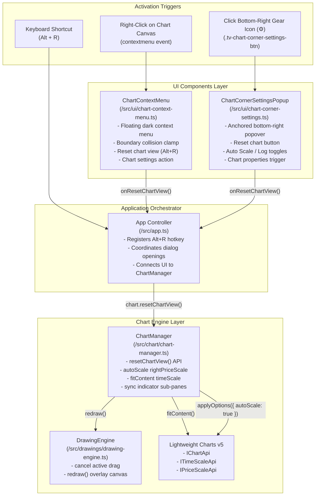
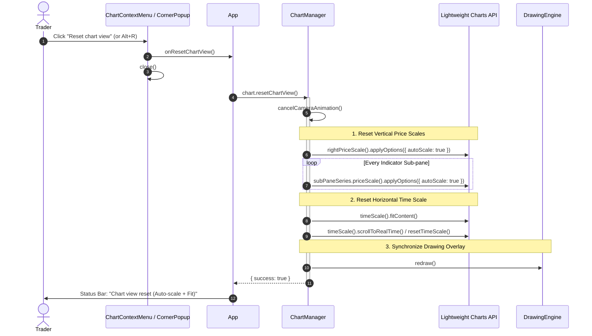

# ADR 0007: Chart Context Menu and Bottom-Right Floating Settings Popup Architecture with One-Click Chart View Reset

- **Status**: Accepted
- **Date**: 2026-11-03
- **Branch**: `drawing-tools`
- **Context**: Trading Chart Replay Terminal (`tv_chart_replay`)
- **Related Documents**:
  - [ADR 0001: Smooth Animations, Micro-Tick Interpolation, and Camera Panning](file:///d:/code/tv_chart_replay/docs/adr/0001-smooth-animations-options-and-tradeoffs.md)
  - [ADR 0003: Drawing Tools Engine Architecture, Interaction Model, and Shortcut Mapping](file:///d:/code/tv_chart_replay/docs/adr/0003-drawing-tools-architecture-and-interaction-model.md)
  - [ADR 0004: Drawing Tool Interaction Lifecycle, Handle Topology, and Snapping Engine Specification](file:///d:/code/tv_chart_replay/docs/adr/0004-drawing-tool-interaction-lifecycle-and-behavior-specification.md)
  - [ADR 0005: Position Drawing Tool Styling, Appearance, and Settings Model Architecture](file:///d:/code/tv_chart_replay/docs/adr/0005-position-drawing-tool-styling-appearance-and-settings-architecture.md)
  - [ADR 0006: Unified Drawing Tool Settings Dialog Architecture and Declarative Schema Engine](file:///d:/code/tv_chart_replay/docs/adr/0006-unified-drawing-tool-settings-dialog-architecture.md)
  - [TradingView Drawing Shortcuts Reference](file:///d:/code/tv_chart_replay/docs/tradingview-drawing-shortcuts.md)

---

## 1. Context and Problem Statement

In the Trading Chart Replay terminal, traders routinely interact with charts across multi-timeframe candle datasets, zoom in to inspect candle wick detail, drag the time axis into the past to study historical setups, and adjust price scales vertically to examine range contractions and expansions. 

However, during active charting sessions, several usability gaps degrade the user experience:

1. **No Quick Viewport Recovery ("Lost in Chart" Problem)**:
   - When a user pans deeply into historical bars or vertically scales price far off the screen, returning to the default auto-scaled, right-aligned viewpoint is cumbersome and unintuitive.
   - The user must manually pinch/drag both horizontal and vertical axes back into alignment.
2. **Missing TradingView Chart Context Menu**:
   - In TradingView Supercharts, right-clicking anywhere on the chart canvas immediately opens a context menu with **"Reset chart view" (Alt + R)** prominently at the top.
   - Currently, in `tv_chart_replay`, right-clicking on `#chart-container` triggers the standard browser context menu (or no-ops), failing TradingView behavioral parity.
3. **Absence of Corner Scale Controls and Settings Launcher**:
   - In TradingView, the bottom-right corner of the chart area (at the junction between the horizontal time scale and vertical price scale) hosts a dedicated settings gear icon (`⚙`).
   - Clicking this icon summons a floating popup popover containing immediate chart viewport actions (including **"Reset chart"** and scale behavior toggles).
   - Currently, the bottom-right scale junction is an empty void without interactive controls.

We require a coherent, modular architecture that delivers:
1. A **Right-Click Context Menu** on the chart featuring a **Reset Chart** action with shortcut hint (`Alt+R`).
2. A **Settings Icon** in the bottom-right corner of the chart area that opens a **Floating Popup Window** with a **Reset Chart** button and scale options.
3. A robust, deterministic **`resetChartView()` engine** integrated into `ChartManager` and Lightweight Charts v5.
4. Total separation of concerns, zero regression on existing drawing tool pointer events, and strict 1:1 TradingView visual ergonomics.

---

## 2. Decision Drivers

- **1:1 TradingView Ergonomics**: The context menu and bottom-right corner popup must replicate TradingView's visual geometry, dark palette (`#1e222d`, `#2a2e39`), font hierarchy, icon styling, keyboard hints (`Alt+R`), and backdrop blur.
- **Deterministic Reset Semantics**: "Reset Chart" must simultaneously reset horizontal time zoom/pan to the latest candles (`fitContent()` / `resetTimeScale()`), enable `autoScale: true` on the primary right price scale and all active sub-pane indicator scales, cancel running camera animations, and synchronously redraw the vector drawing canvas overlay.
- **Non-Interference with Vector Drawing Engine**: The HTML5 canvas drawing engine captures pointer events (`pointerdown`, `pointermove`, `pointerup`) with `{ capture: true }`. Right-click context menus (`button === 2` or `contextmenu` events) must be intercepted without breaking drawing anchor placement, dragging, or handle manipulation.
- **Viewport Boundary Awareness & Collision Avoidance**: Context menus and floating popovers must compute window boundaries dynamically, flipping position (top/bottom, left/right) so they are never clipped outside the screen or chart container.
- **Unified Dismissal Lifecycle**: Popups and context menus must dismiss automatically on outside click, Escape key press, window blur, or chart zoom/pan events.
- **Keyboard Parity**: `Alt + R` must globally trigger chart view reset across the entire application.

---

## 3. Evaluated Architectural Alternatives

| Architecture Alternative | Implementation Strategy | Pros | Cons | Verdict |
| :--- | :--- | :--- | :--- | :--- |
| **A. Monolithic Inline Implementation inside `ChartManager`** | Inject context menu DOM elements, bottom-right buttons, and click listeners directly inside `ChartManager.ts`. | Single file locality; direct access to Lightweight Charts private references. | Violates Single Responsibility Principle (SRP); bloats `ChartManager` (already >600 LOC) with UI DOM lifecycle, CSS handling, and popup management; hard to unit test in headless environments. | **Rejected** |
| **B. Native Browser Menu & Headless Event Listener** | Rely on browser-native right click menu or browser extension injection. | Minimal code footprint. | Look-and-feel completely violates TradingView UI; cannot customize items, icons, or shortcuts; cannot render the bottom-right corner popup. | **Rejected** |
| **C. Global Floating Window Manager Overlay** | Build a general-purpose desktop windowing manager with draggable OS-style floating windows for every UI feature. | Extreme flexibility. | Excessive complexity and overhead for a lightweight popover and context menu; does not match TradingView's lightweight anchored popover model. | **Rejected** |
| **D. Dedicated Component Pair (`ChartContextMenu` + `ChartCornerSettingsPopup`) Orchestrated via `App` & `ChartManager`** *(Adopted)* | Create modular, self-contained UI classes for `ChartContextMenu` and `ChartCornerSettingsPopup`, bound to `#chart-container`, delegating the core reset logic to a clean public method `ChartManager.resetChartView()`. | Strict separation of concerns; highly testable; reusable UI primitives; clean DOM encapsulation; flawless event delegation and boundary detection. | **Accepted** |

---

## 4. Technical Architecture & Component Specification

### 4.1 High-Level Component Topology



---

## 5. UI/UX & TradingView Ergonomics Specification

### 5.1 Right-Click Context Menu (`ChartContextMenu`)

#### 5.1.1 Menu Structure & Items
When a user right-clicks on the chart container (`#chart-container`), the browser's default context menu is suppressed (`e.preventDefault()`). A TradingView-style dark context menu appears at `(e.clientX, e.clientY)`:

```
+-------------------------------------------------+
|  [↺] Reset chart view                  Alt + R  | <-- Primary Requested Action
|-------------------------------------------------|
|  [⚙] Settings...                                |
|  [📋] Copy price                                |
|-------------------------------------------------|
|  [👁] Hide all drawings                         |
|  [🗑] Remove all drawings                        |
|  [📊] Remove all indicators                     |
+-------------------------------------------------+
```

#### 5.1.2 Viewport Boundary Collision Detection
To prevent the context menu from clipping off-screen when right-clicking near the right or bottom edges:
```typescript
// Position clamping logic
const menuWidth = 220;
const menuHeight = 240;
const padding = 8;

let x = e.clientX;
let y = e.clientY;

if (x + menuWidth > window.innerWidth - padding) {
  x = Math.max(padding, x - menuWidth);
}
if (y + menuHeight > window.innerHeight - padding) {
  y = Math.max(padding, y - menuHeight);
}
```

#### 5.1.3 Menu Item Specifications
- **Container**: `position: fixed; z-index: 10000; background: rgba(30, 34, 45, 0.98); backdrop-filter: blur(16px); border: 1px solid #2a2e39; border-radius: 8px; box-shadow: 0 8px 32px rgba(0,0,0,0.65); min-width: 210px; padding: 4px;`
- **Item Row**: `height: 32px; display: flex; align-items: center; justify-content: space-between; padding: 0 10px; border-radius: 4px; color: #d1d4dc; font-size: 13px; cursor: pointer; user-select: none;`
- **Hover State**: `background: #2a2e39; color: #ffffff;`
- **Shortcut Badge**: `font-size: 11px; font-family: 'JetBrains Mono', monospace; color: #787b86;`
- **Icons**: 14x14px SVG icons aligned left with 8px margin-right.

---

### 5.2 Bottom-Right Corner Settings Icon & Floating Popup (`ChartCornerSettingsPopup`)

#### 5.2.1 Placement in Scale Junction Box
In TradingView Supercharts, the vertical price scale (width ~85px) and horizontal time scale (height ~28px) intersect at the bottom-right corner. The settings gear icon is pinned precisely inside or above this junction:

```
+--------------------------------------------------------------------+ |
|                                                                    | |
|                          CHART CANVAS                              | | Price
|                                                                    | | Scale
|                                                                    | | (85px)
+--------------------------------------------------------------------+ |
|                 TIME SCALE BAR (28px)               |   [ ⚙ ]      | |
+-----------------------------------------------------+--------------+-+
                                                          ^
                                             Bottom-Right Settings Icon
```

- **DOM Host**: Appended to `#chart-container`.
- **CSS Geometry**:
  ```css
  .tv-chart-corner-settings-btn {
    position: absolute;
    right: 4px;
    bottom: 4px;
    width: 24px;
    height: 24px;
    display: flex;
    align-items: center;
    justify-content: center;
    background: transparent;
    border: 1px solid transparent;
    border-radius: 4px;
    color: var(--tv-fg-muted);
    cursor: pointer;
    z-index: 60; /* Above Lightweight Charts scale overlays (z-index ~20) */
    transition: all 0.15s ease;
  }
  .tv-chart-corner-settings-btn:hover,
  .tv-chart-corner-settings-btn.active {
    background: var(--tv-hover);
    color: var(--tv-fg-bright);
    border-color: var(--tv-border);
  }
  ```

#### 5.2.2 Floating Popup Window Layout
Clicking the corner settings icon toggles a floating card popup anchored directly above the button:

```
        +-----------------------------------------------+
        |  CHART SETTINGS                        [ ✕ ]  |
        |-----------------------------------------------|
        |  VIEWPORT ACTIONS                             |
        |  +-----------------------------------------+  |
        |  |  [↺] Reset chart view           Alt + R |  | <-- Primary Requested Button
        |  +-----------------------------------------+  |
        |                                               |
        |  PRICE SCALES                                 |
        |  [✓] Auto Scale                  (A)          |
        |  [ ] Invert Scale                             |
        |  [ ] Logarithmic Scale           (Alt + L)    |
        |                                               |
        |-----------------------------------------------|
        |  [⚙] Advanced Chart Properties...             |
        +-----------------------------------------------+
                                |
                              [ ⚙ ] (Bottom-Right Anchor)
```

- **Anchor Offset**: `bottom: 34px; right: 6px;`
- **Popup Container**: `position: absolute; width: 240px; background: rgba(30, 34, 45, 0.98); backdrop-filter: blur(16px); border: 1px solid #2a2e39; border-radius: 8px; box-shadow: 0 10px 36px rgba(0,0,0,0.7); z-index: 1000; padding: 8px;`
- **Primary Reset Button**:
  - Distinct interactive button with hover highlight (`#2962ff` subtle accent or `#2a2e39`).
  - Clicking triggers `onResetChartView()`, closes the popup, and emits visual feedback.

---

## 6. "Reset Chart" Engine Semantics & Lightweight Charts Mechanics

### 6.1 Exact Execution Flow

When "Reset Chart" is triggered (via Right-Click Context Menu, Floating Settings Popup, or `Alt+R` hotkey), `ChartManager.resetChartView()` executes the following sequence:



### 6.2 Lightweight Charts v5 Implementation Details

```typescript
/**
 * Restores the chart viewport to default auto-scaled and right-fitted bounds.
 * Corresponds to TradingView "Reset chart view" (Alt + R).
 */
public resetChartView(): void {
  if (!this.chart) return;

  // 1. Cancel any active smooth camera pan interpolations
  this.cancelCameraAnimation();

  // 2. Auto-scale primary candlestick price scale
  try {
    this.chart.priceScale('right').applyOptions({
      autoScale: true,
    });
  } catch {
    /* fallback if custom scale id */
  }

  // 3. Auto-scale any secondary indicator sub-pane price scales
  for (const series of this.indicatorSeries.values()) {
    try {
      series.priceScale().applyOptions({
        autoScale: true,
      });
    } catch {
      /* ignore */
    }
  }

  // 4. Reset time scale: fit historical content and return camera to current edge
  const timeScale = this.chart.timeScale();
  try {
    timeScale.fitContent();
    timeScale.resetTimeScale();
  } catch {
    /* ignore */
  }

  // 5. Invalidate and re-render vector drawing canvas overlay
  if (this.drawingEngine) {
    this.drawingEngine.redraw();
  }
}
```

---

## 7. Implementation Blueprint & Module Specification

### 7.1 Proposed File Layout

```
frontend/src/
├── chart/
│   └── chart-manager.ts              <-- Add resetChartView() & scale query methods
├── ui/
│   ├── chart-context-menu.ts         <-- NEW: Right-click context menu controller
│   ├── chart-corner-settings.ts      <-- NEW: Bottom-right gear button + floating popup
│   ├── icons.ts                      <-- Add reset_view icon (counter-clockwise arrow / TV reset)
│   └── escape.ts                     <-- Reusable string escaper
├── app.ts                            <-- Wire context menu, corner settings, and Alt+R
└── style.css                         <-- Add styling for .tv-chart-context-menu and .tv-chart-floating-popup
```

---

### 7.2 Interface Contracts

#### 7.2.1 `ChartContextMenu` Interface (`frontend/src/ui/chart-context-menu.ts`)
```typescript
export interface ChartContextMenuOptions {
  container: HTMLElement;
  onResetChartView: () => void;
  onOpenChartSettings?: () => void;
  onRemoveAllDrawings?: () => void;
  onRemoveAllIndicators?: () => void;
  onHideAllDrawings?: () => void;
}

export class ChartContextMenu {
  private menuEl: HTMLElement | null = null;
  private isOpen = false;

  constructor(private readonly options: ChartContextMenuOptions) {
    this.init();
  }

  private init(): void;
  public open(x: number, y: number): void;
  public close(): void;
  public destroy(): void;
}
```

#### 7.2.2 `ChartCornerSettingsPopup` Interface (`frontend/src/ui/chart-corner-settings.ts`)
```typescript
export interface ChartCornerSettingsOptions {
  chartContainer: HTMLElement;
  chartManager: import('../chart/chart-manager').ChartManager;
  onResetChartView: () => void;
  onOpenChartSettings?: () => void;
}

export class ChartCornerSettingsPopup {
  private buttonEl: HTMLButtonElement | null = null;
  private popupEl: HTMLElement | null = null;
  private isOpen = false;

  constructor(private readonly options: ChartCornerSettingsOptions) {
    this.init();
  }

  private init(): void;
  public toggle(): void;
  public open(): void;
  public close(): void;
  public destroy(): void;
}
```

---

### 7.3 Integration inside `App` (`frontend/src/app.ts`)

```typescript
// Inside App.start()
const chartContainer = requireElement('#chart-container');

// 1. Right-click Context Menu
this.chartContextMenu = new ChartContextMenu({
  container: chartContainer,
  onResetChartView: () => {
    this.chart.resetChartView();
    this.showStatusToast('Chart view reset');
  },
  onOpenChartSettings: () => {
    // future settings dialog or alert
  },
  onRemoveAllDrawings: () => {
    this.chart.getDrawingEngine()?.clearAll();
  },
});

// 2. Bottom-Right Corner Settings Button & Floating Popup
this.chartCornerSettings = new ChartCornerSettingsPopup({
  chartContainer,
  chartManager: this.chart,
  onResetChartView: () => {
    this.chart.resetChartView();
    this.showStatusToast('Chart view reset');
  },
});

// 3. Global Keyboard Shortcut (Alt + R)
window.addEventListener('keydown', (e: KeyboardEvent) => {
  if (e.altKey && (e.key === 'r' || e.key === 'R')) {
    e.preventDefault();
    this.chart.resetChartView();
    this.showStatusToast('Chart view reset');
  }
});
```

---

## 8. Event Coordination & Conflict Prevention

1. **Drawing Engine Pointer Conflict**:
   - `DrawingEngine` registers capturing pointer event listeners on `this.container`.
   - On `contextmenu` event, `e.button` is 2. `DrawingEngine` explicitly checks `if (e.button !== 0) return;` and ignores right clicks.
   - Therefore, attaching `contextmenu` on `#chart-container` cleanly intercepts right clicks without interrupting active drawings.
   - If a drawing is currently being placed (first point clicked, awaiting second point), opening the context menu or pressing Escape cleanly aborts the drawing placement in progress and dismisses the context menu.

2. **Outside Click Dismissal**:
   - Both `ChartContextMenu` and `ChartCornerSettingsPopup` register a capture listener for `pointerdown` on `document`.
   - If `!menuEl.contains(target) && !buttonEl.contains(target)`, the menus immediately close.
   - Any chart drag or wheel scroll immediately closes open popups to maintain high-performance chart panning.

---

## 9. Testing & Verification Strategy

### 9.1 Unit Testing (Vitest)
- **`ChartManager.resetChartView()`**:
  - Mock `lightweight-charts` API (`timeScale().fitContent`, `priceScale().applyOptions`).
  - Verify that invoking `resetChartView()` calls `cancelCameraAnimation()`, `fitContent()`, `autoScale: true`, and `drawingEngine.redraw()`.
- **`ChartContextMenu`**:
  - Test instantiation and DOM attachment.
  - Test `open(x, y)` boundary calculation: passing `(window.innerWidth - 10, window.innerHeight - 10)` must clamp coordinates within viewport bounds.
  - Test clicking "Reset chart view" item invokes callback and hides the menu.
  - Test Escape key closes the menu.
- **`ChartCornerSettingsPopup`**:
  - Test button rendering in bottom-right corner.
  - Test clicking button toggles `.active` class and shows popup.
  - Test clicking "Reset chart view" button inside popup invokes callback and closes popup.

### 9.2 End-to-End Verification (Playwright)
- Pan the chart to the left (drag >200px) and scale the price axis vertically.
- **Right-Click Test**:
  1. Trigger right-click on the chart canvas (`page.locator('#chart-container').click({ button: 'right' })`).
  2. Verify `.tv-chart-context-menu` appears visible.
  3. Click `text=Reset chart view`.
  4. Verify context menu closes and visible logical range resets to fit content.
- **Bottom-Right Settings Test**:
  1. Pan the chart away from default view.
  2. Click `.tv-chart-corner-settings-btn` in bottom-right corner.
  3. Verify `.tv-chart-floating-popup` appears.
  4. Click `button:has-text("Reset chart")`.
  5. Verify popup closes and chart returns to default auto-scale.
- **Keyboard Shortcut Test**:
  1. Zoom and pan the chart away.
  2. Press `Alt+R`.
  3. Verify chart view resets immediately.

---

## 10. Consequences & Trade-offs

### 10.1 Positive Consequences
- **Instant Usability Recovery**: Traders can never get permanently lost in a chart; one click or one shortcut (`Alt+R`) instantly restores full situational awareness.
- **100% TradingView Parity**: Follows standard TradingView behavior for right-click menus and corner settings.
- **Non-Invasive Architecture**: Keeps `ChartManager` lightweight and focused on chart data/scales, delegating UI to specialized components.
- **Future Extensibility**: The context menu and floating popup can easily accommodate future features (e.g., indicator presets, time-scale format toggles, screenshot triggers, or full chart settings dialog).

### 10.2 Negative / Mitigated Trade-offs
- **Scale Gutter Space Allocation**: The bottom-right button occupies a 24x24px footprint at the corner of the chart. 
  - *Mitigation*: In TradingView, this area is the inactive junction between the time and price scales. Positioning it at `bottom: 4px; right: 4px` ensures it never overlaps candle bars or critical axis numbers.

