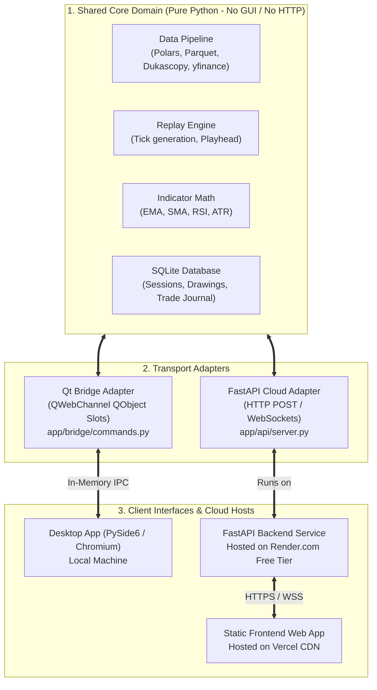

# ADR 0007: Dual Transport Architecture for Qt Desktop Shell and FastAPI Cloud Backend (Vercel & Render.com)

- **Status**: Accepted
- **Date**: 2026-11-02
- **Context**: Trading Chart Replay Terminal (`tv_chart_replay`)
- **Deployment Targets**:
  - **Desktop:** Native PySide6 (Qt) Shell + In-Memory `QWebChannel` IPC
  - **Frontend (Cloud):** Vercel Static Edge CDN (Free Hobby Tier)
  - **Backend (Cloud):** Render.com Native Python Web Service (Free Tier)
- **Related Documents**:
  - [Bridge Contract Specification](file:///d:/code/tv_chart_replay/docs/bridge-contract.md)
  - [Build Plan](file:///d:/code/tv_chart_replay/docs/BUILD_PLAN.md)
  - [Cloud Deployment Guide (Vercel & Render.com)](file:///d:/code/tv_chart_replay/docs/DEPLOYMENT_GUIDE.md)

---

## 1. Context and Problem Statement

The Trading Chart Replayer was originally designed as a local-first desktop application combining:
1. A **Python backend** (`app/`) responsible for data acquisition (Dukascopy, Yahoo Finance), normalization (Polars, Parquet), storage (SQLite), indicator calculation, and replay simulation.
2. A **PySide6 (Qt) desktop shell** (`app/main.py`) hosting a `QWebEngineView` Chromium window.
3. A **TypeScript/Vite frontend** (`frontend/`) rendering Lightweight Charts, custom canvas vector drawings, and trading controls.
4. An in-memory inter-process communication bridge powered by **`QWebChannel`**.

We require the ability to deploy the application across two distinct targets:
- **Desktop Target (Local):** High-performance desktop shell running offline on the user's workstation.
- **Cloud Target (Web):** The frontend hosted as a static Single Page Application (SPA) on **Vercel** connected over the internet to a Python backend hosted on **Render.com** (Free Web Service tier).

### Why Render.com + Vercel?
- **Hugging Face Spaces Gating:** Hugging Face recently gated Docker, Gradio, and Streamlit compute behind credit card verification and paid tiers.
- **Vercel Serverless Limitations:** While Vercel hosts static frontends perfectly, its serverless Python functions lack persistent WebSocket support (preventing continuous 60 FPS tick replay streaming) and enforce a strict 10-second timeout limit.
- **Render.com Free Tier Capabilities:** Render provides **100% free Python web services with no credit card required**, fully supporting long-lived **WebSockets**, HTTP/2, and standard Uvicorn execution.

We must establish an architecture that supports both deployment targets seamlessly without:
- Forking the codebase or duplicating core domain logic (data pipelines, indicators, database access).
- Regressing desktop performance or introducing firewall/port-conflict hurdles on local machines.
- Bloating cloud container images or server environments with unnecessary graphical desktop libraries (e.g. `PySide6`).

---

## 2. Decision Drivers

- **Zero Desktop Regression:** Desktop mode must preserve native in-memory Qt IPC performance, avoid opening local TCP listening ports, prevent Windows Defender/Firewall prompts, and operate fully offline.
- **Zero Cost Cloud Deployment:** Must run completely on free tiers (Vercel Hobby + Render.com Free) with **no credit card requirements**.
- **Full Streaming Support:** Cloud backend must support long-lived **WebSockets (`/ws`)** for real-time replay tick broadcasts, which rules out serverless-only hosting.
- **DRY (Don't Repeat Yourself) Core Domain:** All financial math, indicator algorithms, data normalization routines, and SQLite operations must reside in pure, framework-agnostic Python modules.
- **Polymorphic Frontend Client:** The TypeScript frontend must automatically detect its runtime environment (`window.qt` vs plain browser) and switch between Qt IPC and HTTP/WebSocket transport with zero manual code changes.

---

## 3. Evaluated Architectural Alternatives

### Alternative A: Dual Transport Adapters over a Shared Core (Selected)
Core domain logic is encapsulated in transport-agnostic service modules (`app/application.py`, `app/data/`, `app/replay/`, `app/indicators/`). Two thin adapter layers expose this core:
1. **`app/bridge/commands.py`**: Qt `QObject` slots for the desktop shell (`QWebChannel`).
2. **`app/api/server.py`**: FastAPI router endpoints (HTTP POST & WebSocket) for the cloud backend on Render.com.

*Pros:*
- Preserves ultra-fast native C++ memory IPC on desktop with zero networking overhead.
- Cloud backend runs headlessly via `requirements-cloud.txt`, excluding `PySide6` and keeping memory usage lean.
- Full WebSocket streaming supported out of the box on Render.com.

*Cons:*
- Requires maintaining two thin wrapper layers mapping requests to the core services.

---

### Alternative B: Unified Local HTTP Server (FastAPI Everywhere)
Remove `QWebChannel` entirely. On desktop, `app/main.py` starts a background `uvicorn` instance on `127.0.0.1:<port>`, and the desktop webview connects to `localhost`. The identical FastAPI server runs on Render.com.

*Pros:*
- Single communication protocol for both desktop and web.
- Only one backend adapter to maintain.

*Cons:*
- Triggers OS firewall warnings on user desktops.
- Potential TCP port collisions with other local software.
- Added latency for high-frequency tick replay compared to direct Qt memory IPC.
- Requires local authentication/token management to prevent malicious local processes from accessing the user's trading database.

---

### Alternative C: All-in-One Vercel (Frontend + Python Serverless Functions)
Deploy both the frontend and a Python backend to Vercel using Vercel Serverless Functions (`api/index.py`).

*Pros:*
- Single provider (Vercel only), zero CORS issues.

*Cons:*
- **No WebSockets:** Cannot stream replay ticks continuously; forces polling or client-side only replay.
- **10-second timeout:** Abruptly terminates longer historical data downloads.
- **Rejected** because persistent tick streaming is a foundational architectural requirement.

---

## 4. Decision: Adopt Alternative A with Render.com & Vercel

We adopt **Alternative A**. The architecture is structured into three clean tiers:

---

## 5. Render.com Free Tier Constraints & Mitigations

Deploying the Python backend to Render's free tier introduces specific constraints that our architecture explicitly accommodates:

| Constraint | Impact | Architectural Mitigation |
| :--- | :--- | :--- |
| **512 MB RAM Limit** | Massive tick downloads (e.g. 5 years of 1m ticks) can trigger Out-Of-Memory (OOM) termination. | Core data loaders request bounded candle windows (e.g., 30–90 days or 1H timeframes) instead of unbounded tick history. Polars streaming queries minimize peak RSS memory. |
| **15-Min Inactivity Sleep** | Server spins down when no requests arrive for 15 minutes; cold starts take ~45s. | Client-side keep-alive system in `python-bridge.ts` sends `GET /health` pings every 14 minutes during active sessions. Pings automatically stop after 4 hours of user inactivity to conserve free quota, and resume immediately upon user interaction. |
| **Ephemeral Disk** | Local Parquet and SQLite cache in `/data` resets on spin-down or redeploy. | In-memory session synchronization; datasets are fetched on-demand from upstream providers (Yahoo Finance / Dukascopy) and cached in the transient container filesystem. |
| **WebSockets** | Continuous streaming ticks. | Render natively proxies WebSockets over HTTPS/WSS with no custom configuration needed. |

---

## 6. Implementation Specifications

### 6.1. Dependency Segregation

We maintain two explicit requirements files to ensure the cloud backend remains lightweight and headless:

1. **`requirements.txt` (Desktop Development & Distribution):**
   - Includes `PySide6`, `pydantic`, `polars`, `dukascopy-python`, `yfinance`, `fastapi`, `uvicorn`, etc.
2. **`requirements-cloud.txt` (Headless Cloud Backend for Render.com):**
   - Includes `fastapi`, `uvicorn[standard]`, `pydantic`, `polars`, `dukascopy-python`, `yfinance`, `websockets`.
   - **Excludes** `PySide6`.

---

### 6.2. Frontend Bridge Polymorphism

The TypeScript bridge client in [`frontend/src/bridge/python-bridge.ts`](file:///d:/code/tv_chart_replay/frontend/src/bridge/python-bridge.ts) implements automatic transport resolution:

1. **Check for Qt Environment:**
   If `typeof window !== 'undefined' && window.qt?.webChannelTransport` exists:
   - Initialize and bind `QWebChannelTransport`.
   - Dispatch calls directly through Qt's in-process C++ slots.
2. **Check for Cloud Environment:**
   If `window.qt` is absent and `VITE_BACKEND_URL` is set:
   - Route `callJson(method, payload)` to `POST ${VITE_BACKEND_URL}/api/${method}`.
   - Connect streaming events to `wss://${VITE_BACKEND_URL}/ws`.
3. **Offline Browser Fallback:**
   If neither is reachable, degrade gracefully to client-side synthetic simulation (**Browser Mode**).

---

## 7. Consequences & Trade-offs

### Positive
- **100% Free Forever:** Zero cloud cost with no credit card required on either Vercel or Render.com.
- **Optimal Desktop User Experience:** Desktop users retain instant startup, zero network lag, and no intrusive firewall authorization alerts.
- **Full WebSocket Streaming:** Traders get continuous real-time replay tick streaming in web browsers.
- **Clean Architectural Boundaries:** Enforces strict decoupling of business math from presentation and communication frameworks.

### Negative / Maintenance Overhead
- **Render Cold Starts:** First visit after 15 minutes of inactivity experiences a ~45-second wake-up delay.
- **Contract Synchronization:** Any new API method or bridge slot must be registered in both `app/bridge/commands.py` (Qt) and `app/api/server.py` (FastAPI).
- **Mitigation:** A shared Pydantic request/response schema repository ensures strict compile-time and runtime type validation across both adapters.
