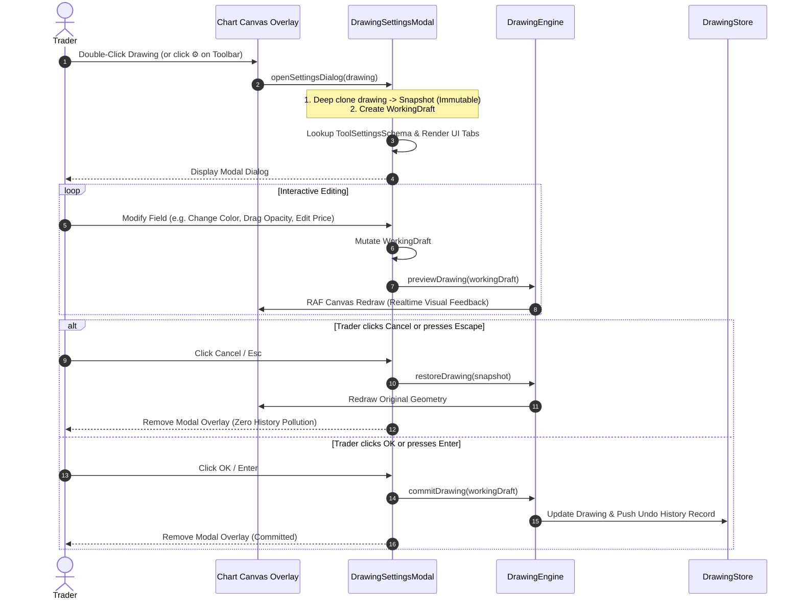

# TradingView Drawing Tools Settings Dialog Specification & Unified Design System

- **Author**: Antigravity Core Architecture Team
- **Date**: 2026-11-02
- **Status**: Approved Specification
- **Engine**: Trading Chart Replay Terminal (`tv_chart_replay`)
- **Companion ADR**: [ADR 0006: Unified Drawing Tool Settings Dialog Architecture](file:///d:/code/tv_chart_replay/docs/adr/0006-unified-drawing-tool-settings-dialog-architecture.md)
- **Reference Catalog**: [TradingView Drawing Tool Behaviors Reference](file:///d:/code/tv_chart_replay/docs/tradingview-drawing-tool-behaviors.md)

---

## 1. Executive Overview & Design Objectives

In professional technical trading terminals such as TradingView, chart drawing tools are far more than static vector strokes; they are dynamic analytical models with precise geometric coordinates, customized mathematical ratios, financial risk-management algorithms, and multi-timeframe visibility constraints.

This document establishes the definitive UI/UX design, visual tokens, layout wireframes, tabbed navigation architecture, and data contracts for the **Unified Drawing Tool Settings Dialog** (`DrawingSettingsModal`) across all **92 drawing tools** supported by the `tv_chart_replay` platform.

### Core Architectural Objectives

1. **1:1 TradingView Supercharts Ergonomic Parity**: Zero cognitive friction for discretionary traders. Dialog geometry, tab order (`Inputs`, `Style`, `Text`, `Coordinates`, `Visibility`), color swatches, opacity sliders, and template menus mirror TradingView down to the pixel.
2. **Polymorphic Schema-Driven UI**: A unified dialog engine renders appropriate tabs and control groups based on a declarative schema for each drawing tool type, eliminating code bloat and fragmented UI logic.
3. **Transactional Live Preview & Zero-Risk Rollback**: Changes made inside the dialog project immediately onto the chart canvas in real time ($60\text{ FPS}$). Closing via `Cancel` or `Escape` cleanly rolls back to an immutable snapshot without dirtying the Undo/Redo history.
4. **Componentized Widget Primitives**: Standardized, reusable components (`ColorOpacityPicker`, `LineWidthAndStyleSelector`, `LevelsMatrixTable`, `CoordinatesPointEditor`, `TimeframeVisibilityMatrix`, `TemplateManager`).
5. **Universal Multi-Timeframe Filtering**: Eliminates chart clutter by allowing drawings to appear only on designated timeframe intervals (seconds, minutes, hours, days, weeks, months).
6. **Persistent Template Presets**: Direct access to local storage-backed user style templates (`Save As...`, `Apply Default`, `Save as Default`).

---

## 2. Universal Dialog Shell Anatomy & Wireframes

### 2.1 Visual Wireframe of the Universal Dialog Shell

```
+-----------------------------------------------------------------------------------+
|  [Icon] TREND LINE SETTINGS                       EURUSD · 1h                 [✕] |  <-- Header
+-----------------------------------------------------------------------------------+
|  [ Inputs ]   [ Style ]   [ Text ]   [ Coordinates ]   [ Visibility ]             |  <-- Dynamic Tab Bar
+-----------------------------------------------------------------------------------+
|                                                                                   |
|   Line                                                                            |
|   Color & Opacity:  [ #2962ff ][Swatch]  Opacity: [======o=======] 100%           |
|   Thickness:        [ 1px ] [ 2px ] [ 3px ] [ 4px ]                               |
|   Line Style:       [ Solid (—) ] [ Dashed (---) ] [ Dotted (···) ]               |
|                                                                                   |
|   Extensions & Markers                                                            |
|   [x] Extend Left              [ ] Extend Right                                   |
|   [ ] Middle Point             [x] Show Price Labels                              |
|   Left End:  [ Normal      ▾]  Right End: [ Arrow        ▾]                       |
|                                                                                   |
|   Stats & Metrics (Info Line)                                                     |
|   [x] Show Bars Range          [x] Show Distance (Pips)                           |
|   [ ] Show Angle               [ ] Always Show Stats                              |
|                                                                                   |
+-----------------------------------------------------------------------------------+
|  [ Template ▾ ]                                            [ Cancel ]   [   OK   ] |  <-- Footer Bar
+-----------------------------------------------------------------------------------+
```

### 2.2 Shell Component Breakdown

1. **Header Bar**:
   - **Tool Icon**: Vector SVG representing the active tool (e.g. Trend Line icon, Fib Retracement icon).
   - **Title Badge**: Name of the tool formatted as uppercase bold typography (e.g., `TREND LINE`, `FIB RETRACEMENT`, `LONG POSITION`).
   - **Subtitle Context**: Active trading pair and chart timeframe (e.g., `EURUSD · 1h`).
   - **Close Button (`✕`)**: Top-right corner; executes instant cancellation and rollback.
2. **Dynamic Tab Navigation Bar**:
   - Displays only the tabs applicable to the selected tool.
   - Tabs appear in strict TradingView order: `[ Inputs ]` $\to$ `[ Style ]` $\to$ `[ Text ]` $\to$ `[ Coordinates ]` $\to$ `[ Visibility ]`.
   - Active tab features an accented bottom highlight indicator (`#2962ff`) with elevated typography.
3. **Scrollable Content Panel**:
   - High-contrast, dark-themed container (`#1e222d` background) with customized compact scrollbars.
   - Controls are partitioned into logical fieldsets with subtle dividing borders (`#2a2e39`).
4. **Footer Action Bar**:
   - **Template Preset Menu (Left)**: Popover dropdown for `Template ▾` providing preset management.
   - **Action Buttons (Right)**:
     - `Cancel` (Secondary, neutral `#2a2e39` button, keyboard shortcut: `Escape`).
     - `OK` / `Save` (Primary accented `#2962ff` button, keyboard shortcut: `Enter`).
     - _Optional Context Action_: For `long_position` / `short_position`, an additional green `Create Order` button is present.

---

## 3. Comprehensive Specifications for the Five Settings Tabs

```mermaid
graph TD
    Modal["DrawingSettingsModal Shell"]
    Modal --> TabInputs["1. [ Inputs ]"]
    Modal --> TabStyle["2. [ Style ]"]
    Modal --> TabText["3. [ Text ]"]
    Modal --> TabCoords["4. [ Coordinates ]"]
    Modal --> TabVis["5. [ Visibility ]"]

    TabInputs --> PosCalc["Financial Risk / Position Calculator"]
    TabInputs --> VWAPInputs["Anchor Time, Source, Bands Multipliers"]
    TabInputs --> RegInputs["Polynomial Degree, Dev Multipliers"]

    TabStyle --> StrokeOpts["Color, Opacity, Width, Solid/Dashed/Dotted"]
    TabStyle --> ExtOpts["Extend Left/Right, Rays, Endcaps, Midpoint"]
    TabStyle --> FibMatrix["24-Level Ratio Table (Coeff, Color, Width, Fill)"]
    TabStyle --> PosStyle["Target/Stop Zone Colors, Opacities, Compact Stats"]

    TabText --> TextEditor["Multiline Content Textarea"]
    TabText --> Typography["Font Size (10-40px), Bold, Italic, Color"]
    TabText --> Alignment["9-Point Alignment Grid (H: L/C/R, V: T/M/B)"]
    TabText --> Container["Box Fill, Opacity, Border Color & Width"]

    TabCoords --> PointList["Point 1 .. Point N Anchor Editors"]
    PointList --> PriceInp["Tick-Precision Price Stepper"]
    PointList --> BarTimeInp["Synchronized Bar Index & ISO DateTime Picker"]

    TabVis --> IntervalBuckets["Ticks, Seconds, Minutes, Hours, Days, Weeks, Months"]
    IntervalBuckets --> RangeSliders["Min-Max Interval Ranges (e.g. 1m - 59m)"]
```



---

### 3.1 Tab 1: `[ Inputs ]` Tab

Active exclusively for tools that incorporate underlying financial calculations, quantitative statistical algorithms, or anchored mathematical models.

#### A. Long & Short Position Tools (`long_position`, `short_position`)

Mirrors the high-fidelity financial modeling specified in [ADR 0005](file:///d:/code/tv_chart_replay/docs/adr/0005-position-drawing-tool-styling-appearance-and-settings-architecture.md):

| Control Label        | Control Widget   | Default Value    | Description & Constraints                                  |
| :------------------- | :--------------- | :--------------- | :--------------------------------------------------------- |
| **Account Size**     | `NumberStepper`  | `10,000`         | Account equity in cash currency (min: 100, step: 500).     |
| **Account Currency** | `TextInput`      | `USD`            | ISO 4217 Currency Code (USD, EUR, GBP, JPY).               |
| **Risk Mode**        | `SelectDropdown` | `% of Account`   | Toggle: `PERCENT` vs `CASH`.                               |
| **Risk Amount / %**  | `NumberStepper`  | `1.0%` / `$100`  | Cash or equity fraction risked on the trade.               |
| **Entry Price**      | `NumberStepper`  | `Point[0].price` | Open price level of the trade.                             |
| **Profit Level**     | `NumberStepper`  | `Point[1].price` | Take profit target price or ticks/pips.                    |
| **Stop Level**       | `NumberStepper`  | `Point[2].price` | Stop loss price or ticks/pips.                             |
| **Account Leverage** | `SelectDropdown` | `1x` (Cash)      | Multiplier: `1x`, `2x`, `5x`, `10x`, `20x`, `50x`, `100x`. |
| **Lot Precision**    | `SelectDropdown` | `2 Decimals`     | Fractional lot rounding (`0`, `1`, `2`, `3`).              |

_Live Reactive Financial Summary Card_:
Embedded directly below inputs, computing in real-time on every keystroke:

- **Position Size**: `Q = (Account Equity × Risk%) / (Entry - Stop)` in standard lots.
- **Risk / Reward Ratio**: Normalized as `1 : R` (e.g. `1 : 2.50`).
- **Risk Capital**: Monetary loss at stop loss including pip distance.
- **Projected Profit**: Monetary gain at take profit including pip distance.
- **Margin Warning**: Flags red banner if required margin `(Q × Contract Size × Price) / Leverage` exceeds Account Size.

#### B. Anchored VWAP (`anchored_vwap`)

- **Anchor Date/Time**: DateTime picker defining the session/candle anchor origin.
- **Source**: Price basis for VWAP calculation (`hlc3`, `close`, `hl2`, `ohlc4`).
- **Bands Calculation Mode**: Standard Deviation vs Percentage vs None.
- **Band Multipliers**: Band 1 (`1.0σ`), Band 2 (`2.0σ`), Band 3 (`3.0σ`).

#### C. Fixed Range Volume Profile (`fixed_range_volume_profile`)

- **Row Layout**: Number of Rows vs Ticks per Row.
- **Row Size**: Numerical value (default: `24` rows).
- **Volume Type**: Up/Down Volume vs Total Volume vs Delta.
- **Value Area Volume**: Percentage of volume in Value Area (default: `70%`).

#### D. Regression Channel (`regression_channel`)

- **Source**: Price basis (`close`, `open`, `high`, `low`, `hlc3`).
- **Upper / Lower Deviations**: Standard deviation multipliers (default: `2.0σ`).
- **Use Upper / Lower Channel**: Independent toggles.
- **Display Pearson's R**: Toggles statistical correlation coefficient label.

---

### 3.2 Tab 2: `[ Style ]` Tab

The core visual customization tab. Controls rendering strokes, opacities, endpoints, fills, ratio matrices, and axis scale markers.

#### A. Universal Stroke & Line Controls

- **Color Swatch & Native Picker**: 6 instant palette chips (`#2962ff`, `#089981`, `#f23645`, `#ff9800`, `#ab47bc`, `#ffffff`) plus native HTML5 color input.
- **Opacity Slider**: Horizontal range slider ($0\%\text{--}100\%$) controlling stroke alpha transparency.
- **Line Width**: Segmented button pills: `[ 1px ]`, `[ 2px ]`, `[ 3px ]`, `[ 4px ]`.
- **Line Style**: Visual dropdown or segmented buttons: `[ Solid (—) ]`, `[ Dashed (---) ]`, `[ Dotted (···) ]`.

#### B. Directional & Extension Controls

- **Extend Left**: Checkbox; projects line indefinitely toward the past ($-\infty$).
- **Extend Right**: Checkbox; projects line indefinitely toward the future ($+\infty$).
- **Ray Mode**: Single-direction infinite projection from Point 1 through Point 2.
- **Middle Point**: Checkbox; renders a centered snap vertex handle at $50\%$ line length.
- **Price Labels**: Checkbox; renders real-time price scale tags on the chart's vertical price axis.
- **Left End Marker**: Dropdown: `Normal`, `Arrow`, `Circle`.
- **Right End Marker**: Dropdown: `Normal`, `Arrow`, `Circle`.

#### C. Geometric Shapes & Background Fills

- **Fill Background**: Toggle checkbox enabling shape interior color.
- **Background Color**: Independent color picker for fill.
- **Background Opacity**: Dedicated slider ($0\%\text{--}100\%$, defaulting to $20\%$).

#### D. Fibonacci & Pitchfork Multi-Level Ratio Matrix

For tools with multi-ratio grids (`fib_retracement`, `fib_extension`, `fib_channel`, `pitchfork`, `gann_box`):

```
+-----------------------------------------------------------------------------------+
|  [x] Trend Line: [#787b86][■] 1px (—)         [x] Use One Color: [#2962ff][■]     |
|  [x] Background Fill   Opacity: [===o===============] 15%      [ ] Reverse Levels |
|                                                                                   |
|  Ratio Levels Table:                                                              |
|  [x] 0.000  [#787b86][■] 1px (—)      [x] 0.618  [#089981][■] 1px (—)             |
|  [x] 0.236  [#787b86][■] 1px (—)      [x] 0.786  [#ff9800][■] 1px (—)             |
|  [x] 0.382  [#f23645][■] 1px (—)      [x] 1.000  [#787b86][■] 1px (—)             |
|  [x] 0.500  [#2962ff][■] 1px (—)      [x] 1.618  [#089981][■] 1px (—)             |
|  [ ] 0.650  [#089981][■] 1px (—)      [ ] 2.618  [#ab47bc][■] 1px (—)             |
|                                                                                   |
|  Display & Labels:                                                                |
|  [x] Show Prices          [x] Show Levels: (o) Values  ( ) Percents               |
|  Labels Alignment H: [ Left ▾ ]       Labels Alignment V: [ Top ▾ ]               |
|  [ ] Extend Lines Left    [x] Extend Lines Right    [ ] Logarithmic Scale Levels  |
+-----------------------------------------------------------------------------------+
```

- **Level Checkboxes**: 24 distinct levels (including standard Fibonacci extensions and Golden Pocket ratios: `0`, `0.236`, `0.382`, `0.5`, `0.618`, `0.65`, `0.786`, `1.0`, `1.272`, `1.414`, `1.618`, `2.0`, `2.618`, `3.618`, `4.236`, `-0.236`, `-0.382`, `-0.618`).
- **Independent Color & Stroke**: Each level ratio row has its own color swatch and line thickness selector.
- **Use One Color**: Master checkbox forcing all active ratio levels to inherit a single designated color.
- **Background Fill**: Shading applied between successive active levels with configurable global opacity ($0\%\text{--}100\%$).
- **Reverse**: Inverts $0\%$ and $100\%$ anchor assignments.
- **Prices & Levels Display**: Toggles price level tags, numeric ratio labels, and percentage formatting (`61.8%` vs `0.618`).
- **Label Alignment**: 6-way position matrix (Horizontal: `Left`, `Center`, `Right`; Vertical: `Top`, `Middle`, `Bottom`).

#### E. Position Tool Appearance (Long/Short)

- **Profit Target Zone Color**: Default `#089981` (Green) with opacity slider ($0\%\text{--}100\%$, default $20\%$).
- **Stop Loss Zone Color**: Default `#f23645` (Red) with opacity slider ($0\%\text{--}100\%$, default $20\%$).
- **Compact Stats Mode**: Single-line condensed summary pill vs 3-line card.
- **Always Show Stats**: Displays the central metrics badge permanently rather than on selection/hover.
- **Show Price Labels**: Toggles entry, target, and stop price badges on the vertical axis scale.

---

### 3.3 Tab 3: `[ Text ]` Tab

Dedicated to typography, text annotation, alignment, and container card styling. Active for annotation tools (`text`, `callout`, `balloon`, `note`, `signpost`, `price_note`) and geometric shapes with embedded text labels (`rectangle`, `trend_line`, `parallel_channel`).

```
+-----------------------------------------------------------------------------------+
|  Text Content:                                                                    |
|  +-----------------------------------------------------------------------------+  |
|  | Breakout of daily resistance; retesting support zone with high volume...     |  |
|  +-----------------------------------------------------------------------------+  |
|                                                                                   |
|  Typography:                                                                      |
|  Font Size: [ 14px ▾ ]      Style: [ Bold (B) ] [ Italic (I) ]                     |
|  Text Color: [#ffffff][■]   [x] Word Wrap                                         |
|                                                                                   |
|  Alignment:                                                                       |
|  Horizontal: [ Left (◄) ] [ Center (▲) ] [ Right (►) ]                             |
|  Vertical:   [ Top (▲) ]  [ Middle (■) ] [ Bottom (▼) ]                            |
|                                                                                   |
|  Text Box Container:                                                              |
|  [x] Background: [#1e222d][■]  Opacity: [======o=======] 85%                       |
|  [x] Border:     [#363a45][■]  Width:   [ 1px ▾ ]                                  |
+-----------------------------------------------------------------------------------+
```

1. **Multiline Textarea**: Auto-resizing text field supporting multiple lines and clipboard paste.
2. **Typography Controls**:
   - **Font Size**: Select dropdown offering standard sizes: `10px`, `12px`, `14px`, `16px`, `20px`, `24px`, `28px`, `32px`, `40px`.
   - **Font Weight & Slant**: Segmented toggle buttons for **Bold** (`B`) and _Italic_ (`I`).
   - **Text Color**: Palette swatches and custom color picker.
   - **Word Wrap**: Checkbox; wraps text within the bounds of a shape or restricts callout width.
3. **9-Point Alignment Grid**:
   - **Horizontal Alignment**: `Left`, `Center`, `Right`.
   - **Vertical Alignment**: `Top`, `Middle`, `Bottom`.
4. **Text Container Box**:
   - **Background Fill**: Toggle checkbox, background color swatch, and opacity slider.
   - **Border Stroke**: Toggle checkbox, border color swatch, and border width stepper.

---

### 3.4 Tab 4: `[ Coordinates ]` Tab

Provides exact mathematical numerical control over anchor vertices. Allows discretionary and algorithmic traders to align drawings with precise price highs/lows and historical candle timestamps without mouse jitter.

```
+-----------------------------------------------------------------------------------+
|  Point 1 (Start Anchor)                                                           |
|  Price:      [ 1.0854200 ▲▼ ]                                                     |
|  Bar Index:  [ 1042 ▲▼ ]        Date/Time: [ 2026-11-02 14:30:00 📅 ]             |
|                                                                                   |
|  Point 2 (End Anchor)                                                             |
|  Price:      [ 1.0921000 ▲▼ ]                                                     |
|  Bar Index:  [ 1088 ▲▼ ]        Date/Time: [ 2026-11-02 18:15:00 📅 ]             |
|                                                                                   |
|  Point 3 (Channel / Extrusion Offset)                                             |
|  Price:      [ 1.0815000 ▲▼ ]                                                     |
|  Bar Index:  [ 1042 ▲▼ ]        Date/Time: [ 2026-11-02 14:30:00 📅 ]             |
+-----------------------------------------------------------------------------------+
```

1. **Dynamic Point Resolution**:
   - The dialog automatically renders Point 1 through Point $N$ based on the tool's point count ($N = 1$ for horizontal lines, $N = 2$ for trendlines and rectangles, $N = 3$ for channels and pitchforks, $N = 5$ for Elliott Waves, $N = 7$ for Head & Shoulders).
2. **Tick-Precision Price Inputs**:
   - Stepper input matching the exact fractional tick size of the chart symbol (e.g. 5 decimals for EUR/USD: `0.00001`, 2 decimals for equities/crypto: `0.01`).
3. **Synchronized Bar Index & DateTime**:
   - Editing the Bar Index automatically synchronizes the Date/Time picker to the candle's open timestamp.
   - Picking a calendar Date/Time resolves the nearest candle bar index via binary search over the chart's historical bar array.

---

### 3.5 Tab 5: `[ Visibility ]` Tab

Manages multi-timeframe display filtering. Discretionary traders often require macro drawings (e.g. Daily support/resistance zones, Weekly Fibonacci levels) to remain visible across all timeframes, while micro scalping structures (1-minute trendlines, 5-minute rectangles) must be hidden on higher timeframe charts to prevent clutter.

```
+-----------------------------------------------------------------------------------+
|  Interval Visibility Filters                                                      |
|                                                                                   |
|  [ ] Ticks                                                                        |
|  [x] Seconds:   Range from [  1 ] to [ 59 ] seconds                               |
|  [x] Minutes:   Range from [  1 ] to [ 59 ] minutes                               |
|  [x] Hours:     Range from [  1 ] to [ 24 ] hours                                 |
|  [x] Days                                                                         |
|  [x] Weeks                                                                        |
|  [x] Months                                                                       |
|                                                                                   |
|  Quick Visibility Presets:                                                        |
|  [ All Timeframes ]   [ Intraday Only (< 1D) ]   [ Higher Timeframes (≥ 1D) ]     |
+-----------------------------------------------------------------------------------+
```

1. **Granularity Interval Buckets**:
   - **Ticks**: Simple toggle for tick-level charts.
   - **Seconds**: Toggle + lower/upper range stepper (`1s` to `59s`).
   - **Minutes**: Toggle + lower/upper range stepper (`1m` to `59m`).
   - **Hours**: Toggle + lower/upper range stepper (`1h` to `24h`).
   - **Days**, **Weeks**, **Months**: Individual toggles for daily, weekly, and monthly charts.
2. **Quick Visibility Filter Presets**:
   - **All Timeframes**: Activates all intervals.
   - **Intraday Only**: Activates Minutes and Hours; disables Days, Weeks, and Months.
   - **Higher Timeframes Only**: Disables Seconds and Minutes; activates Days, Weeks, and Months.
3. **Runtime Evaluation**:
   - The drawing engine evaluates visibility during every canvas redraw cycle:
     $$\text{isVisible} = \text{drawing.visible} \land \text{evaluateVisibility(drawing.visibility, currentChartTimeframe)}$$

---

## 4. Comprehensive 92-Tool Settings Schema & Tab Matrix

The table below catalogs all 92 supported tools, mapping their category, available tabs, default tab, and specific functional settings controls:

| #         | Tool Type Identifier         | Category          | Available Tabs               | Default Tab | Specialized Setting Controls                                                                                   |
| :-------- | :--------------------------- | :---------------- | :--------------------------- | :---------- | :------------------------------------------------------------------------------------------------------------- |
| **1**     | `trend_line`                 | Directional Lines | `Style, Text, Coords, Vis`   | `Style`     | Line style, extend left/right, midpoint, price labels, left/right endcaps.                                     |
| **2**     | `ray`                        | Directional Lines | `Style, Text, Coords, Vis`   | `Style`     | Line style, extend right (fixed true), midpoint, price labels.                                                 |
| **3**     | `info_line`                  | Directional Lines | `Style, Text, Coords, Vis`   | `Style`     | Line style, show distance, show pips, show angle, show bars range.                                             |
| **4**     | `extended_line`              | Directional Lines | `Style, Text, Coords, Vis`   | `Style`     | Line style, extend left/right (fixed true), midpoint, price labels.                                            |
| **5**     | `trend_angle`                | Directional Lines | `Style, Text, Coords, Vis`   | `Style`     | Line style, angle degree badge display, extend right.                                                          |
| **6**     | `horizontal_line`            | Directional Lines | `Style, Text, Coords, Vis`   | `Style`     | Infinite horizontal projection, price label on vertical scale, text tag.                                       |
| **7**     | `horizontal_ray`             | Directional Lines | `Style, Text, Coords, Vis`   | `Style`     | Single-direction right projection, price label on vertical scale.                                              |
| **8**     | `vertical_line`              | Directional Lines | `Style, Text, Coords, Vis`   | `Style`     | Infinite vertical projection, time label on horizontal time scale.                                             |
| **9**     | `cross_line`                 | Directional Lines | `Style, Text, Coords, Vis`   | `Style`     | Dual axis crosshair projection, time & price scale markers.                                                    |
| **10**    | `arrow`                      | Directional Lines | `Style, Text, Coords, Vis`   | `Style`     | Arrowhead styling, line width, color, extend left/right.                                                       |
| **11**    | `arrow_marker`               | Directional Lines | `Style, Coords, Vis`         | `Style`     | 1-point instant directional pointer icon, color, size.                                                         |
| **12**    | `fib_retracement`            | Fibonacci / Gann  | `Style, Coords, Vis`         | `Style`     | 24-level ratio table, individual colors, background fill opacity, reverse, prices, levels %, labels alignment. |
| **13**    | `fib_extension`              | Fibonacci / Gann  | `Style, Coords, Vis`         | `Style`     | 3-point trend-based extension matrix, ratio levels, background shading, reverse.                               |
| **14**    | `fib_projection`             | Fibonacci / Gann  | `Style, Coords, Vis`         | `Style`     | Alternate price projection matrix, ratios, level labels.                                                       |
| **15**    | `fib_timezones`              | Fibonacci / Gann  | `Style, Coords, Vis`         | `Style`     | Time ratio intervals (1, 2, 3, 5, 8, 13, 21), vertical lines color/style.                                      |
| **16**    | `fib_channel`                | Fibonacci / Gann  | `Style, Coords, Vis`         | `Style`     | Diagonal channel ratio lines, background fill, extend left/right.                                              |
| **17**    | `fib_speed_fan`              | Fibonacci / Gann  | `Style, Coords, Vis`         | `Style`     | Fan radial angle ratios (0.382, 0.5, 0.618), fan background fills.                                             |
| **18**    | `fib_circles`                | Fibonacci / Gann  | `Style, Coords, Vis`         | `Style`     | Concentric Fibonacci radial circles, ratio rings, line widths.                                                 |
| **19**    | `gann_fan`                   | Fibonacci / Gann  | `Style, Coords, Vis`         | `Style`     | 1x8, 1x4, 1x2, 1x1, 2x1, 4x1, 8x1 Gann angle rays, ray colors.                                                 |
| **20**    | `gann_box`                   | Fibonacci / Gann  | `Style, Coords, Vis`         | `Style`     | 2D price-time grid, price ratios, time ratios, box background fills.                                           |
| **21**    | `pitchfork`                  | Pitchforks        | `Style, Coords, Vis`         | `Style`     | Median line, 8 level lines, background fill opacity, extend lines.                                             |
| **22**    | `schiff_pitchfork`           | Pitchforks        | `Style, Coords, Vis`         | `Style`     | Modified origin Schiff median calculation, level lines, fill opacity.                                          |
| **23**    | `modified_schiff_pitchfork`  | Pitchforks        | `Style, Coords, Vis`         | `Style`     | Halfway price/time origin recalculation, levels, background fill.                                              |
| **24**    | `inside_pitchfork`           | Pitchforks        | `Style, Coords, Vis`         | `Style`     | Midpoint inversion geometry, levels, fill opacity.                                                             |
| **25**    | `parallel_channel`           | Channels          | `Style, Coords, Vis`         | `Style`     | Parallel upper/lower boundaries, median line, background fill opacity, extend left/right.                      |
| **26**    | `regression_channel`         | Channels          | `Inputs, Style, Coords, Vis` | `Style`     | Source, polynomial degree, upper/lower standard dev multipliers, Pearson's R.                                  |
| **27**    | `equidistant_channel`        | Channels          | `Style, Coords, Vis`         | `Style`     | Symmetrical channel distance offset, line style, background fill.                                              |
| **28**    | `flat_top_bottom`            | Channels          | `Style, Coords, Vis`         | `Style`     | Horizontal flat boundary with angled trendline, fill opacity.                                                  |
| **29**    | `disjoint_channel`           | Channels          | `Style, Coords, Vis`         | `Style`     | Diverging / non-parallel channel envelopes, fill opacity.                                                      |
| **30**    | `rectangle`                  | Shapes            | `Style, Text, Coords, Vis`   | `Style`     | Border stroke/width/style, background fill & opacity, multiline text tag, text alignment.                      |
| **31**    | `rotated_rectangle`          | Shapes            | `Style, Text, Coords, Vis`   | `Style`     | 3-point rotated box geometry, border, fill opacity, embedded text.                                             |
| **32**    | `ellipse`                    | Shapes            | `Style, Text, Coords, Vis`   | `Style`     | Bounding radii, border stroke, background fill & opacity, text.                                                |
| **33**    | `circle`                     | Shapes            | `Style, Text, Coords, Vis`   | `Style`     | Center-radius geometry, border stroke, fill opacity, text.                                                     |
| **34**    | `triangle`                   | Shapes            | `Style, Text, Coords, Vis`   | `Style`     | 3-vertex polygon, border lines, background fill opacity.                                                       |
| **35**    | `polyline`                   | Shapes            | `Style, Coords, Vis`         | `Style`     | Multi-point open polygon, line color, width, vertex handles.                                                   |
| **36**    | `path`                       | Shapes            | `Style, Coords, Vis`         | `Style`     | Directed path with optional terminal arrow, line style.                                                        |
| **37**    | `curve`                      | Shapes            | `Style, Coords, Vis`         | `Style`     | Quadratic Bézier curvature tension, line width, fill opacity.                                                  |
| **38**    | `arc`                        | Shapes            | `Style, Coords, Vis`         | `Style`     | Circular arc sweep angle, border color, line style.                                                            |
| **39**    | `brush`                      | Freehand          | `Style, Coords, Vis`         | `Style`     | Smooth vector stroke, line width (1-10px), color, opacity.                                                     |
| **40**    | `highlighter`                | Freehand          | `Style, Coords, Vis`         | `Style`     | Broad semi-transparent highlight stroke (10-30px), opacity default 30%.                                        |
| **41**    | `pencil`                     | Freehand          | `Style, Coords, Vis`         | `Style`     | Fine 1px stroke, raw coordinate capture, opacity slider.                                                       |
| **42**    | `pen`                        | Freehand          | `Style, Coords, Vis`         | `Style`     | Anti-aliased medium 2px stroke, pressure simulation.                                                           |
| **43**    | `text`                       | Annotations       | `Text, Coords, Vis`          | `Text`      | Multiline content, font size (10-40px), bold, italic, color, background, border.                               |
| **44**    | `anchored_text`              | Annotations       | `Text, Coords, Vis`          | `Text`      | Screen-space invariant text anchor, typography, box background.                                                |
| **45**    | `note`                       | Annotations       | `Text, Coords, Vis`          | `Text`      | Compact note icon expanding to popup card on hover/click, typography.                                          |
| **46**    | `anchored_note`              | Annotations       | `Text, Coords, Vis`          | `Text`      | Viewport-fixed compact note marker.                                                                            |
| **47**    | `signpost`                   | Annotations       | `Text, Coords, Vis`          | `Text`      | Vertical pin post with callout tag, pin color, text styling.                                                   |
| **48**    | `callout`                    | Annotations       | `Text, Coords, Vis`          | `Text`      | Pointing arrow elbow, speech box container, background fill, typography.                                       |
| **49**    | `balloon`                    | Annotations       | `Text, Coords, Vis`          | `Text`      | Rounded speech bubble with bottom tail, background color, typography.                                          |
| **50**    | `price_label`                | Annotations       | `Style, Coords, Vis`         | `Style`     | 1-point instant price callout badge, font size, background color, auto-updating price.                         |
| **51**    | `price_note`                 | Annotations       | `Text, Coords, Vis`          | `Text`      | Price tag combined with custom annotation text.                                                                |
| **52**    | `date_label`                 | Annotations       | `Style, Coords, Vis`         | `Style`     | 1-point timestamp badge, date formatting pattern, background color.                                            |
| **53**    | `price_range`                | Measurement       | `Style, Coords, Vis`         | `Style`     | Vertical distance measurement, price delta, pips, percentage change, fill opacity.                             |
| **54**    | `date_range`                 | Measurement       | `Style, Coords, Vis`         | `Style`     | Horizontal time measurement, bar count, elapsed duration, fill opacity.                                        |
| **55**    | `date_and_price_range`       | Measurement       | `Style, Coords, Vis`         | `Style`     | Combined 2D bounding measurement box, price/time/bar stats, fill opacity.                                      |
| **56**    | `bars_count`                 | Measurement       | `Style, Coords, Vis`         | `Style`     | Dedicated candle bar counter, text font size, fill opacity.                                                    |
| **57**    | `measurement`                | Measurement       | `Style, Coords, Vis`         | `Style`     | Shift-click instant precision ruler, stat badges, auto-dismiss.                                                |
| **58**    | `long_position`              | Risk/Reward       | `Inputs, Style, Coords, Vis` | `Inputs`    | Financial risk calculator, account equity, risk %, entry/TP/SL, target/stop zone opacities, compact stats.     |
| **59**    | `short_position`             | Risk/Reward       | `Inputs, Style, Coords, Vis` | `Inputs`    | Symmetrical short risk calculator, equity, risk %, target/stop opacities.                                      |
| **60**    | `forecast`                   | Risk/Reward       | `Inputs, Style, Coords, Vis` | `Style`     | Price target projection, target date, success/fail threshold criteria.                                         |
| **61**    | `projection`                 | Risk/Reward       | `Style, Coords, Vis`         | `Style`     | Clone projection vector, line styling, fill opacity.                                                           |
| **62**    | `bars_pattern`               | Risk/Reward       | `Style, Coords, Vis`         | `Style`     | Sampled ghost candlestick series, opacity, bullish/bearish color overrides.                                    |
| **63**    | `ghost_feed`                 | Risk/Reward       | `Style, Coords, Vis`         | `Style`     | Synthetic forward bar projection, opacity slider.                                                              |
| **64**    | `head_and_shoulders`         | Patterns          | `Style, Text, Coords, Vis`   | `Style`     | Left shoulder, head, right shoulder, neckline, ratio labels, fill opacity.                                     |
| **65**    | `xabcd_pattern`              | Harmonics         | `Style, Text, Coords, Vis`   | `Style`     | 5-point harmonic structure (Gartley, Bat, Butterfly), Fibonacci ratio legs, leg colors.                        |
| **66**    | `cypher_pattern`             | Harmonics         | `Style, Text, Coords, Vis`   | `Style`     | Harmonic cypher ratio validation, leg line widths, fill opacity.                                               |
| **67**    | `abcd_pattern`               | Harmonics         | `Style, Text, Coords, Vis`   | `Style`     | 4-point lightning pattern, AB=CD ratio equality check, leg colors.                                             |
| **68**    | `triangle_pattern`           | Patterns          | `Style, Text, Coords, Vis`   | `Style`     | A-B-C-D-E contracting / expanding triangle, wave labels, fill opacity.                                         |
| **69**    | `three_drives`               | Patterns          | `Style, Text, Coords, Vis`   | `Style`     | 1-2-3 symmetrical impulse drives, ratio symmetry, fill opacity.                                                |
| **70**    | `elliott_impulse`            | Elliott Waves     | `Style, Text, Coords, Vis`   | `Style`     | 5-wave motive structure `(1-2-3-4-5)`, wave degree dropdown, line style, fill opacity.                         |
| **71**    | `elliott_correction`         | Elliott Waves     | `Style, Text, Coords, Vis`   | `Style`     | 3-wave corrective structure `(A-B-C)`, wave degree dropdown, line style.                                       |
| **72**    | `elliott_triangle`           | Elliott Waves     | `Style, Text, Coords, Vis`   | `Style`     | 5-wave corrective triangle `(A-B-C-D-E)`, wave degree dropdown, fill opacity.                                  |
| **73**    | `elliott_triple_combo`       | Elliott Waves     | `Style, Text, Coords, Vis`   | `Style`     | Complex corrective combo `(W-X-Y-X-Z)`, wave degree, line colors.                                              |
| **74**    | `elliott_double_combo`       | Elliott Waves     | `Style, Text, Coords, Vis`   | `Style`     | Corrective combo `(W-X-Y)`, wave degree, line colors.                                                          |
| **75**    | `cyclic_lines`               | Cycles            | `Style, Coords, Vis`         | `Style`     | Recurring equidistant vertical time lines, line style, interval cycle length.                                  |
| **76**    | `time_cycles`                | Cycles            | `Style, Coords, Vis`         | `Style`     | Semi-circular time cycle arcs, arc color, cycle count.                                                         |
| **77**    | `sine_line`                  | Cycles            | `Style, Coords, Vis`         | `Style`     | Continuous sinusoidal harmonic wave, amplitude, wavelength frequency.                                          |
| **78**    | `anchored_vwap`              | Volume / Profiles | `Inputs, Style, Coords, Vis` | `Inputs`    | Anchor time, price source (`hlc3`), standard deviation bands (1σ, 2σ, 3σ), band colors.                        |
| **79**    | `fixed_range_volume_profile` | Volume / Profiles | `Inputs, Style, Coords, Vis` | `Inputs`    | Row count, calculation mode, Value Area % (70%), POC line color/width, Up/Down volume colors.                  |
| **80-92** | _Other variants_             | Auxiliary Tools   | `Style, Coords, Vis`         | `Style`     | Configured according to their category parent schema.                                                          |

---

## 5. Template & Preset Management System

### 5.1 The `Template ▾` Dropdown Hierarchy

Located in the bottom-left corner of the modal footer:

```
[ Template ▾ ]
  ├── Save As...                  --> Prompts modal for user template name
  ├── Apply Default               --> Snaps all fields back to factory tool defaults
  ├── Save as Default             --> Overwrites user's default style for this tool type
  ├── --------------------------
  ├── Golden Pocket Fib (User)    --> Loads saved preset
  ├── ICT Order Block (User)      --> Loads saved preset
  └── Scalp Risk 1% (User)        --> Loads saved preset
```

### 5.2 Storage Schema in `localStorage`

User templates and tool default overrides are persisted in the browser's `localStorage` under namespaced JSON keys:

```typescript
// Key: "tv_drawing_templates_fib_retracement"
[
  {
    id: "tpl_fib_golden_pocket",
    name: "Golden Pocket Fib",
    toolType: "fib_retracement",
    createdAt: 1798889200000,
    style: {
      color: "#787b86",
      width: 1,
      levels: [
        { index: 0, enabled: true, coeff: 0.0, color: "#787b86" },
        { index: 1, enabled: true, coeff: 0.618, color: "#089981" },
        { index: 2, enabled: true, coeff: 0.65, color: "#089981" },
        { index: 3, enabled: true, coeff: 1.0, color: "#787b86" },
      ],
      fillBackground: true,
      backgroundOpacity: 0.25,
    },
  },
];
```

### 5.3 Workflows

1. **Save As...**: Prompts the user for a preset name. Serializes current active form state, validates that a non-empty name was entered, and inserts it into the template registry.
2. **Apply Default**: Fetches the tool's factory default style (`getToolDefaultStyle(type)`), updates the working draft, and forces a re-render of all dialog form fields and chart canvas preview.
3. **Save as Default**: Overwrites the user's base style for that tool in `localStorage` (`tv_tool_default_{toolType}`). Future instances of this tool drawn on the chart will inherit this updated style automatically.
4. **Preset Application**: Selecting a saved preset immediately overlays its style properties onto the current working draft.

---

## 6. Interaction State Machine & Transactional Lifecycle

The settings dialog guarantees non-destructive real-time previewing with transactional rollback:



### Keyboard Navigation & Hotkeys

- **`Escape`**: Closes the dialog immediately, reverting all uncommitted adjustments.
- **`Enter`**: Submits the dialog and commits changes (when focus is on single-line inputs or buttons).
- **`Tab` / `Shift + Tab`**: Cycles focus through form inputs sequentially.
- **Arrow Keys (`▲` / `▼`)**: Increments or decrements numeric price and coordinate steppers.

---

## 7. CSS Design System & Visual Tokens

The dialog adheres strictly to the dark-theme design tokens of TradingView Supercharts:

```css
:root {
  /* Surface & Background Tokens */
  --tv-modal-bg: #1e222d;
  --tv-modal-header-bg: #131722;
  --tv-modal-border: #2a2e39;
  --tv-modal-overlay-bg: rgba(0, 0, 0, 0.65);

  /* Text & Foreground Tokens */
  --tv-text-primary: #d1d4dc;
  --tv-text-secondary: #787b86;
  --tv-text-disabled: #434651;

  /* Accent & Action Tokens */
  --tv-accent-blue: #2962ff;
  --tv-accent-blue-hover: #1e53e5;
  --tv-accent-green: #089981;
  --tv-accent-red: #f23645;

  /* Form Control Tokens */
  --tv-input-bg: #131722;
  --tv-input-border: #363a45;
  --tv-input-focus-border: #2962ff;
  --tv-btn-neutral-bg: #2a2e39;
  --tv-btn-neutral-hover: #363a45;

  /* Geometry & Elevation */
  --tv-modal-radius: 6px;
  --tv-modal-shadow: 0 16px 32px rgba(0, 0, 0, 0.5);
  --tv-modal-width: 520px;
  --tv-modal-max-height: 680px;
}
```

### Layout Rules

- **Container Sizing**: Fixed dialog width of `520px` with a maximum height of `680px` (`calc(90vh - 40px)` on compact screens).
- **Tab Header**: Height `44px`, horizontal flexbox with border-bottom `1px solid var(--tv-modal-border)`.
- **Field Rows**: Min-height `36px`, aligned via CSS grid with `140px` fixed label column and flexible input column.
- **Form Controls**: Height `32px`, border-radius `4px`, padding `0 8px`, font size `13px`.
- **Responsive Handling**: If the viewport height is less than `600px`, the dialog body automatically scrolls with an overlaid subtle drop-shadow header and footer.

---

## 8. Summary & Next Steps

This specification establishes the architectural blueprint for the Unified Settings Popup across all 92 drawing tools in `tv_chart_replay`.

Following this design:

1. `DrawingSettingsModal` replaces the ad-hoc settings modal in `drawing-style-editor.ts`.
2. A declarative schema registry (`drawing-settings-schema.ts`) configures each tool.
3. Reusable UI widget primitives ensure 1:1 visual parity with TradingView.
4. Transactional live preview guarantees seamless visual validation and zero-risk cancellation.
5. Persistent template management empowers traders with rapid workflow customization.
