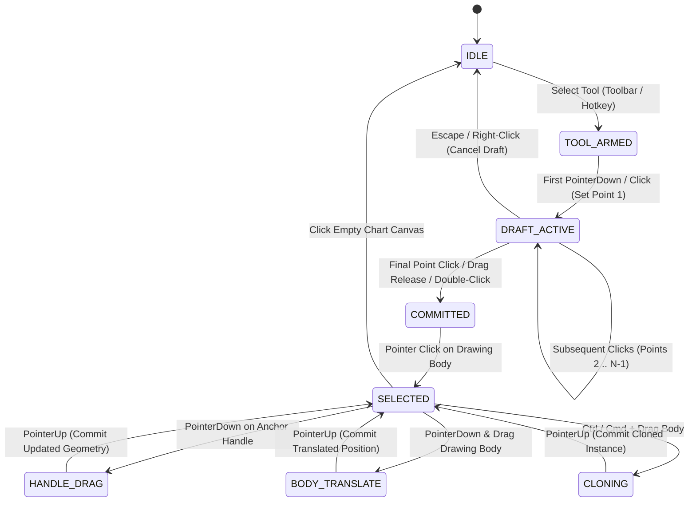

# TradingView Drawing Tools Interaction & Drawing Behavior Specification

A comprehensive technical reference, geometric specification, and interaction behavioral catalog for TradingView drawing tools. This specification details exact point counts, pointer click/drag workflows, control handle anatomy, modifier key constraints (`Shift`, `Ctrl`/`Cmd`, `Alt`), magnet snapping mechanics, and mathematical coordinate projection models for integration into the `tv_chart_replay` engine.

---

## 1. System Interaction Model & Universal Mechanics

### 1.1 Universal Pointer Input Lifecycle
In TradingView, every drawing tool follows a deterministic multi-stage interaction lifecycle:



1. **Two Supported Input Modes**:
   - **Click-Move-Click (Default & Standard)**: The user clicks once to drop Point 1, releases the mouse button, moves the cursor across the chart (displaying a dynamic live rubberband preview), and clicks again to drop Point 2 (or subsequent points).
   - **Click-Drag-Release**: The user presses pointer down at Point 1, holds the mouse button down while dragging across the chart, and releases the pointer at Point 2. TradingView auto-detects dragging: if the mouse moves more than $4\text{px}$ before pointer up, it completes the two-point tool upon release.
2. **Draft Cancellation**:
   - Pressing `Escape` or performing a **Right-Click** at any stage during drafting immediately aborts the active draft and clears preview points from memory.
3. **Completion Criteria**:
   - **Fixed-Point Tools** (e.g., Trend Line = 2, Parallel Channel = 3, Head & Shoulders = 7): Auto-commit and transition to `SELECTED` immediately upon placement of the final required anchor point.
   - **Multi-Point Open / Closed Tools** (e.g., Polyline, Path): Sequential clicks place successive vertices; the drawing is completed by **Double-Clicking**, pressing `Enter`, clicking back onto Point 1 (closing the loop), or pressing `Escape`.
   - **Continuous Drag Tools** (e.g., Brush, Highlighter, Pencil): Point capture begins on `PointerDown`, accumulates raw $(x, y) \to (t, p)$ samples on `PointerMove`, and commits on `PointerUp`.
4. **Persistent Selection & Hover Threshold**:
   - Anchor handles and vector paths maintain a spatial hit-testing threshold of $\epsilon = 6\text{px}$ (screenspace). When hovered within $\epsilon$, the cursor changes to a crosshair, `pointer`, or directional resize cursor (`nwse-resize`, `nesw-resize`, `ew-resize`, `ns-resize`).

---

### 1.2 Universal Modifier Key Behaviors

| Key / Shortcut | Platform (Win / Mac) | Context / Phase | Universal Engine Behavior |
| :--- | :--- | :--- | :--- |
| **`Shift` (Hold)** | `Shift` / `⇧ Shift` | **Placing or Dragging Line Handles** | **Angle Constraint Snapping**: Snaps line orientation to nearest $45^\circ$ increment ($\{0^\circ, \pm 45^\circ, \pm 90^\circ, \pm 135^\circ, 180^\circ\}$). |
| **`Shift` (Hold)** | `Shift` / `⇧ Shift` | **Placing or Resizing Shapes** | **Aspect Ratio Lock**: Forces $1:1$ bounding box aspect ratio (Rectangle $\to$ perfect square; Ellipse $\to$ perfect circle). |
| **`Shift` (Hold)** | `Shift` / `⇧ Shift` | **Translating Existing Objects** | **Axial Lock**: Restricts translation strictly to horizontal axis ($\Delta p = 0$) or vertical axis ($\Delta t = 0$), whichever displacement is greater. |
| **`Shift` + Click**| `Shift` + Click | **Chart Canvas** | **Instant Precision Measure Tool**: Ephemeral distance/bar ruler without needing to select the toolbar tool. |
| **`Ctrl` / `Cmd`** | `Ctrl` / `⌘ Cmd` | **Placing or Dragging Points** | **Magnet Inversion**: Inverts global Magnet Mode temporarily. If Magnet is OFF, snaps to nearest candle OHLC. If Magnet is ON, disables snap for freehand placement. |
| **`Ctrl` / `Cmd`** | `Ctrl` / `⌘ Cmd` | **Dragging Selected Object** | **Instant Clone**: Spawns a duplicate instance of the drawing and drags the duplicate, leaving the original anchored. |
| **`Ctrl` / `Cmd`** | `Ctrl` / `⌘ Cmd` | **Clicking Drawings** | **Multi-Selection**: Toggles object membership in the multi-selection group (`selectedDrawingIds`). |
| **`Alt` (Hold)** | `Alt` / `⌥ Option` | **Placing or Resizing Shapes** | **Center-Outward Expansion**: Origin anchor acts as the center rather than the top-left corner. |
| **Arrow Keys** | `↑ ↓ ← →` | **Selected Drawing** | **Fine Pixel/Tick Nudge**: Shifts time by $\pm 1\text{ bar}$ or price by $\pm 1\text{ minimum tick size}$. Holding `Shift` + Arrows nudges by 10 units. |
| **`Delete` / `Bksp`** | `Delete` / `⌫` | **Selected Drawing** | **Removal**: Deletes currently selected drawing(s) and records state to the Undo stack. |

---

### 1.3 Magnet Mode Mechanics (Weak vs Strong Magnet)

The TradingView Magnet system alters raw cursor coordinates $(x_{\text{mouse}}, y_{\text{mouse}})$ before they reach the drawing state machine:

1. **Weak Magnet**:
   - Searches candidate bars within a horizontal proximity window ($\le 25\text{px}$).
   - Within that candle, calculates Euclidean distance to the 4 key price levels: Open ($O$), High ($H$), Low ($L$), Close ($C$).
   - If cursor distance to any level is $\le 15\text{px}$, snaps point coordinates to $(t_{\text{bar}}, p_{\text{snapped}})$.
   - If outside the proximity radius, cursor moves smoothly in free-float coordinate space.
2. **Strong Magnet**:
   - Projects horizontal cursor position strictly to the nearest candle centerline ($t_{\text{bar}}$).
   - Vertically snaps unconditionally to whichever price level among $\{O, H, L, C\}$ is closest to $y_{\text{mouse}}$, regardless of mouse distance.

---

## 2. Exhaustive Tool-by-Tool Drawing Behavior Catalog

```
Index of Tool Categories:
1. Trend Lines & Directional Vectors
2. Fibonacci & Gann Analytical Instruments
3. Pitchfork Instruments
4. Channels & Statistical Envelopes
5. Geometric Shapes & Polygons
6. Freehand & Vector Drawing Tools
7. Annotations, Badges & Labels
8. Measurement, Risk/Reward & Position Forecasting
9. Chart Patterns & Harmonic Ratios
10. Volume & Anchor Indicators
```

---

### 2.1 Category 1: Trend Lines & Directional Vectors

#### 1. Trend Line (`trend_line`)
* **Anchor Points**: **2 points** ($P_1$: Start anchor, $P_2$: End anchor).
* **Placement Workflow**:
  1. Click 1: Sets $P_1(t_1, p_1)$.
  2. Pointer Move: Displays live rubberband line from $P_1$ to cursor $(t_c, p_c)$.
  3. Click 2: Sets $P_2(t_2, p_2)$ and commits.
* **Control Handles**:
  - Handle 1 ($P_1$): Re-positions origin vertex without modifying $P_2$.
  - Handle 2 ($P_2$): Adjusts line angle, slope, and endpoint without modifying $P_1$.
  - Midpoint Handle: Centered at $((t_1+t_2)/2, (p_1+p_2)/2)$; dragging it translates the entire line without altering its length or slope.
* **Modifier Behavior**:
  - Holding `Shift` constrains line angle to $0^\circ$ (pure horizontal), $\pm 45^\circ$, or $\pm 90^\circ$ (pure vertical).
* **Styling & Calculation**:
  - Options: Extend Left, Extend Right, Show Price Labels at ends, Show Bar Count / Distance delta, Line Style (solid, dashed, dotted), Width ($1\text{--}4\text{px}$).

#### 2. Ray (`ray`)
* **Anchor Points**: **2 points** ($P_1$: Origin anchor, $P_2$: Direction vector).
* **Placement Workflow**:
  1. Click 1: Sets originating vertex $P_1$.
  2. Pointer Move: Displays line from $P_1$, passing through cursor, projected infinitely to chart boundary.
  3. Click 2: Sets directional reference $P_2$.
* **Control Handles**:
  - Handle 1 ($P_1$): Moves originating point.
  - Handle 2 ($P_2$): Pivots ray orientation around $P_1$.
* **Geometry**: Half-line starting at $P_1$ extending through $P_2$ to $t \to +\infty$ (or current viewport boundary).
* **Modifier Behavior**: `Shift` snaps directional angle to $45^\circ$ increments.

#### 3. Info Line (`info_line`)
* **Anchor Points**: **2 points** ($P_1$: Start, $P_2$: End).
* **Placement Workflow**: Identical to Trend Line (2 clicks).
* **Unique Drawing Behavior**:
  - Generates an attached floating HUD info card along the center of the line.
  - Automatically calculates and renders:
    $$\Delta p = p_2 - p_1 \quad (\text{Price difference and ticks})$$
    $$\%\Delta = \frac{p_2 - p_1}{p_1} \times 100\%$$
    $$\text{Bars} = |\text{barIndex}_2 - \text{barIndex}_1|$$
    $$\Delta t = |t_2 - t_1| \quad (\text{Days / Hours / Minutes})$$
    $$\theta = \arctan\left(\frac{y_2 - y_1}{x_2 - x_1}\right) \quad (\text{Angle in degrees})$$
* **Control Handles**: Handle 1 ($P_1$), Handle 2 ($P_2$), and Midpoint handle.

#### 4. Extended Line (`extended_line`)
* **Anchor Points**: **2 points** ($P_1$, $P_2$).
* **Geometry**: Infinite line extending in **both** directions ($t \to -\infty$ and $t \to +\infty$) passing through both anchor points.
* **Control Handles**: Two internal circular handles corresponding to $P_1$ and $P_2$. Dragging either handle pivots the infinite line around the other handle.

#### 5. Trend Angle (`trend_angle`)
* **Anchor Points**: **2 points** ($P_1$: Vertex, $P_2$: Arm).
* **Unique Drawing Behavior**:
  - Draws a fixed horizontal reference line from $P_1$ to the right, a diagonal ray from $P_1$ through $P_2$, and a circular angle arc at $P_1$ showing the numeric angle $\theta \in [-180^\circ, 180^\circ]$.
  - The angle is measured in screen pixel space relative to the horizontal axis.

#### 6. Horizontal Line (`horizontal_line`)
* **Anchor Points**: **1 point** ($P_1(t_1, p_1)$).
* **Placement Workflow**:
  1. Click 1: Single click on any price level immediately commits the line.
* **Geometry**: Renders an infinite horizontal line across the entire chart at $y = \text{priceToCoordinate}(p_1)$.
* **Control Handles**: Single central handle at $(t_1, p_1)$. Dragging it moves the line vertically (adjusting price); horizontal dragging slides the handle anchor along the time axis.
* **Scale Pinning**: Always renders an active price badge on the vertical price axis matching the line's color.

#### 7. Horizontal Ray (`horizontal_ray`)
* **Anchor Points**: **1 point** ($P_1(t_1, p_1)$).
* **Placement Workflow**: Single click commits.
* **Geometry**: Renders a horizontal line starting at $(t_1, p_1)$ and extending rightward to $t \to +\infty$. It does not draw to the left of $t_1$.
* **Control Handles**: Single handle at $P_1$.

#### 8. Vertical Line (`vertical_line`)
* **Anchor Points**: **1 point** ($P_1(t_1, p_1)$).
* **Placement Workflow**: Single click commits.
* **Geometry**: Full-height line across the entire chart viewport at $x = \text{timeToCoordinate}(t_1)$.
* **Control Handles**: Single central handle. Dragging it snaps to candle timestamps across the horizontal time scale.

#### 9. Cross Line (`cross_line`)
* **Anchor Points**: **1 point** ($P_1(t_1, p_1)$).
* **Placement Workflow**: Single click commits.
* **Geometry**: Renders simultaneous intersecting full-width horizontal and full-height vertical lines at $(t_1, p_1)$, pinning badges to both price and time axes.

#### 10. Arrow (`arrow`)
* **Anchor Points**: **2 points** ($P_1$: Tail, $P_2$: Head).
* **Drawing Behavior**: Vector segment terminating in an equilateral triangular arrowhead oriented along the direction vector $\vec{v} = P_2 - P_1$.
* **Modifier Behavior**: `Shift` constrains angle to $45^\circ$ increments.

---

### 2.2 Category 2: Fibonacci & Gann Analytical Instruments

#### 1. Fibonacci Retracement (`fib_retracement`)
* **Anchor Points**: **2 points** ($P_1$: Swing Base / Extremum, $P_2$: Swing Peak / Retracement Anchor).
* **Placement Workflow**:
  1. Click 1: Click swing low (for uptrend) or swing high (for downtrend) $P_1(t_1, p_1)$.
  2. Pointer Move: Displays horizontal level bands expanding dynamically with cursor $P_2(t_c, p_c)$.
  3. Click 2: Click opposite swing peak $P_2(t_2, p_2)$ to lock and commit.
* **Mathematical Calculation**:
  - Given base vertical delta $\Delta p = p_2 - p_1$:
  $$\text{Level}(r) = p_1 + r \cdot (p_2 - p_1)$$
  - Standard Default Ratios $r$:
    $$\{0.0, \; 0.236, \; 0.382, \; 0.5, \; 0.618, \; 0.786, \; 1.0, \; 1.618, \; 2.618, \; 3.618, \; 4.236\}$$
* **Control Handles**:
  - Handle 1 ($P_1$): Re-anchors level $0.0$ (or $1.0$ if inverted).
  - Handle 2 ($P_2$): Re-anchors opposite level.
* **Styling Options**: Extend lines left/right, show level values as percentage or decimal, align labels (left, center, right), toggle background fills between consecutive ratio zones.

#### 2. Trend-Based Fib Extension (`fib_extension`)
* **Anchor Points**: **3 points** ($P_1$: Origin / Wave 1 Start, $P_2$: Wave 1 Crest, $P_3$: Wave 2 Retracement Base).
* **Placement Workflow**:
  1. Click 1: Set swing start $P_1$.
  2. Click 2: Set swing high $P_2$ (establishes reference impulse magnitude $\Delta p = |p_2 - p_1|$).
  3. Pointer Move: Live preview projects extension levels originating from cursor $P_3$.
  4. Click 3: Set retracement pivot $P_3$ to commit.
* **Mathematical Projection**:
  $$\text{Level}(r) = p_3 + r \cdot (p_2 - p_1) \quad (\text{for bullish continuation})$$
  Standard Ratios: $\{0.0, 0.382, 0.618, 1.0, 1.272, 1.618, 2.0, 2.618\}$.
* **Control Handles**: 3 circular handles at $P_1$, $P_2$, $P_3$. Adjusting $P_3$ changes projection base without altering measured impulse scale.

#### 3. Fib Channel (`fib_channel`)
* **Anchor Points**: **3 points** ($P_1$, $P_2$: Trend Baseline; $P_3$: Channel Width / Expansion Reference).
* **Placement Workflow**:
  1. Clicks 1 & 2: Define primary directional trendline between $P_1$ and $P_2$.
  2. Click 3: Place point $P_3$ perpendicular to baseline, setting channel width $W_0$.
* **Geometry**: Computes parallel lines spaced at Fibonacci multiples of $W_0$:
  $$W(r) = r \cdot W_0 \quad \text{for } r \in \{0.236, 0.382, 0.5, 0.618, 1.0, 1.618, 2.618\}$$

#### 4. Fib Time Zones (`fib_timezones`)
* **Anchor Points**: **2 points** ($P_1$: Time Zero / Cycle Start, $P_2$: First Unit Interval).
* **Geometry**:
  - Let base bar interval be $N = |\text{barIndex}_2 - \text{barIndex}_1|$.
  - Generates vertical lines at bar indices:
    $$\text{Bar}_k = \text{barIndex}_1 + \operatorname{round}(F_k \cdot N)$$
    where $F_k \in \{0, 1, 2, 3, 5, 8, 13, 21, 34, 55, 89, 144, \dots\}$ (Fibonacci sequence).

#### 5. Fib Speed Resistance Fan (`fib_speed_fan`)
* **Anchor Points**: **2 points** ($P_1$: Origin apex, $P_2$: Extremum).
* **Geometry**: Constructs a vertical line at $t_2$ from $p_1$ to $p_2$, divides that vertical interval into Fibonacci ratios ($0.382, 0.5, 0.618$), and radiates rays from $P_1$ passing through those ratio levels.

#### 6. Fib Circles (`fib_circles`)
* **Anchor Points**: **2 points** ($P_1$: Center origin, $P_2$: Base radius perimeter).
* **Geometry**: Calculates base radius $R_0 = \sqrt{(x_2 - x_1)^2 + (y_2 - y_1)^2}$ in screen space, and renders concentric circles with radii $R(r) = r \cdot R_0$ for $r \in \{0.236, 0.382, 0.5, 0.618, 0.786, 1.0, 1.618, 2.618\}$.

#### 7. Gann Fan (`gann_fan`)
* **Anchor Points**: **2 points** ($P_1$: Vertex / Origin, $P_2$: 1x1 Master Ray Reference).
* **Geometry**: Radiates 9 rays from $P_1$:
  - Rays: $1\times 8$, $1\times 4$, $1\times 3$, $1\times 2$, $1\times 1$ (primary angle), $2\times 1$, $3\times 1$, $4\times 1$, $8\times 1$.
  - In TradingView, angles are defined by price-to-time ratios based on the chart's current price scale aspect or fixed scale.

#### 8. Gann Box (`gann_box`)
* **Anchor Points**: **2 points** ($P_1$: Top-Left / Start, $P_2$: Bottom-Right / End).
* **Geometry**:
  - Draws rectangular boundary between $(t_1, p_1)$ and $(t_2, p_2)$.
  - Subdivides the bounding area into an $8 \times 8$ or $4 \times 4$ harmonic grid.
  - Draws diagonal cross rays connecting opposite corners and intermediate division points to evaluate Gann price/time squaring.

---

### 2.3 Category 3: Pitchfork Instruments

#### 1. Andrews' Pitchfork (`pitchfork`)
* **Anchor Points**: **3 points**:
  - $P_1$: Base / Origin Pivot (Major swing anchor).
  - $P_2$: Swing Peak (Upper bound).
  - $P_3$: Swing Trough (Lower bound).
* **Placement Workflow**:
  1. Click 1: Click prominent reaction low or high ($P_1$).
  2. Click 2: Click subsequent swing high ($P_2$).
  3. Pointer Move: Median line and prongs project live tracking cursor $P_3$.
  4. Click 3: Click subsequent swing low ($P_3$) to commit.
* **Mathematical Calculation**:
  - Midpoint $M$ between $P_2$ and $P_3$:
    $$M = \left(\frac{t_2 + t_3}{2}, \; \frac{p_2 + p_3}{2}\right)$$
  - **Median Line**: Ray starting at $P_1$ extending through $M$ to infinity.
  - Direction vector $\vec{v} = M - P_1$.
  - **Upper Prong**: Ray starting at $P_2$ parallel to $\vec{v}$ ($P_2 + k \cdot \vec{v}$).
  - **Lower Prong**: Ray starting at $P_3$ parallel to $\vec{v}$ ($P_3 + k \cdot \vec{v}$).
* **Control Handles**: 3 handles ($P_1, P_2, P_3$). Moving $P_1$ adjusts origin and tilts the entire channel. Moving $P_2$ or $P_3$ updates the midpoint and channel prong width.

```
       P2 (Swing High)
       *--------------------------------------> Upper Prong
      / \
     /   \           M (Midpoint of P2-P3)
    /     \-----------*-----------------------> Median Line
   /     /
  *     /
 P1    *--------------------------------------> Lower Prong
(Origin)  P3 (Swing Low)
```

#### 2. Schiff Pitchfork (`schiff_pitchfork`)
* **Anchor Points**: **3 points** ($P_1, P_2, P_3$).
* **Drawing Behavior & Geometry**:
  - Similar to Andrews' Pitchfork, but shifts the effective origin point $P_1'$ **halfway along the vertical price distance** between $P_1$ and $P_2$:
    $$P_1' = \left(t_1, \; p_1 + \frac{p_2 - p_1}{2}\right)$$
  - The median line is drawn from $P_1'$ through $M = (P_2 + P_3) / 2$.
  - Reduces the steepness of the pitchfork in fast trends.

#### 3. Modified Schiff Pitchfork (`modified_schiff_pitchfork`)
* **Anchor Points**: **3 points** ($P_1, P_2, P_3$).
* **Drawing Behavior & Geometry**:
  - Shifts the effective origin $P_1''$ **halfway along the horizontal time axis** between $P_1$ and $P_2$:
    $$P_1'' = \left(t_1 + \frac{t_2 - t_1}{2}, \; p_1\right)$$
  - The median line is drawn from $P_1''$ through $M = (P_2 + P_3) / 2$.

#### 4. Inside Pitchfork (`inside_pitchfork`)
* **Anchor Points**: **3 points** ($P_1, P_2, P_3$).
* **Drawing Behavior & Geometry**:
  - The origin of the median line is set at the midpoint between $P_1$ and $P_2$, passing through $P_3$.

---

### 2.4 Category 4: Channels & Statistical Envelopes

#### 1. Parallel Channel (`parallel_channel`)
* **Anchor Points**: **3 points**:
  - $P_1$: Baseline Start Anchor.
  - $P_2$: Baseline End Anchor.
  - $P_3$: Channel Width / Channel Offset Anchor.
* **Placement Workflow**:
  1. Click 1: Click first swing pivot ($P_1$).
  2. Pointer Move: Preview rubberband line follows cursor.
  3. Click 2: Click second pivot ($P_2$), establishing trendline baseline.
  4. Pointer Move: Channel expands perpendicularly/vertically to cursor position $P_3$, displaying upper band, lower band, and dashed midpoint line.
  5. Click 3: Click anywhere to set channel boundary width and commit.
* **Mathematical Calculation**:
  - Baseline vector: $\vec{B} = P_2 - P_1$.
  - The offset line is parallel to $\vec{B}$, passing through $P_3$.
  - Midline is computed at $50\%$ distance between baseline and offset line:
    $$\text{Mid}(t) = \frac{\text{BaseLine}(t) + \text{OffsetLine}(t)}{2}$$
* **Control Handles**:
  - Handle 1 ($P_1$) & Handle 2 ($P_2$): Adjust baseline slope, orientation, and endpoints.
  - Handle 3 ($P_3$): Adjusts channel width.
  - Center Body Drag: Translates entire channel intact.
* **Styling Options**: Extend Left, Extend Right, Toggle Midline, Fill Color & Opacity.

#### 2. Flat Top / Bottom Channel (`flat_top_bottom`)
* **Anchor Points**: **3 points**.
* **Drawing Behavior**:
  - Baseline is constrained to be strictly horizontal (slope $= 0$), while the opposite boundary slopes dynamically to connect swing highs/lows (ascending/descending triangles).

#### 3. Linear Regression Channel (`regression_channel`)
* **Anchor Points**: **2 points** ($P_1(t_1)$, $P_2(t_2)$).
* **Placement Workflow**:
  1. Click 1: Select start bar timestamp $t_1$.
  2. Click 2: Select end bar timestamp $t_2$.
* **Mathematical Calculation**:
  - Queries all candle close prices $\{p_i\}$ between $t_1$ and $t_2$ ($N$ bars).
  - Fits ordinary least squares (OLS) linear trendline:
    $$y = mx + b$$
  - Calculates standard deviation $\sigma$ of residuals $(p_i - \hat{p}_i)$.
  - Upper channel plotted at $\hat{y} + k \cdot \sigma$; lower channel at $\hat{y} - k \cdot \sigma$ (default $k = 2.0$).
* **Control Handles**: Two handles at the time boundaries ($t_1$ and $t_2$). Dragging either re-queries candle bars and recalculates OLS regression in real-time.

---

### 2.5 Category 5: Geometric Shapes & Polygons

#### 1. Rectangle (`rectangle`)
* **Anchor Points**: **2 points** ($P_1$: First Corner, $P_2$: Diagonally Opposite Corner).
* **Placement Workflow**:
  1. Click 1: Set corner $(t_1, p_1)$.
  2. Pointer Move: Bounding rectangle expands dynamically.
  3. Click 2: Set opposite corner $(t_2, p_2)$ and commit.
* **Control Handles**:
  - **4 Corner Handles**: Dragging any corner adjusts both adjacent sides.
  - **4 Edge Midpoint Handles**: Dragging top/bottom edge adjusts only price ($p$); dragging left/right edge adjusts only time ($t$).
  - **Center Drag**: Translates box position.
* **Modifier Behavior**:
  - Holding `Shift` locks width and height to $1:1$ screen pixel aspect ratio (**Square Lock**).
  - Holding `Alt` expands rectangle outward from $P_1$ as the center.
* **Styling**: Extend Left, Extend Right, Border Width, Background Fill & Opacity.

#### 2. Rotated Rectangle (`rotated_rectangle`)
* **Anchor Points**: **3 points**.
* **Placement Workflow**:
  1. Click 1: Set first vertex $P_1$.
  2. Click 2: Set second vertex $P_2$ (defines length and tilt angle of initial edge).
  3. Pointer Move: Extrudes perpendicular width to cursor.
  4. Click 3: Set perpendicular distance $P_3$ and commit.
* **Control Handles**: 4 corner handles and edge handles aligned along rotated axes.

#### 3. Circle (`circle`)
* **Anchor Points**: **2 points** ($P_1$: Center, $P_2$: Circumference Perimeter).
* **Placement Workflow**:
  1. Click 1: Set center coordinate $(t_1, p_1)$.
  2. Pointer Move: Circle expands radially.
  3. Click 2: Click perimeter $(t_2, p_2)$ to commit.
* **Control Handles**: Handle 1 at center (moves circle), Handle 2 on perimeter (resizes radius).

#### 4. Ellipse (`ellipse`)
* **Anchor Points**: **2 points** (Bounding box extremities).
* **Placement Workflow**:
  1. Click 1: First corner of bounding oval.
  2. Click 2: Diagonally opposite corner.
* **Control Handles**: 4 orthogonal perimeter handles (Top, Bottom, Left, Right) to independently scale vertical semi-axis $r_y$ and horizontal semi-axis $r_x$.
* **Modifier Behavior**: Holding `Shift` forces $r_x = r_y$ (Circle Lock).

#### 5. Triangle (`triangle`)
* **Anchor Points**: **3 points** ($P_1, P_2, P_3$: Three vertices).
* **Placement Workflow**:
  1. Click 1: Place Vertex 1.
  2. Click 2: Place Vertex 2 (draws first edge).
  3. Pointer Move: Live preview displays closed 3-sided polygon connecting to cursor.
  4. Click 3: Place Vertex 3 to close and commit.
* **Control Handles**: 3 handles, one at each vertex.

#### 6. Polyline (`polyline`) & Path (`path`)
* **Anchor Points**: **$N$ points** ($N \ge 2$).
* **Placement Workflow**:
  1. Sequential Clicks: Each click places a new node $P_i$.
  2. Live Preview: Line segment follows cursor from $P_{last}$ to $(t_c, p_c)$.
  3. **Completion**:
     - **Double-Click** or **`Enter`**: Commits the multi-segment line.
     - **Click on $P_1$**: Closes polygon into a filled geometric shape.
     - **`Escape`**: Commits current segments if $N \ge 2$; cancels if $N < 2$.
* **Control Handles**: Every placed vertex contains an independent circular handle.

#### 7. Curve (`curve`) & Arc (`arc`)
* **Anchor Points**: **3 points** ($P_1$: Start, $P_2$: End, $P_3$: Curvature Deflection Peak).
* **Placement Workflow**:
  1. Click 1 & 2: Define baseline endpoints.
  2. Pointer Move: Curves the arc perpendicular to baseline following cursor distance.
  3. Click 3: Sets curvature radius and commits.

---

### 2.6 Category 6: Freehand & Vector Drawing Tools

#### 1. Brush (`brush`)
* **Input Modality**: Continuous pointer drag.
* **Drawing Behavior**:
  1. `PointerDown`: Initializes point array `points = [P_0]`. Captures pointer.
  2. `PointerMove`: Samples cursor coordinates. To avoid excessive point density, applies distance decimation (ignores points within $3\text{px}$ of previous point).
  3. `PointerUp`: Commits the stroke. Applies spline smoothing (Catmull-Rom or cubic Bézier fitting) across sampled points to eliminate hand jitter.
* **Selection & Handles**: When selected, displays bounding box with corner resize handles.

#### 2. Highlighter (`highlighter`)
* **Drawing Behavior**: Identical sampling to Brush, but renders with wide stroke ($12\text{--}24\text{px}$) and translucent global alpha ($0.3$), using `globalCompositeOperation = 'source-over'` to emulate a fluorescent felt-tip marker.

#### 3. Pencil (`pencil`)
* **Drawing Behavior**: Zero smoothing, raw $1\text{px}$ stroke width. Captures raw coordinates directly.

#### 4. Pen (`pen`)
* **Drawing Behavior**: Click-to-place vector Bézier curves with tangent handle manipulation (standard vector pen tool).

---

### 2.7 Category 7: Annotations, Badges & Labels

#### 1. Text (`text`)
* **Anchor Points**: **1 point** ($P_1(t_1, p_1)$).
* **Placement Workflow**:
  1. Click 1: Click chart location.
  2. **In-place Textarea**: Instantly opens a floating rich-text editor at cursor position.
  3. Pressing `Shift + Enter` adds newlines; pressing `Enter` or clicking outside commits text.
* **Control Handles**: Single anchor handle at text baseline. Dragging repositions text.
* **Properties**: Font size ($10\text{--}40\text{px}$), bold/italic, text color, background fill toggle, border color.

#### 2. Callout (`callout`)
* **Anchor Points**: **2 points** ($P_1$: Target Pointer Tip, $P_2$: Text Bubble Anchor).
* **Placement Workflow**:
  1. Click 1: Set pointer tip anchored to candle wick/body ($P_1$).
  2. Pointer Move: Speech bubble box follows cursor with dynamic triangular leader arrow pointing back to $P_1$.
  3. Click 2: Set bubble location ($P_2$) and open text editor.
* **Control Handles**: Handle 1 on pointer tip; Handle 2 on text bubble.

#### 3. Price Label (`price_label`)
* **Anchor Points**: **1 point** ($P_1(t_1, p_1)$).
* **Placement Workflow**: Single click commits.
* **Behavior**: Renders a pointed price tag badge pointing to candle $(t_1, p_1)$, automatically formatting and displaying the numeric price value of $p_1$ formatted to the symbol's tick decimals.

#### 4. Date Label (`date_label`)
* **Anchor Points**: **1 point** ($P_1(t_1, p_1)$).
* **Behavior**: Renders a calendar badge showing formatted timestamp (e.g. `2026-11-02 09:30`).

---

### 2.8 Category 8: Measurement, Risk/Reward & Position Forecasting

#### 1. Measure Tool (`measurement`) / Date and Price Range (`date_and_price_range`)
* **Anchor Points**: **2 points** ($P_1$: Start, $P_2$: End).
* **Shortcut**: **`Shift` + Click** anywhere on chart initiates instant temporary measurement.
* **Placement Workflow**:
  1. Click 1: Set starting coordinate $P_1(t_1, p_1)$.
  2. Pointer Move: Renders dashed bounding box with diagonal dimension line and dynamic stats card.
  3. Click 2: Commits. (If triggered via `Shift + Click`, clicking anywhere else dismisses and destroys the temporary box).
* **Calculated Metrics Displayed**:
  - **Price Difference**: $\Delta p = p_2 - p_1$ (with tick count).
  - **Percentage Change**: $\%\Delta = ((p_2 - p_1) / p_1) \times 100\%$.
  - **Bar Count**: $|\text{barIndex}_2 - \text{barIndex}_1| \text{ bars}$.
  - **Elapsed Time**: Formatted duration (e.g., `12d 4h`, `45m`).
  - **Volume Sum**: Total traded volume summed across all enclosed bars.

#### 2. Long Position Tool (`long_position`)
* **Anchor Points**: **1 placement click** (or 2-point drag), which instantiates **3 price levels**:
  1. **Entry Price ($p_{\text{entry}}$)**: Anchored at cursor price upon initial click.
  2. **Take Profit ($p_{\text{target}}$)**: Default $+2 \times$ risk above entry.
  3. **Stop Loss ($p_{\text{stop}}$)**: Default $-1 \times$ risk below entry.
* **Placement Workflow**:
  1. Click 1: Click at desired entry candle. Tool instantly instantiates full position geometry centered on that bar.
* **Visual Anatomy & Geometry**:
  - **Green Profit Zone**: Translucent green rectangle ($0.2\text{--}0.35$ opacity, `#089981`) from $p_{\text{entry}}$ up to $p_{\text{target}}$, spanning width $\Delta t$.
  - **Red Risk Zone**: Translucent red rectangle ($0.2\text{--}0.35$ opacity, `#f23645`) from $p_{\text{entry}}$ down to $p_{\text{stop}}$, spanning width $\Delta t$.
  - **Entry Line**: Solid central dividing line with terminal circle handles.
  - **Floating Stats Badges**:
    - Top badge: Target price, profit amount in currency, profit percentage, target pips/ticks.
    - Bottom badge: Stop price, loss amount in currency, loss percentage, stop pips/ticks.
    - Center badge: Risk / Reward Ratio ($R:R$).
* **Control Handles**:
  - **Handle 1 (Target Top Edge Handle)**: Dragging changes $p_{\text{target}}$ (Take Profit). Updates $R:R$ in real-time.
  - **Handle 2 (Stop Bottom Edge Handle)**: Dragging changes $p_{\text{stop}}$ (Stop Loss). Updates $R:R$ in real-time.
  - **Handle 3 (Entry Center Line Handle)**: Dragging vertically moves $p_{\text{entry}}$, preserving relative stop and target distances.
  - **Handle 4 (Right Edge Handle)**: Dragging horizontally adjusts time duration $\Delta t$ (width of position box).
* **Position Sizing Math (Risk Management Engine)**:
  $$\text{Risk Amount (\$) } = \text{Account Size} \times \left(\frac{\text{Risk } \%}{100}\right) \quad (\text{or fixed cash})$$
  $$\text{Position Size (Units)} = \frac{\text{Risk Amount (\$) }}{|p_{\text{entry}} - p_{\text{stop}}| \times \text{Contract Size}}$$
  $$R:R = \frac{|p_{\text{target}} - p_{\text{entry}}|}{|p_{\text{entry}} - p_{\text{stop}}|}$$

```
   Target Handle [O] --------------------------------------------- $p_target (+3.20%)
   |                                                             |
   |              PROFIT ZONE (Green Fill #089981)               |  R:R = 2.50
   |                                                             |
   Entry Handle  [O] ============================================= $p_entry (Entry)
   |                                                             |
   |               RISK ZONE (Red Fill #f23645)                  |  Risk: $500 (1%)
   |                                                             |
   Stop Handle   [O] --------------------------------------------- $p_stop (-1.28%)
                     [<-------------- Duration dt -------------->] [O] Width Handle
```

#### 3. Short Position Tool (`short_position`)
* **Behavior**: Identical to Long Position, inverted vertically:
  - $p_{\text{target}} < p_{\text{entry}}$ (Green profit zone below entry).
  - $p_{\text{stop}} > p_{\text{entry}}$ (Red risk zone above entry).

#### 4. Forecast Tool (`forecast`)
* **Anchor Points**: **2 points** ($P_1$: Entry candle, $P_2$: Projected price and future date).
* **Behavior**: Evaluates historical/live candles after $t_1$. If price touches $p_2$ before expiration $t_2$, status updates to "Success"; if price breaches stop threshold, updates to "Failure".

---

### 2.9 Category 9: Chart Patterns & Harmonic Ratios

#### 1. Head and Shoulders (`head_and_shoulders`)
* **Anchor Points**: **7 consecutive points**:
  1. $P_1$: Left Shoulder High
  2. $P_2$: Left Valley / Neckline Anchor 1
  3. $P_3$: Head Peak High
  4. $P_4$: Right Valley / Neckline Anchor 2
  5. $P_5$: Right Shoulder High
  6. $P_6$: Breakdown Exit / Neckline Extrapolate
* **Behavior**: Draws connecting trend lines forming the left shoulder, head, and right shoulder, and automatically draws the dashed neckline through $P_2$ and $P_4$.

#### 2. XABCD Harmonic Pattern (`xabcd_pattern`)
* **Anchor Points**: **5 points** ($X, A, B, C, D$).
* **Placement Workflow**:
  - Sequential clicks place $X \to A \to B \to C \to D$.
* **Automatic Ratio Calculation**:
  - Automatically calculates and renders retracement/extension labels along the internal legs:
    - Leg $AB$ ratio relative to $XA$: $|p_B - p_A| / |p_A - p_X|$.
    - Leg $BC$ ratio relative to $AB$: $|p_C - p_B| / |p_B - p_A|$.
    - Leg $CD$ ratio relative to $BC$: $|p_D - p_C| / |p_C - p_B|$.
    - Leg $XD$ ratio relative to $XA$: $|p_D - p_X| / |p_A - p_X|$.

#### 3. Elliott Wave Impulse (1-2-3-4-5) (`elliott_impulse`)
* **Anchor Points**: **6 points** ($P_0$: Origin, $P_1$: Wave 1, $P_2$: Wave 2, $P_3$: Wave 3, $P_4$: Wave 4, $P_5$: Wave 5).
* **Labels**: Automatically badges each vertex with `(0)`, `(1)`, `(2)`, `(3)`, `(4)`, `(5)`.

#### 4. Elliott Correction Wave (A-B-C) (`elliott_correction`)
* **Anchor Points**: **4 points** ($P_0$: Wave Start, $P_1$: Wave A, $P_2$: Wave B, $P_3$: Wave C).
* **Labels**: Badges vertices with `(0)`, `(A)`, `(B)`, `(C)`.

---

### 2.10 Category 10: Volume & Anchor Indicators

#### 1. Anchored VWAP (`anchored_vwap`)
* **Anchor Points**: **1 point** ($P_1(t_1, p_1)$).
* **Placement Workflow**: Click any candle bar $t_1$.
* **Mathematical Calculation**:
  - From bar $t_1$ through current chart bar $t_N$:
    $$\text{Cumulative Typical Price Volume} = \sum_{i = \text{bar}_1}^{N} \left(\frac{H_i + L_i + C_i}{3} \times V_i\right)$$
    $$\text{Cumulative Volume} = \sum_{i = \text{bar}_1}^{N} V_i$$
    $$\text{AVWAP}_i = \frac{\text{CumTPV}_i}{\text{CumVol}_i}$$
* **Geometry**: Renders continuous smooth line starting at $t_1$ following price fluctuations.
* **Control Handles**: Single handle at anchor bar $t_1$. Dragging it along the time scale immediately recalculates the volume-weighted average from the new starting bar.

#### 2. Fixed Range Volume Profile (`fixed_range_volume_profile`)
* **Anchor Points**: **2 points** ($P_1$: Start Bar, $P_2$: End Bar).
* **Behavior**: Aggregates all tick/volume data within $[t_1, t_2]$, bins prices into horizontal buckets, and draws a horizontal volume histogram (distinguishing buy volume vs. sell volume) directly inside that date window, highlighting Point of Control (POC), Value Area High (VAH), and Value Area Low (VAL).

---

## 3. Mathematical Reference & Coordinate Invariants

### 3.1 Logical vs Screen Coordinate Transformations
All drawings in `tv_chart_replay` must be stored exclusively in **Logical Coordinates**:
$$\mathbf{P}_{\text{logical}} = (t, p) \quad \text{where } t \in \mathbb{N} \text{ (unix timestamp)}, \; p \in \mathbb{R} \text{ (price)}$$

On every animation frame or viewport transform (pan/zoom), logical points map to screen pixels:
$$x = \text{timeScale.timeToCoordinate}(t)$$
$$y = \text{priceScale.priceToCoordinate}(p)$$

### 3.2 Inverse Projection on Pointer Event
When the user clicks screen pixel $(x_{\text{mouse}}, y_{\text{mouse}})$:
$$t_{\text{raw}} = \text{timeScale.coordinateToTime}(x_{\text{mouse}})$$
$$p_{\text{raw}} = \text{priceScale.coordinateToPrice}(y_{\text{mouse}})$$

If **Magnet Mode** is active (or inverted via `Ctrl`), $(t_{\text{raw}}, p_{\text{raw}})$ snaps to candidate candle OHLC:
$$(t, p) = \operatorname{SnapToOHLC}(t_{\text{raw}}, p_{\text{raw}}, \text{mode} = \text{'weak'} \mid \text{'strong'})$$

### 3.3 Angle Snapping Math (`Shift` Constraint)
When `Shift` is held while moving endpoint $(x_2, y_2)$ relative to origin $(x_1, y_1)$:
$$\Delta x = x_2 - x_1, \quad \Delta y = y_2 - y_1$$
$$\theta = \operatorname{atan2}(\Delta y, \Delta x)$$
$$\theta_{\text{snapped}} = \operatorname{round}\left(\frac{\theta}{\pi / 4}\right) \times \frac{\pi}{4}$$
$$R = \sqrt{\Delta x^2 + \Delta y^2}$$
$$x_{2,\text{constrained}} = x_1 + R \cos(\theta_{\text{snapped}})$$
$$y_{2,\text{constrained}} = y_1 + R \sin(\theta_{\text{snapped}})$$

---

## 4. Implementation Mapping for `tv_chart_replay`

To integrate this drawing behavior into the codebase:

1. **`frontend/src/drawings/drawing-types.ts`**:
   - `DrawingType`: Contains all keys matching the catalog above.
   - `DrawingPoint`: Holds `{ timestamp: number, price: number }`.
   - Tool definition includes `requiredPoints: number` ($1, 2, 3, \dots, \infty$).

2. **`frontend/src/drawings/drawing-engine.ts`**:
   - Manages the Finite State Machine (`IDLE`, `TOOL_SELECTED`, `DRAWING`, `SELECTED`, `MOVING`, `EDITING_HANDLE`, `CLONING`).
   - Dispatches pointer events to `handleContainerPointerDown`, `handleContainerPointerMove`, `handleContainerPointerUp`.
   - Executes `Ctrl + Drag` clone spawning and `Shift` angle/axial constraints.
   - Enforces weak/strong magnet snapping against the current candle dataset.

3. **`frontend/src/drawings/drawing-renderers.ts`**:
   - Dispatches custom 2D canvas drawing routines based on `drawing.type`.
   - Renders dual-ring circular handles (`r_inner = 2px`, `r_outer = 4.5px`) when `drawing.id === selectedDrawingId`.

---

## 5. References & Official Sources

- **TradingView Help Center & Support Solutions**:
  - [Drawing Tools Overview & Coordinates](https://www.tradingview.com/support/solutions/43000547463-trend-line/)
  - [Long and Short Position Calculation Engine](https://www.tradingview.com/support/solutions/43000473950-how-do-the-long-and-short-position-tools-work/)
  - [Andrews, Schiff, and Modified Schiff Pitchforks](https://www.tradingview.com/support/solutions/43000547470-pitchfork/)
  - [Date and Price Range Measurement Tool](https://www.tradingview.com/support/solutions/43000547500-date-and-price-range/)
  - [Anchored VWAP Calculation & Dynamics](https://www.tradingview.com/support/solutions/43000587285-anchored-vwap/)
- **Related Project Architectural Documents**:
  - [ADR 0003: Drawing Tools Engine Architecture & Interaction Model](file:///d:/code/tv_chart_replay/docs/adr/0003-drawing-tools-architecture-and-interaction-model.md)
  - [TradingView Drawing Tool Icons Visual Catalog](file:///d:/code/tv_chart_replay/docs/tradingview-drawing-tool-icons.md)
  - [TradingView Drawing Keyboard Shortcuts](file:///d:/code/tv_chart_replay/docs/tradingview-drawing-shortcuts.md)

